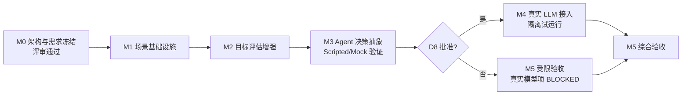

# R5-5.3 开发任务与验收矩阵

> 配套：`R5-5.3-总体设计与实施规格.md`（设计）、`R5-5.3-接口与数据契约台账.md`（接口）、
> `R5-5.3-D8-真实LLM接入审批准备.md`（审批）。
> 状态：规划稿，等待评审。**M1～M5 在评审结论前不得开工。**
> 纪律：每阶段验收门槛全部 PASS 才可进入下一阶段；FAIL/BLOCKED 不改判；未执行记 NOT_RUN。

---

## 0. 阶段总览与依赖链

| 阶段 | 名称 | 入口条件 | 出口条件 |
|---|---|---|---|
| M0 | 架构和需求冻结 | 本轮 4 份设计文档完成 | **评审通过**（架构+安全+契约） |
| M1 | 场景基础设施 | M0 通过 | 场景包验收门槛全 PASS |
| M2 | 目标评估增强 | M1 通过 | 断言验收门槛全 PASS |
| M3 | Agent 决策抽象升级 | M2 通过 | 决策闭环验收门槛全 PASS（Scripted/Mock） |
| M4 | 真实 LLM 接入 | M3 通过 **且 D8 批准** | 试运行报告 + 回滚演练通过 |
| M5 | 综合验收 | M4（或受限验收） | 全矩阵验收 PASS 或显式 BLOCKED 登记 |

---

## 1. M0：架构和需求冻结

| 项 | 内容 |
|---|---|
| **输入** | 本阶段 4 份设计文档（DR1 + DR2 + DR2.1 整改后）；R5-5.1-R / R5-5.2 验收证据；现状代码（HEAD `bb3bd55`，最后代码变更 `60d89e7`） |
| **输出** | 冻结的总体设计、数据契约、接口台账、风险清单、准入条件（本文档）+ 设计评审整改记录 |
| **依赖** | 无（起点） |
| **交付物** | `R5-5.3-总体设计与实施规格.md`、`R5-5.3-接口与数据契约台账.md`、`R5-5.3-D8-真实LLM接入审批准备.md`、本文档、`R5-5.3-设计评审整改记录.md` |
| **验收门槛** | ① 设计评审（架构/安全/契约/可测试性）通过；② C05 冻结承诺确认；③ SUT 改造范围（project-edit 复用已有 update_project + Web 编辑页）获认可；④ D8 条件清单进入审批流程；⑤ 评审纪要归档；⑥ **DR1 六项 P0 全部解决**；⑦ **DR2 七项 P0 + 五项 P1 全部解决**；⑧ **DR2.1 九项收尾整改全部完成**；⑨ **D1～D5 未决决策已登记责任方/最迟确认时间/阶段阻塞关系（不得由 WorkBuddy 自行批准）** |

**本轮（文档阶段）即 M0 的执行体。M0 完成 ≠ 开发开始；开发开始还需评审签字。**
**DR1 整改已完成；DR2 整改已完成；M0 技术预审已完成（含 R1 补充修正），等待 M0 独立架构评审与责任人签字。评审前不得进入 M1。**
**M0 评审材料另含 4 项待评审观察项（DR2 记录 §14.10）：性质是"待评审"，不是"已实现"，也不改变 D1～D5 的任何状态。**
**待批准清单见 `R5-5.3-M0-决策确认单.md`（18 项，全部 `PENDING`，0 项已批准）。**

### M0 评审准入矩阵（DR2 后）

| 准入项 | 状态 | 证据 |
|---|---|---|
| DR1-01 多步骤目标语义统一 | ✅ 已解决 | 总体设计 §3.3/§3.4/§3.5 + 台账 §6.5.1 |
| DR1-02 Scenario 版本化 API | ✅ 已解决 | 总体设计 §2.2.1 + 台账 §1 |
| DR1-03 TeamFlow 数据生命周期 | ✅ 已解决 | 总体设计 §2.4（复用 update_project、方案 B′ 清理） |
| DR1-04 PolicyValidator/ToolGateway 权威关系 | ✅ 已解决 | 总体设计 §4.3/§4.4 + 台账 §4/§5 |
| DR1-05 Observation v2 与 Goal Assertion 契约 | ✅ 已解决 | 总体设计 §3.2.1（采集契约 + 断言规范） |
| DR1-06 Trace Hash v3 与上下文审计 | ✅ 已解决 | 总体设计 §6.3/§6.4 + 台账 §7.2 |
| **DR2-01 GoalStatus 与 TestCaseVerdict 分离** | ✅ 已解决 | 总体设计 §3.6 + 台账 §6.2 |
| **DR2-02 执行授权凭证（封堵绕过路径）** | ✅ 已解决 | 总体设计 §4.3 + 台账 §4.2/§5.4 |
| **DR2-03 Secret Reference 机制** | ✅ 已解决 | 总体设计 §4.2 + 台账 §9-B |
| **DR2-04 测试数据清理并发安全（方案 B′）** | ✅ 已解决 | 总体设计 §2.4（租约 + 所有权 + 清理锁） |
| **DR2-05 Path Spec / Scripted Fixture / Real Agent 分离** | ✅ 已解决 | 总体设计 §2.5.2 |
| **DR2-06 Scenario Digest 与历史身份保障** | ✅ 已解决 | 总体设计 §2.2/§2.2.1 |
| **DR2-07 D8 Provider 与 Kill Switch 统一** | ✅ 已解决 | D8 §2.2/§2.3/§10/§11.2 |
| **DR2-08 Prompt 截断安全** | ✅ 已解决 | 总体设计 §5.5 |
| **DR2-09 Trace Hash v3 唯一字段清单** | ✅ 已解决 | 总体设计 §6.3 + 台账 §7.2.1 |
| **DR2-10 step_id/observation_ref 稳定关联** | ✅ 已解决 | 总体设计 §3.5 |
| **DR2-11 断言计数口径修正** | ✅ 已解决 | 总体设计 §3.1/§3.3 + 本文档 §3.1 |
| **DR2-12 Preconditions 与 Data Lifecycle 分离** | ✅ 已解决 | 总体设计 §2.5.3 + 台账 §9-A |
| **DR2.1-01 TestCaseVerdict 三态完整语义** | ✅ 已解决 | 总体设计 §3.6.2（五级优先级 + 注册期 R1–R6）+ 台账 §6.2 |
| **DR2.1-02 敏感输入识别 + SecretResolver** | ✅ 已解决 | 总体设计 §4.2（判定链 + fail-closed）+ 台账 §5.8 |
| **DR2.1-03 执行授权凭证原子性** | ✅ 已解决 | 总体设计 §4.3（A1–A9 + T1–T6）+ 台账 §5.4 |
| **DR2.1-04 Evidence 引用统一** | ✅ 已解决 | 总体设计 §3.2.2（V1–V6）+ 台账 §6.5.2（E1–E7）；全文下标引用已清零 |
| **DR2.1-05 scenario_digest 算法** | ✅ 已解决 | 总体设计 §2.2.2（S1–S8 + 9 类非法样例）+ 台账 §9-A.1（28 字段白名单） |
| **DR2.1-06 旧源码迁移映射** | ✅ 已解决 | 总体设计 §2.6（2.6.1～2.6.8，六处不一致逐条映射） |
| **DR2.1-07 M2 计数与矩阵口径** | ✅ 已解决 | 本文档 §3：现有 11 + 新增 9 = 20 种；27 组；M2 任务 7 项 |
| **DR2.1-08 未决决策 D1–D5** | ✅ 已登记（**未批准**） | DR2 记录 §10：责任方 / 最迟确认时间 / 阶段阻塞；D6 为计数笔误已删除、R8 已撤销。**M0 评审不得据此宣布设计全部冻结** |
| **DR2.1-09 Git 与 CI 交付记录** | ✅ 已核对 | README / 本文档 §1 / DR2 记录 §1、§14（HEAD `bb3bd55` 起点、最后代码变更 `60d89e7`） |
| D8 API Key/隐私/出站/费用/Kill Switch/降级/审批 | ✅ 已整改 | D8 文档 §2.3/§3/§6.2/§7/§9/§10/§12 |
| C05 冻结不变 | ✅ 确认 | 全文零改动 |
| D8 仍 BLOCKED | ✅ 确认 | 409 不解除 |
| 安全边界零放宽 | ✅ 确认 | OriginPolicy/预算/门禁不动 |
| README 与实际 Git 状态一致 | ✅ 已同步 | 代码基线 = 最后代码变更 `60d89e7`；文档起点 HEAD `bb3bd55` / 起点 20 ahead / 本轮 3 个文档提交 → 23 ahead、0 behind（勘误轮再 +1 提交，见 DR2 记录 §14.11） |
| 无业务代码修改 | ✅ 确认 | 本轮仅文档改动 |
| **M0 待评审观察项（4 项）已登记** | ✅ 已登记（**未实现、未批准**） | DR2 记录 §14.10：Scenario Digest 算法白名单 / Execution Lock 跨进程范围 / `url_and_content` 归类口径 / D8 Provider 默认模型；不得读作已实现 |
| **M0 技术预审 R1（N1–N8 / O2-D4 解耦 / O4 缺陷 / v3 归属）** | ✅ 已登记（**未实现、未批准**） | `R5-5.3-M0-架构评审预审记录.md` §4.5 / §5.5 / §5.6 / §9 / §10 / §11.1：新增 **N8**（Candidate 无自批判定）、N1 网络暴露取证、N4 表述校准、O2 与 D4 解耦、O4 实现缺陷、Trace Hash v3 归属 **M3-7** |
| **M0 决策确认单（18 项）** | ✅ 已建立（**0 项已批准**） | `R5-5.3-M0-决策确认单.md`：全部 `PENDING`，签字栏留空；`M0_FROZEN` 仍为 false |

---

## 2. M1：场景基础设施

| 项 | 内容 |
|---|---|
| **输入** | M0 冻结设计；现有 `scenarios.py` / `ScenarioRegistry`；TeamFlow SUT |
| **输出** | Scenario Package v2（版本化）、测试数据生命周期、四类路径承载、两个未实现场景解法落地 |
| **依赖** | M0；project-edit 的 SUT 最小改造（先行） |
| **交付物** | 场景包 schema + 注册表扩展；`data_setup`/`cleanup` 执行器；TeamFlow 编辑路由（最小）；form-validation 种子机制；场景包版本管理；单元/集成测试 |

### 2.1 任务分解

> **编号对齐说明（2026-11-25 总指令）**：本节编号已对齐长周期开发总指令的 M1-0～M1-8。
> 旧编号与新编号的映射：旧 M1-3→新 **M1-4**、旧 M1-4→新 **M1-5**、旧 M1-5→新 **M1-6**、旧 M1-6→新 **M1-7**、旧 M1-7→新 **M1-8**；
> 新增 **M1-0（部署边界）** 与 **M1-3（Scenario Digest）**。DR2 记录 §10/§11 中"M1-3 = 数据生命周期清理器"一律读作新 **M1-4**。

| # | 任务 | 备注 |
|---|---|---|
| M1-0 | **部署边界保护**：默认仅 loopback（`127.0.0.1`/`localhost`/`::1`）；非 loopback 需显式配置，否则启动即拒；`app_env=prod` 且无认证 → 拒启；清理 `api_host` 死配置；非 loopback 启动显式警示；补负向测试 | **N1**；M0 通过后的第一项，先于任何业务改动 |
| M1-1 | Scenario 字段扩展（version/preconditions/data_setup/cleanup/denied_actions/paths） | 校验规则见台账 §1；旧版可读、未知字段拒绝 |
| M1-2 | 注册表版本化（`(id, version)` 唯一） | 不破坏 `public_view`；Run 锁定版本并写入 Trace |
| M1-3 | **Scenario Digest**（SHA-256 + `canonical-json-v1` + 算法标识 + 未知算法硬拒绝 + 禁止静默回退） | **O1**；补正例/反例/跨版本读取；历史记录按自带算法校验 |
| M1-4 | 测试数据生命周期执行器（setup/teardown 钩子 + **活动租约 + 清理锁 + 孤儿判定**，DR2-04） | **D4 参数**；清理失败显式登记；禁止按前缀误删活动 Run 数据；**不读 O2 执行锁参数** |
| M1-5 | TeamFlow SUT 最小改造：编辑路由 + `edit-success`/`form-error` testid | **不伪造业务页面**；复用 `service.update_project` |
| M1-6 | project-edit 场景包（四类路径 **Path Specification** + 可选 scripted_fixture，DR2-05） | SUT 改造后启用；须真实浏览器闭环 |
| M1-7 | form-validation 场景包（种子 + 四类路径，连续两次运行） | 依赖 M1-4 |
| M1-8 | 每场景四类路径矩阵登记（已有 4 场景补边界/恢复路径）+ **M1 联合验收** | 缺口显式登记；形成 M1 实施与验收报告 |

**M1 阶段的硬禁区**：**不得实现 Trace Hash v3**（归属 M3-7）。M1 期间 `HASH_VERSION` 保持 2，`scenario_id/version/digest` 照常持久化但**不参与哈希**（预审记录 §4.5）。

### 2.2 验收门槛

- [ ] **M1-0**：非 loopback 未显式授权 → 启动被拒（负向测试）；`app_env=prod` 无认证 → 拒启；非 loopback 启动日志含"审批门禁不可信"警示
- [ ] 场景包校验参数化测试全 PASS（含 denied_actions 冲突、版本重复、四类路径越界、未知字段、非法版本）
- [ ] 同 id 多版本并存可注册；执行锁定版本并写入 Trace；历史场景含义不因新版本发布而改变
- [ ] **Digest**：未知算法注册被拒 + 读取返回 `unsupported-digest-algorithm`（不重算）+ 篡改任一参与字段可检出 + 跨版本读取结论不变
- [ ] project-edit：真实浏览器 GOAL_VERIFIED + Candidate + Compile（正常路径）；异常/边界/恢复路径各有证据
- [ ] form-validation：连续两次运行均可重复（种子清理验证），不遗留测试数据；并发两个 Run 数据互不影响
- [ ] Explorer 核心无新增 `if scenario_id` 分支（代码审查断言）
- [ ] **Trace Hash 仍为 v2**，未引入 v3 常量或分支（代码审查断言）
- [ ] 回归：`test_agentic_scenarios.py` 34 项 + 全量 pytest 全 PASS
- [ ] 不降低既有断言、不动安全边界（diff 审查）

---

## 3. M2：目标评估增强

| 项 | 内容 |
|---|---|
| **输入** | M1 场景包（承载新断言）；现有 `goal_assertions.py` **11 种**断言（`SUPPORTED_KINDS`） |
| **输出** | Observation v2（结构化 DOM）、**9 种新断言**（v2 共 **20 种**）、多步骤目标、证据完整性校验、TestCaseVerdict、稳定 Evidence 引用 |
| **依赖** | M1 |
| **交付物** | Observation v2 采集器；新 kind 求值器（9 种）；`dom_counts`/`dom_relations`；动态绑定表；TestCaseVerdict 求值器；`observation_ref`/`field_path` 引用层；**27 组**参数化测试（9 × 三态） |

### 3.1 任务分解（DR2-11 修正：9 种新增断言，final/intermediate 不是独立 kind）

| # | 任务 | 对应设计 | 说明 |
|---|---|---|---|
| M2-1 | Observation v2：`dom_counts` / `dom_relations` / `attrs` 白名单采集 | §3.2 | |
| M2-2 | 新断言 1-6：table_row_count / list_item_count / element_attr / element_relation / page_transition / url_and_content | §3.3 | 6 种新增 |
| M2-3 | 新断言 7-9：multi_step_goal（含 `stage` 取值 intermediate/final）/ dynamic_match / evidence_complete | §3.3/§3.5 | 3 种新增；**`final`/`intermediate` 是 `multi_step_goal.stage` 的取值，不是独立断言类型** |
| M2-4 | 证据完整性校验 + 读取时复算 + **`observation_ref`/`field_path` 稳定引用层**（DR2.1-04） | §3.4/§3.2.2 | 禁止下标引用；引用不可解析 → 复算失败可诊断 |
| M2-5 | L7 关闭验证：超长页面靠后内容断言可判（不再依赖 text_excerpt 截断） | 遗留 L7 | |
| M2-6 | TestCaseVerdict 求值器（**五级优先级** + 注册期 R1–R6，DR2.1-01） | §3.6 | 负向测试通过形成有效证据；`NOT_EVALUATED` 不得产出 PASSED |
| M2-7 | step_id / observation_ref / evidence_ref 稳定关联（DR2-10） | §3.5 | 不用 step_index 推导 |

**计数口径（DR2-11 统一）**：
- 现有断言：**11 种**（`SUPPORTED_KINDS`：url_exact/url_regex/testid/element_exists/element_visible/
  element_text/form_state/page_state/all_of/any_of/not）；
- 新增断言：**9 种**（上表 M2-2 六种 + M2-3 三种）；
- `form_state` 是已有类型，**不计新增**；
- M2 开发任务：**7 项**（M2-1～M2-7）；
- 参数化测试：**9 种新断言 × 三态 = 27 组**（每种 kind 的 PASSED/FAILED/INCONCLUSIVE）+ 现有 11 种回归。

> **O3 待定口径（M2-2 动工前必须定口，否则本段数字作废）**：`url_and_content` 若被认定为**纯语法糖**
> （注册期展开为 `all_of`，不进 `SUPPORTED_KINDS`），则三处数字全部改变：
> **evaluator kind 19 种 / 对外声明形式 20 种 / 参数化测试 24 组**（见预审记录 §9 O3、决策确认单 O3）。
> 本节现行 **20 / 20 / 27** 是"当作独立 kind"口径。**两套数字不得混用**；O3 落定后须同步改本节
> §3.1 / §3.2 / §6.1 三处，并检查注册期 kind 合法性判定集与求值器数量一致（不得留下
> "注册期接受、执行期无 handler"的空洞）。
>
> **M2 阶段的硬禁区**：**不得实现 Trace Hash v3**（归属 M3-7）。M2 产出的 `Observation`/`Verdict`/
> `Evidence` 字段在 v2 哈希下不参与摘要，待 M3-7 落 v3 时统一覆盖（预审记录 §4.5）。

### 3.2 验收门槛（DR2-11 同步计数）

- [ ] **9 种**新断言 × 三态（PASSED/FAILED/INCONCLUSIVE）参数化测试全 PASS（27 组）
- [ ] 语义保持 7 条逐条用例 PASS（INCONCLUSIVE 不冒充 FAILED；只收紧不放宽；无自裁决）
- [ ] L7 专项：>3000 字符页面的目标断言可判且证据正确
- [ ] 观测体积有上限（按断言按需采集，长稳无膨胀）
- [ ] TestCaseVerdict 与 goal_status 独立求值（DR2-01）：负向测试 PASS 样例 + 错误密码成功登录 FAIL 样例
- [ ] TestCaseVerdict **五级优先级全覆盖**（DR2.1-01 + 勘误追加格，**八格**样例矩阵逐格验证）：
  GoalStatus 明确不匹配 → `FAILED`（即使 expect 全 PASSED）；required expect `FAILED` → `FAILED`；
  `NOT_EVALUATED` → `INCONCLUSIVE`（**不得 PASSED**，也**不得直接 FAILED**，设计 §3.6.2 N1–N4）；
  `NOT_EVALUATED` + required expect `FAILED` → `FAILED`（明确失败证据不被"未评估"稀释，样例 8）；
  required expect `INCONCLUSIVE` → `INCONCLUSIVE`
- [ ] 注册期拒绝矩阵（DR2.1-01）：空 `expect` / 全 `optional` / `expected_goal_status=INCONCLUSIVE`
  / 路径声明 `test_case_verdict` —— 四类均拒绝注册
- [ ] Evidence 引用无下标（DR2.1-04）：三份文档静态检查"以数组下标索引 observation"的实际引用命中数为 0
  （禁止性条款与差异记录除外）；
  `page_transition` 缺 `from_ref` → `INCONCLUSIVE`；无对应 Observation → `INCONCLUSIVE`（不绑最近一条）
- [ ] step_id/observation_ref 稳定关联（DR2-10）：步数≠观察数场景下断言仍正确关联
- [ ] 回归：`test_goal_semantics.py` + 34 项场景测试 + 现有 11 种断言全 PASS
- [ ] 不读取输入值（密码不是 observation）红线复验

---

## 4. M3：Agent 决策抽象升级

| 项 | 内容 |
|---|---|
| **输入** | M2 评估能力；现有 `Policy` Protocol / ScriptedPolicy / ToolGateway |
| **输出** | Context Builder、统一 Planner（Action Proposal）、Policy Validator 六项检查、决策记录（Trace Hash v3）、MockProvider；**用 Scripted/Mock 验证闭环** |
| **依赖** | M2 |
| **交付物** | `context_builder.py`、Proposal schema、PolicyDecision、DecisionRecord、MockProvider、闭环测试、授权凭证签发/验证（含原子性）、SecretResolver、敏感字段识别链 |

### 4.1 任务分解

| # | 任务 | 对应设计 |
|---|---|---|
| M3-1 | Context Builder（确定性组装 + 脱敏 + 安全上下文不可截断，DR2-08） | 台账 §2 |
| M3-2 | Action Proposal schema + 统一 Planner 接口（`propose`）+ secret_ref（DR2-03） | 台账 §3 |
| M3-3 | Policy Validator 六项检查独立化（fail-closed）+ 执行授权凭证签发（DR2-02/DR2.1-03） | 设计 §4.3 |
| M3-4 | 执行后检查五项（预期比对/异常检测/重规划信号） | 设计 §4.4 |
| M3-5 | 停止策略映射层（BUDGET_EXHAUSTED/EXECUTION_FAILED 聚合语义，枚举不改） | 设计 §4.5 |
| M3-6 | MockProvider（确定性假模型，`is_real_model=False`，观测响应式） | D8 文档 §2.1 |
| M3-7 | DecisionRecord + Trace Hash v3（v1/v2 兼容校验，DR2-09 唯一字段清单） | 设计 §6 |
| M3-8 | 重复/危险动作检测 + 破坏性操作默认禁止（DR2-02） | 设计 §4.3 |
| M3-9 | ToolGateway 授权凭证验证（6 项 + **原子性 A1–A9**：nonce 原子消费 / 预算预留同临界区 / 同 Run 串行，DR2.1-03） | 设计 §4.3 / 台账 §5.4 |
| M3-10 | Secret Resolver（secret_ref 解析 + 五步权限校验 + 四类错误语义，DR2.1-02） | 设计 §4.2 / 台账 §5.8 |
| M3-11 | 敏感字段识别链（DOM `type=password` / `autocomplete` / 场景声明 / `unknown` fail-closed，DR2.1-02） | 设计 §4.2 |

### 4.2 验收门槛

- [ ] 决策闭环用 MockProvider 跑通：**观测变化 → 提案变化**（Mock 是观测响应式，DR2-05）→ 断言判定 → 停止，全链路 trace 可回放
- [ ] 六项执行前检查逐项用例 PASS（含 origin-denied → POLICY_STOP）
- [ ] **执行授权凭证 6 项验证用例 PASS**（含 5 类非法样例：绕过/伪造/参数改/跨 Run/重放，DR2-02）
- [ ] **授权凭证原子性六类用例 PASS**（DR2.1-03 T1–T6）：同一 nonce 并发（恰好 1 成功）、
  同 Run 两 Proposal 竞争预算（1 成功 + 1 `budget-state-changed`）、参数被改（`args-mismatch`）、
  授权过期（`token-expired`）、预算版本变化、直接调用执行入口（`invalid-authorization`）
- [ ] **敏感字段识别用例 PASS**（DR2.1-02）：`input[type=password]` 命中、`autocomplete` 敏感值命中、
  场景 `sensitive_selectors` 命中、`unknown` → fail-closed（拒绝明文）、明文 value 拒绝（含空串）、
  `env://` 与 `..` 路径穿越拒绝、跨场景引用拒绝
- [ ] **Observation 不含真实密码**（DR2.1-02）：敏感 selector 只计数不取值，`attrs` 整块丢弃，
  Trace/日志/错误消息扫描无明文
- [ ] **破坏性操作默认禁止**用例 PASS（未授权破坏性操作一次即 POLICY_STOP）
- [ ] **secret_ref 用例 PASS**（敏感输入走引用；明文 value 拒绝；未声明引用拒绝；env:// 拒绝，DR2-03）
- [ ] **Prompt 截断安全用例 PASS**（安全上下文不被截断；溢出时停止推理，DR2-08）
- [ ] fail-closed 用例 PASS（校验器异常不放行）
- [ ] 三模式标记验收：Scripted/Mock 输出永不含真实推理标注
- [ ] Trace Hash v3 矩阵 PASS（v1/v2/v3 各自校验、篡改可检出、历史不迁移，DR2-09 字段清单）
- [ ] 决策链关联完整性（decision_id 单链回放）PASS
- [ ] 回归：`test_scripted_agent.py` / `test_planner.py` / `test_llm_exploration.py` / 安全专项全 PASS
- [ ] 模型失败不产生伪造决策（StructuredOutputError 路径用例）

---

## 5. M4：真实 LLM 接入（**D8 批准后才可执行**）

| 项 | 内容 |
|---|---|
| **输入** | M3 决策抽象；**D8 正式批准**；限额 API Key |
| **输出** | 真实 Provider 接通、费用闸、人工开关、降级策略、试运行报告 |
| **依赖** | M3 + **D8 批准（硬门禁）** |
| **交付物** | 费用闸实现、开关实现、试运行报告、对照评估报告、回滚演练记录 |

### 5.1 任务分解

| # | 任务 | 对应 D8 文档 |
|---|---|---|
| M4-1 | 人工启用开关（默认关；409 行为保持直至开启） | §10 |
| M4-2 | 费用闸：单次 $0.50 / 单日 $20 硬停 + token 记账 | §6 |
| M4-3 | 失败降级（scripted / stop 二选一）+ `degraded_from` 标记 | §7 |
| M4-4 | 隔离试运行（teamflow-login/project-create，并发 1） | §13 |
| M4-5 | 逐步扩大 + 失败注入演练 | §13 |
| M4-6 | Scripted vs Real 对照评估报告 | §13 |
| M4-7 | 回滚演练（关闭开关 → 409/NOT-REAL 恢复验证） | §11.2 |

### 5.2 验收门槛

- [ ] D8 批准文件归档（12 项条件清单全勾）
- [ ] 开关关闭时行为与 R5-5.2 完全一致（回归证明）
- [ ] 费用闸实测：模拟超限 → 硬停，日志与 trace 有记录
- [ ] 降级路径实测：断网/超限/坏输出 → 无伪造决策
- [ ] 试运行报告：Proposal 合法率、policy 拒绝率、费用实测、trace 完整性
- [ ] 回滚演练通过（开关关闭后 `test_llm_policy.py` + 场景回归全 PASS）
- [ ] 真实推理与 Scripted 推理在报告/UI 中可区分（验收断言）

**D8 未批准时：M4 整阶段 NOT_RUN（显式登记），跳至 M5 受限验收。**

---

## 6. M5：综合验收

| 项 | 内容 |
|---|---|
| **输入** | M4（或 M3 + D8 未批的受限态） |
| **输出** | 全矩阵验收报告 |
| **依赖** | M4 或受限验收前置 |
| **交付物** | 综合验收报告、证据目录、风险闭环登记 |

### 6.1 验收矩阵（模块 × 验收项）

| 模块 | 验收项 | 方法 | 门槛 |
|---|---|---|---|
| 场景 | 六场景状态真实（4+2 或 6） | 真实浏览器 + `blocked_reason` 核查 | 无冒充实现 |
| 场景 | 四类路径（正常/异常/边界/恢复） | 场景包路径逐类执行 | 每 implemented 场景 ≥1 证据/类或显式登记缺口 |
| 断言 | **9 种**新断言三态 + TestCaseVerdict（**五级优先级**） | 参数化 + 真实页面 | 全 PASS（DR2-11 计数；DR2-01 负向测试通过样例；DR2.1-01 `NOT_EVALUATED` 不得 PASSED） |
| 断言 | Evidence 引用稳定（`observation_ref` + `field_path`） | 静态检查 + 复算 | 无数组下标索引 observation 的实际引用（禁止性条款除外）；无对应 Observation 时 `INCONCLUSIVE`（DR2.1-04） |
| 断言 | L7 关闭 | 超长页面专项 | PASS |
| 决策 | 闭环（Scripted/Mock；Real 若 D8 已批） | 真实浏览器全流程 | trace 单链可回放 |
| 决策 | 六项安全检查 | 越界/重复/危险注入 | 全部拒绝且可解释 |
| 决策 | 授权凭证原子性 | 同 nonce 并发 / 预算竞争 / 重放注入 | 恰好执行一次；无绕过路径（DR2.1-03） |
| 安全 | 敏感字段识别链 | `type=password`/`autocomplete`/场景声明/`unknown` 注入 | 明文 value 全拒；Observation 无真实密码（DR2.1-02） |
| 停止 | 七类停止语义 | 注入式触发 | 枚举语义正确（无 GOAL_REACHED 冒充） |
| Trace | v3 哈希 + 兼容 | 矩阵测试 | 历史不迁移、篡改可检出 |
| Trace | 敏感脱敏 | 扫描 trace | 无明文密码/输入值 |
| LLM | 模型失败降级 | 断网/超限/坏输出 | 无伪造决策 |
| LLM | 模式区分 | UI/报告断言 | Scripted/Mock 不冒充真实推理 |
| 安全 | OriginPolicy / 预算 / C05 冻结 | 安全专项 + diff 审查 | 零放宽 |
| 回归 | 全量 pytest / Product E2E / Browser E2E | `verify_all --mode all` | 全 PASS（BLOCKED 显式登记） |
| CI | GitHub Actions 五 Job | push 后轮询 | 5/5 success |

### 6.2 门禁执行纪律（沿用项目约定）

- soak 长稳用 `--teamflow-port` 指定独立端口（8001 是开发实例）；
- `verify_all --out` 必须绝对路径；
- WorkBuddy 沙箱对 >50 文件批量删除有保护：长验证序列拆独立会话，本地偶发
  `test_sandbox_paths` junction 误杀**改判禁止**，用分段复验 + GitHub CI 交叉印证；
- PASS/FAIL/SKIP/BLOCKED/EMPTY/NOT_RUN 六态，只有 PASS 算通过。

---

## 7. 需求与阶段映射（完整）

| 需求 | 来源 | 阶段 | 验收项（§6.1 行） |
|---|---|---|---|
| Q1 场景可扩展可复用 | 五个核心问题 #1 | M1 | 场景 ×2 行 |
| Q2 Agent 自主决策 | #2 | M3（M4 真实化） | 决策 ×2 行 |
| Q3 业务目标验证 | #3 | M2 | 断言 ×2 行 |
| Q4 防越权/重复/危险 | #4 | M3 | 决策-安全行 |
| Q5 可追溯/可复验/可评估 | #5 | M3/M5 | Trace ×2 行 |
| 场景 16 项要求 | §四（任务书） | M1 | 场景 ×2 行 |
| Goal Assertion 升级（任务书 10 项要求 → **9 种新断言**，v2 共 20 种） | §五 | M2 | 断言 ×2 行 |
| Agent 输入/输出/前后检查/停止 | §六 | M3 | 决策 + 停止行 |
| LLM 15 项安全接入 | §七 | M4 | LLM ×2 行 |
| Trace 8 项保证 | §八 | M3/M5 | Trace ×2 行 |
| 架构与接口台账 | §九 | M0 | 评审门槛 |
| project-edit / form-validation | §四 | M1 | 场景行 |
| L7（text_excerpt 3000） | R5-4 遗留 | M2 | L7 行 |

---

## 8. 风险清单与应对（含阶段归属）

| # | 风险 | 阶段 | 应对 | 触发回滚/升级 |
|---|---|---|---|---|
| R1 | 观测膨胀 | M2 | 按需采集 + 体积上限 | 长稳发现延迟 → 收紧采集 |
| R2 | 断言语义漏洞 | M2 | 语义 7 条铁律 + 参数化先行 | 任一语义用例 FAIL → 停 M2 |
| R3 | Planner 绕过 Policy | M3 | 单通道 + 物理隔离 | 安全审查发现绕过路径 → 停 M3 |
| R4 | Proposal schema 注入 | M3 | 严格 schema + unknown 拒绝 | 注入用例通过 → 加固后再验 |
| R5 | 费用失控 | M4 | 双闸 + 限额 key | 超限 → 关开关（D8 §11） |
| R6 | 幻觉假成功 | M3/M4 | 模型不裁决 verdict | 发现假 VERIFIED → 停 M4 |
| R7 | Trace 兼容破坏 | M3 | 三版本并存、不迁移 | 历史校验失败 → 停 M3 |
| R8 | SUT 改造引故障 | M1 | 最小改造 + SUT 回归先行 | SUT 不稳 → 冻结场景启用 |
| R9 | 种子清理失败 | M1 | finally + 显式登记 | 遗留数据 → 场景下线整改 |
| R10 | 三模式混淆 | M3/M4 | 硬标记 + 验收断言 | 发现冒充 → 报告作废重出 |
| R11 | D8 未批准 | M4 | 受限验收路径 | M4 NOT_RUN，M5 真实模型项 BLOCKED |
| R12 | 沙箱删除守卫误杀测试 | 全程 | 分段复验 + CI 交叉印证 | 不改判，证据保留 |

---

## 9. 交付与评审流程

1. **本轮交付（已完成）**：4 份 R5-5.3 文档 + README/索引/清单收口 → 提交 Git。
2. **评审**：源码及架构评审（设计、契约、安全边界、SUT 范围、D8 条件）。
3. **评审通过后**：按 M1 → M5 顺序开工，每阶段门槛全 PASS 才进入下一阶段。
4. **评审未通过**：修订设计文档，回到第 2 步；不得先写代码后补设计。

最终交付附：文件清单、架构图、接口台账、需求与阶段映射、风险清单、D8 审批条件、
验收矩阵、Git 变更记录、测试与验证结果（随各阶段滚动补齐）。
