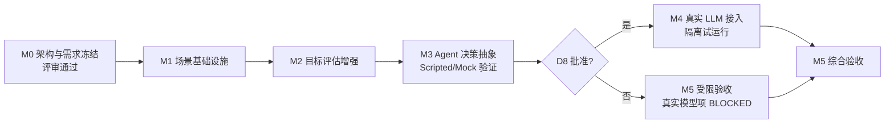

# R5-5.3 开发任务与验收矩阵

> 配套：`R5-5.3-总体设计与实施规格.md`（设计）、`R5-5.3-接口与数据契约台账.md`（接口）、
> `R5-5.3-D8-真实LLM接入审批准备.md`（审批）。
> 状态：规划稿，等待评审。**M1～M5 在评审结论前不得开工。**
> 纪律：每阶段验收门槛全部 PASS 才可进入下一阶段；FAIL/BLOCKED 不改判；未执行记 NOT_RUN。

---

## 0. 阶段总览与依赖链

| 阶段 | 名称 | 入口条件 | 出口条件 |
|---|---|---|---|
| M0 | 架构和需求冻结 | 本轮 4 份设计文档完成 | **评审通过**（架构+安全+契约） |
| M1 | 场景基础设施 | M0 通过 | 场景包验收门槛全 PASS |
| M2 | 目标评估增强 | M1 通过 | 断言验收门槛全 PASS |
| M3 | Agent 决策抽象升级 | M2 通过 | 决策闭环验收门槛全 PASS（Scripted/Mock） |
| M4 | 真实 LLM 接入 | M3 通过 **且 D8 批准** | 试运行报告 + 回滚演练通过 |
| M5 | 综合验收 | M4（或受限验收） | 全矩阵验收 PASS 或显式 BLOCKED 登记 |

---

## 1. M0：架构和需求冻结

| 项 | 内容 |
|---|---|
| **输入** | 本阶段 4 份设计文档；R5-5.1-R / R5-5.2 验收证据；现状代码（HEAD `6a21f47`） |
| **输出** | 冻结的总体设计、数据契约、接口台账、风险清单、准入条件（本文档） |
| **依赖** | 无（起点） |
| **交付物** | `R5-5.3-总体设计与实施规格.md`、`R5-5.3-接口与数据契约台账.md`、`R5-5.3-D8-真实LLM接入审批准备.md`、本文档 |
| **验收门槛** | ① 设计评审（架构/安全/契约/可测试性）通过；② C05 冻结承诺确认；③ SUT 改造范围（project-edit）获认可；④ D8 条件清单进入审批流程；⑤ 评审纪要归档 |

**本轮（文档阶段）即 M0 的执行体。M0 完成 ≠ 开发开始；开发开始还需评审签字。**

---

## 2. M1：场景基础设施

| 项 | 内容 |
|---|---|
| **输入** | M0 冻结设计；现有 `scenarios.py` / `ScenarioRegistry`；TeamFlow SUT |
| **输出** | Scenario Package v2（版本化）、测试数据生命周期、四类路径承载、两个未实现场景解法落地 |
| **依赖** | M0；project-edit 的 SUT 最小改造（先行） |
| **交付物** | 场景包 schema + 注册表扩展；`data_setup`/`cleanup` 执行器；TeamFlow 编辑路由（最小）；form-validation 种子机制；场景包版本管理；单元/集成测试 |

### 2.1 任务分解

| # | 任务 | 备注 |
|---|---|---|
| M1-1 | Scenario 字段扩展（version/preconditions/data_setup/cleanup/denied_actions/paths） | 校验规则见台账 §1 |
| M1-2 | 注册表版本化（`(id, version)` 唯一） | 不破坏 `public_view` |
| M1-3 | 测试数据生命周期执行器（setup/teardown 钩子，finally 语义） | 清理失败显式登记 |
| M1-4 | TeamFlow SUT 最小改造：编辑路由 + `edit-success`/`form-error` testid | **不伪造业务页面** |
| M1-5 | project-edit 场景包（四类路径） | SUT 改造后启用 |
| M1-6 | form-validation 场景包（种子 + 四类路径） | 依赖 M1-3 |
| M1-7 | 每场景四类路径矩阵登记（已有 4 场景补边界/恢复路径） | 缺口显式登记 |

### 2.2 验收门槛

- [ ] 场景包校验参数化测试全 PASS（含 denied_actions 冲突、版本重复、四类路径越界）
- [ ] 同 id 多版本并存可注册；执行锁定版本并写入 Trace
- [ ] project-edit：真实浏览器 GOAL_VERIFIED + Candidate + Compile（正常路径）；异常/边界/恢复路径各有证据
- [ ] form-validation：连续两次运行均可重复（种子清理验证），不遗留测试数据
- [ ] Explorer 核心无新增 `if scenario_id` 分支（代码审查断言）
- [ ] 回归：`test_agentic_scenarios.py` 34 项 + 全量 pytest 全 PASS
- [ ] 不降低既有断言、不动安全边界（diff 审查）

---

## 3. M2：目标评估增强

| 项 | 内容 |
|---|---|
| **输入** | M1 场景包（承载新断言）；现有 `goal_assertions.py` 10 类 |
| **输出** | Observation v2（结构化 DOM）、10 类新断言、多步骤目标、证据完整性校验 |
| **依赖** | M1 |
| **交付物** | Observation v2 采集器；新 kind 求值器；`dom_counts`/`dom_relations`；动态绑定表；测试 |

### 3.1 任务分解

| # | 任务 | 对应设计 |
|---|---|---|
| M2-1 | Observation v2：`dom_counts` / `dom_relations` / `attrs` 白名单采集 | §3.2 |
| M2-2 | 新断言 1-6：table_row_count / list_item_count / element_attr / element_relation / page_transition / url_and_content | §3.3 |
| M2-3 | 新断言 7-10：multi_step_goal / final·intermediate / dynamic_match / evidence_complete | §3.3/§3.5 |
| M2-4 | 证据完整性校验 + 读取时复算 | §3.4 |
| M2-5 | L7 关闭验证：超长页面靠后内容断言可判（不再依赖 text_excerpt 截断） | 遗留 L7 |

### 3.2 验收门槛

- [ ] 10 类新断言 × 三态（PASSED/FAILED/INCONCLUSIVE）参数化测试全 PASS
- [ ] 语义保持 7 条逐条用例 PASS（INCONCLUSIVE 不冒充 FAILED；只收紧不放宽；无自裁决）
- [ ] L7 专项：>3000 字符页面的目标断言可判且证据正确
- [ ] 观测体积有上限（按断言按需采集，长稳无膨胀）
- [ ] 回归：`test_goal_semantics.py` + 34 项场景测试 + 全量 PASS
- [ ] 不读取输入值（密码不是 observation）红线复验

---

## 4. M3：Agent 决策抽象升级

| 项 | 内容 |
|---|---|
| **输入** | M2 评估能力；现有 `Policy` Protocol / ScriptedPolicy / ToolGateway |
| **输出** | Context Builder、统一 Planner（Action Proposal）、Policy Validator 六项检查、决策记录（Trace Hash v3）、MockProvider；**用 Scripted/Mock 验证闭环** |
| **依赖** | M2 |
| **交付物** | `context_builder.py`、Proposal schema、PolicyDecision、DecisionRecord、MockProvider、闭环测试 |

### 4.1 任务分解

| # | 任务 | 对应设计 |
|---|---|---|
| M3-1 | Context Builder（确定性组装 + 脱敏） | 台账 §2 |
| M3-2 | Action Proposal schema + 统一 Planner 接口（`propose`） | 台账 §3 |
| M3-3 | Policy Validator 六项检查独立化（fail-closed） | 设计 §4.3 |
| M3-4 | 执行后检查五项（预期比对/异常检测/重规划信号） | 设计 §4.4 |
| M3-5 | 停止策略映射层（BUDGET_EXHAUSTED/EXECUTION_FAILED 聚合语义，枚举不改） | 设计 §4.5 |
| M3-6 | MockProvider（确定性假模型，`is_real_model=False`） | D8 文档 §2.1 |
| M3-7 | DecisionRecord + Trace Hash v3（v1/v2 兼容校验） | 设计 §6 |
| M3-8 | 重复/危险动作检测 | 设计 §4.3-6 |

### 4.2 验收门槛

- [ ] 决策闭环用 MockProvider 跑通：观测变化 → 提案变化 → 断言判定 → 停止，全链路 trace 可回放
- [ ] 六项执行前检查逐项用例 PASS（含 origin-denied → POLICY_STOP）
- [ ] fail-closed 用例 PASS（校验器异常不放行）
- [ ] 三模式标记验收：Scripted/Mock 输出永不含真实推理标注
- [ ] Trace Hash v3 矩阵 PASS（v1/v2/v3 各自校验、篡改可检出、历史不迁移）
- [ ] 决策链关联完整性（decision_id 单链回放）PASS
- [ ] 回归：`test_scripted_agent.py` / `test_planner.py` / `test_llm_exploration.py` / 安全专项全 PASS
- [ ] 模型失败不产生伪造决策（StructuredOutputError 路径用例）

---

## 5. M4：真实 LLM 接入（**D8 批准后才可执行**）

| 项 | 内容 |
|---|---|
| **输入** | M3 决策抽象；**D8 正式批准**；限额 API Key |
| **输出** | 真实 Provider 接通、费用闸、人工开关、降级策略、试运行报告 |
| **依赖** | M3 + **D8 批准（硬门禁）** |
| **交付物** | 费用闸实现、开关实现、试运行报告、对照评估报告、回滚演练记录 |

### 5.1 任务分解

| # | 任务 | 对应 D8 文档 |
|---|---|---|
| M4-1 | 人工启用开关（默认关；409 行为保持直至开启） | §10 |
| M4-2 | 费用闸：单次 $0.50 / 单日 $20 硬停 + token 记账 | §6 |
| M4-3 | 失败降级（scripted / stop 二选一）+ `degraded_from` 标记 | §7 |
| M4-4 | 隔离试运行（teamflow-login/project-create，并发 1） | §13 |
| M4-5 | 逐步扩大 + 失败注入演练 | §13 |
| M4-6 | Scripted vs Real 对照评估报告 | §13 |
| M4-7 | 回滚演练（关闭开关 → 409/NOT-REAL 恢复验证） | §11.2 |

### 5.2 验收门槛

- [ ] D8 批准文件归档（12 项条件清单全勾）
- [ ] 开关关闭时行为与 R5-5.2 完全一致（回归证明）
- [ ] 费用闸实测：模拟超限 → 硬停，日志与 trace 有记录
- [ ] 降级路径实测：断网/超限/坏输出 → 无伪造决策
- [ ] 试运行报告：Proposal 合法率、policy 拒绝率、费用实测、trace 完整性
- [ ] 回滚演练通过（开关关闭后 `test_llm_policy.py` + 场景回归全 PASS）
- [ ] 真实推理与 Scripted 推理在报告/UI 中可区分（验收断言）

**D8 未批准时：M4 整阶段 NOT_RUN（显式登记），跳至 M5 受限验收。**

---

## 6. M5：综合验收

| 项 | 内容 |
|---|---|
| **输入** | M4（或 M3 + D8 未批的受限态） |
| **输出** | 全矩阵验收报告 |
| **依赖** | M4 或受限验收前置 |
| **交付物** | 综合验收报告、证据目录、风险闭环登记 |

### 6.1 验收矩阵（模块 × 验收项）

| 模块 | 验收项 | 方法 | 门槛 |
|---|---|---|---|
| 场景 | 六场景状态真实（4+2 或 6） | 真实浏览器 + `blocked_reason` 核查 | 无冒充实现 |
| 场景 | 四类路径（正常/异常/边界/恢复） | 场景包路径逐类执行 | 每 implemented 场景 ≥1 证据/类或显式登记缺口 |
| 断言 | 10 类新断言三态 | 参数化 + 真实页面 | 全 PASS |
| 断言 | L7 关闭 | 超长页面专项 | PASS |
| 决策 | 闭环（Scripted/Mock；Real 若 D8 已批） | 真实浏览器全流程 | trace 单链可回放 |
| 决策 | 六项安全检查 | 越界/重复/危险注入 | 全部拒绝且可解释 |
| 停止 | 七类停止语义 | 注入式触发 | 枚举语义正确（无 GOAL_REACHED 冒充） |
| Trace | v3 哈希 + 兼容 | 矩阵测试 | 历史不迁移、篡改可检出 |
| Trace | 敏感脱敏 | 扫描 trace | 无明文密码/输入值 |
| LLM | 模型失败降级 | 断网/超限/坏输出 | 无伪造决策 |
| LLM | 模式区分 | UI/报告断言 | Scripted/Mock 不冒充真实推理 |
| 安全 | OriginPolicy / 预算 / C05 冻结 | 安全专项 + diff 审查 | 零放宽 |
| 回归 | 全量 pytest / Product E2E / Browser E2E | `verify_all --mode all` | 全 PASS（BLOCKED 显式登记） |
| CI | GitHub Actions 五 Job | push 后轮询 | 5/5 success |

### 6.2 门禁执行纪律（沿用项目约定）

- soak 长稳用 `--teamflow-port` 指定独立端口（8001 是开发实例）；
- `verify_all --out` 必须绝对路径；
- WorkBuddy 沙箱对 >50 文件批量删除有保护：长验证序列拆独立会话，本地偶发
  `test_sandbox_paths` junction 误杀**改判禁止**，用分段复验 + GitHub CI 交叉印证；
- PASS/FAIL/SKIP/BLOCKED/EMPTY/NOT_RUN 六态，只有 PASS 算通过。

---

## 7. 需求与阶段映射（完整）

| 需求 | 来源 | 阶段 | 验收项（§6.1 行） |
|---|---|---|---|
| Q1 场景可扩展可复用 | 五个核心问题 #1 | M1 | 场景 ×2 行 |
| Q2 Agent 自主决策 | #2 | M3（M4 真实化） | 决策 ×2 行 |
| Q3 业务目标验证 | #3 | M2 | 断言 ×2 行 |
| Q4 防越权/重复/危险 | #4 | M3 | 决策-安全行 |
| Q5 可追溯/可复验/可评估 | #5 | M3/M5 | Trace ×2 行 |
| 场景 16 项要求 | §四（任务书） | M1 | 场景 ×2 行 |
| Goal Assertion 10 项升级 | §五 | M2 | 断言 ×2 行 |
| Agent 输入/输出/前后检查/停止 | §六 | M3 | 决策 + 停止行 |
| LLM 15 项安全接入 | §七 | M4 | LLM ×2 行 |
| Trace 8 项保证 | §八 | M3/M5 | Trace ×2 行 |
| 架构与接口台账 | §九 | M0 | 评审门槛 |
| project-edit / form-validation | §四 | M1 | 场景行 |
| L7（text_excerpt 3000） | R5-4 遗留 | M2 | L7 行 |

---

## 8. 风险清单与应对（含阶段归属）

| # | 风险 | 阶段 | 应对 | 触发回滚/升级 |
|---|---|---|---|---|
| R1 | 观测膨胀 | M2 | 按需采集 + 体积上限 | 长稳发现延迟 → 收紧采集 |
| R2 | 断言语义漏洞 | M2 | 语义 7 条铁律 + 参数化先行 | 任一语义用例 FAIL → 停 M2 |
| R3 | Planner 绕过 Policy | M3 | 单通道 + 物理隔离 | 安全审查发现绕过路径 → 停 M3 |
| R4 | Proposal schema 注入 | M3 | 严格 schema + unknown 拒绝 | 注入用例通过 → 加固后再验 |
| R5 | 费用失控 | M4 | 双闸 + 限额 key | 超限 → 关开关（D8 §11） |
| R6 | 幻觉假成功 | M3/M4 | 模型不裁决 verdict | 发现假 VERIFIED → 停 M4 |
| R7 | Trace 兼容破坏 | M3 | 三版本并存、不迁移 | 历史校验失败 → 停 M3 |
| R8 | SUT 改造引故障 | M1 | 最小改造 + SUT 回归先行 | SUT 不稳 → 冻结场景启用 |
| R9 | 种子清理失败 | M1 | finally + 显式登记 | 遗留数据 → 场景下线整改 |
| R10 | 三模式混淆 | M3/M4 | 硬标记 + 验收断言 | 发现冒充 → 报告作废重出 |
| R11 | D8 未批准 | M4 | 受限验收路径 | M4 NOT_RUN，M5 真实模型项 BLOCKED |
| R12 | 沙箱删除守卫误杀测试 | 全程 | 分段复验 + CI 交叉印证 | 不改判，证据保留 |

---

## 9. 交付与评审流程

1. **本轮交付（已完成）**：4 份 R5-5.3 文档 + README/索引/清单收口 → 提交 Git。
2. **评审**：源码及架构评审（设计、契约、安全边界、SUT 范围、D8 条件）。
3. **评审通过后**：按 M1 → M5 顺序开工，每阶段门槛全 PASS 才进入下一阶段。
4. **评审未通过**：修订设计文档，回到第 2 步；不得先写代码后补设计。

最终交付附：文件清单、架构图、接口台账、需求与阶段映射、风险清单、D8 审批条件、
验收矩阵、Git 变更记录、测试与验证结果（随各阶段滚动补齐）。
