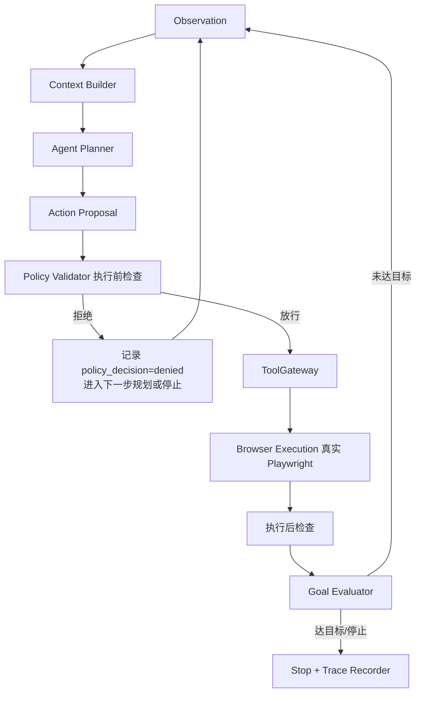
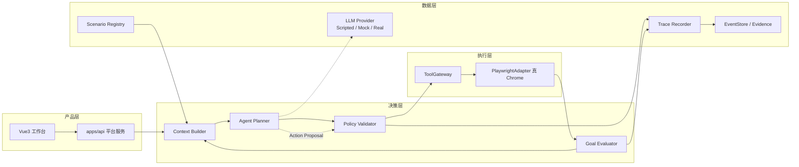
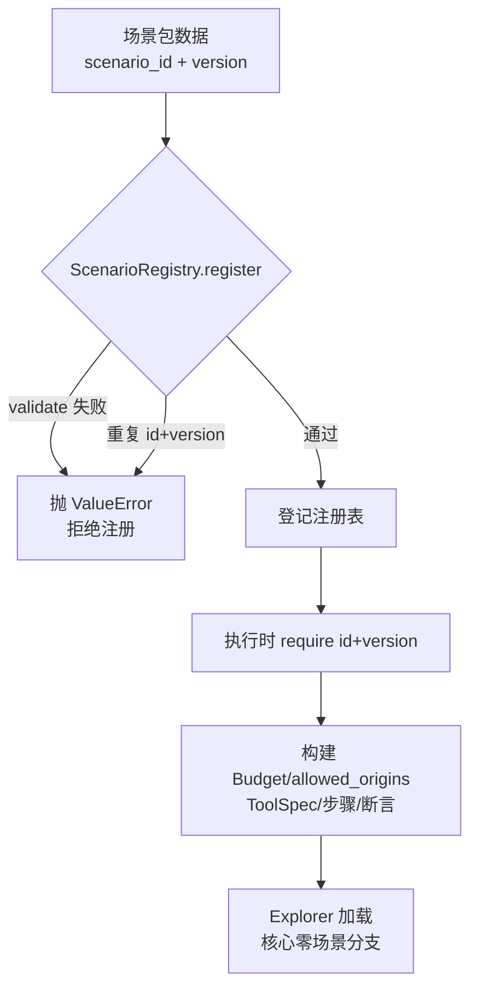
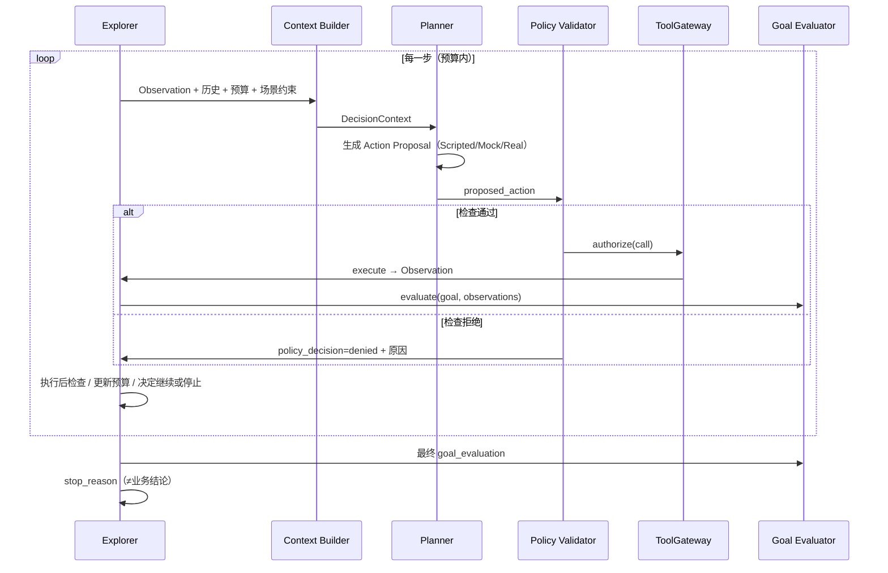
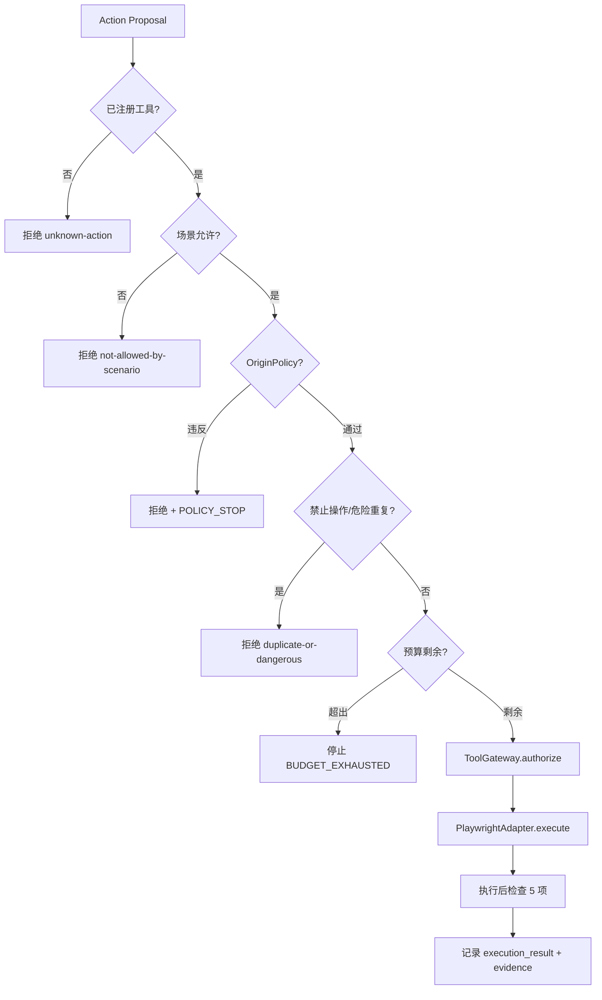
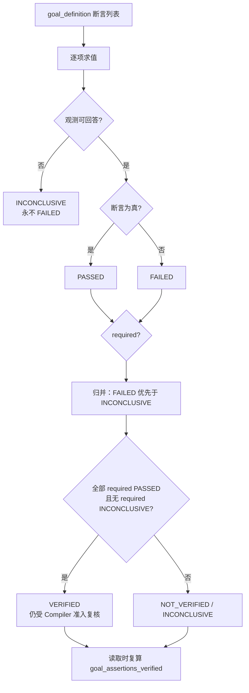
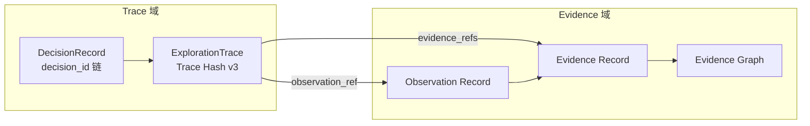
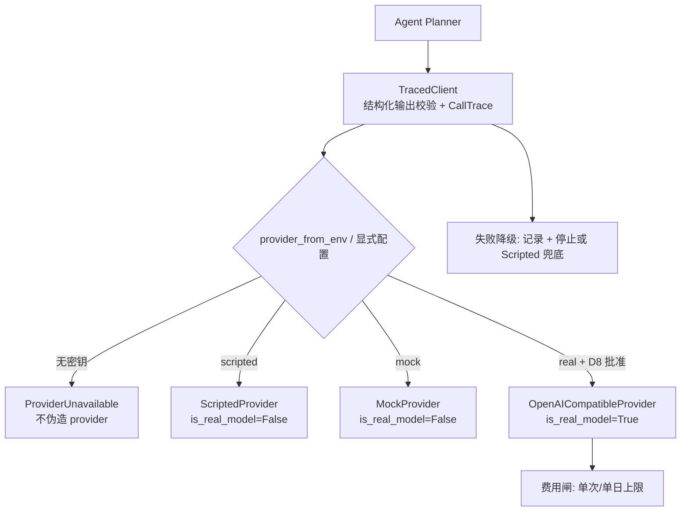

# R5-5.3 总体设计与实施规格

> 阶段名称：**Agent 决策与场景能力升级**
> 分支：`r5-5-product-completion`；基线 HEAD `6a21f47`（R5-5.1-R 最终验收收口提交）。
> 任务性质：**架构设计与开发准入**，不是功能开发。本轮不写业务代码、不启用真实模型、不解除 D8。
> 配套文档：`R5-5.3-接口与数据契约台账.md`（接口台账）、`R5-5.3-D8-真实LLM接入审批准备.md`（审批材料）、
> `R5-5.3-开发任务与验收矩阵.md`（M0～M5 任务与验收门槛）。
> 状态：**设计稿，等待源码及架构评审。未获评审结论前不进入 M1～M5 正式开发。**

---

## 0. 任务定位与设计边界

### 0.1 核心目标

将当前以 ScriptedProvider 为主的探索体系，升级为能够在严格约束下**理解目标、分析页面状态、
选择操作、执行操作、观察结果并动态调整决策**的 Agentic Testing 系统。

本轮只回答"怎么建、怎么验、怎么不越界"，不回答"现在就建"。

### 0.2 五个核心问题与设计响应

| # | 核心问题 | 设计响应 | 详见 |
|---|---|---|---|
| Q1 | 场景如何真正做到可扩展和可复用？ | Scenario Package v2：版本化场景包 + 数据生命周期 + Explorer 核心零场景分支 | §2 |
| Q2 | Agent 如何根据观察结果自主决定下一步？ | 决策闭环：Context Builder → Planner → Action Proposal → Policy → Gateway → Goal Evaluator | §4 |
| Q3 | 如何验证 Agent 是否真的完成业务目标？ | Goal Assertion v2：结构化 DOM Observation + 元素级断言 + 多步骤目标 + 证据完整性校验 | §3 |
| Q4 | 如何防止越权、重复、危险操作？ | 执行前 Policy Validation 六项检查 + 执行后五项检查 + 预算闸 + OriginPolicy 不变 | §4.3/§4.4 |
| Q5 | 如何让探索过程可追溯、可复验、可评估？ | 完整 Trace 结构（决策链关联、Trace Hash v3、Scripted 可重放 / Real 可复核不假装可复现） | §6 |

### 0.3 严格边界（本轮全程有效）

1. 不修改 `main`；不合并分支；不 force push。
2. 不删除正式数据（`data/`）。
3. **不修改 C05 冻结契约**（`packages/contracts/schemas/C05_Event.schema.json` 零改动）。
4. **不解除 D8**：Explorer `llm` 策略保持 409 BLOCKED，真实模型调用保持关闭。
5. 不启用真实模型；不擅自开放外部网站（OriginPolicy 仅放行本地已批准 origin）。
6. 不改变 Candidate 人工审批门禁（`review_confirmed` + `uncertainty_acknowledged` 服务端强制）。
7. 不启动完整 Repair 自动执行；不做全面前端重设计。
8. 不重复实现现有模块（优先复用，见 §7.2 复用矩阵）。
9. 不为通过测试而降低断言或修改安全边界。
10. 本轮交付 = 文档设计成果 + 任务矩阵；评审通过后才进入开发。

---

## 1. 现状基线（设计输入）

以 `README.md`「阶段状态冻结」表为准（2026-11-25 核查源码与验收证据后填写，此处摘录设计相关行）：

| 模块 | 已完成（设计可依赖） | 未完成（本阶段要补） | 限制 |
|---|---|---|---|
| Explorer | 目标驱动、ToolGateway、Trace Hash v2、Compiler 硬准入、场景注册表驱动 | 自主 LLM 决策 | 决策来自 ScriptedProvider |
| Scenario | 注册/查重/校验、4 场景真实浏览器验证 | project-edit、form-validation；四类用例矩阵 | 2 场景 `implemented=False` |
| Goal Assertion | 10 类结构化断言、组合、逐项证据、读取时复算 | 表格行数/列表计数/元素属性/多元素关系/状态转换 | `text_excerpt` 3000 截断 |
| Trace | Trace Hash v2、prompt_version 进哈希、脱敏 | 决策闭环全字段、token/费用 | v1 历史不可检 intent 篡改 |

设计前提（不可推翻的既有语义）：

- **StopReason 与 GoalStatus 分离**：`PLAN_EXHAUSTED` 说明脚本走完，不说明业务目标达成；
  只有 Goal Evaluator 能给 `GOAL_VERIFIED`。**不存在 `GOAL_REACHED` 这个值，本设计也不引入。**
- `INCONCLUSIVE` 永不冒充 `FAILED`；观测不可用 ≠ 断言失败。
- 断言只收紧 Compiler 准入（VERIFIED 也可被收紧为 NOT_VERIFIED/INCONCLUSIVE），不放宽。
- Agent 不能自行声明 VERIFIED；所有结论必须能回溯到证据路径。

---

## 2. R5-5.3-A：场景体系升级（Scenario Package v2）

### 2.1 设计原则

现有 `packages/agents/scenarios.py` 已确立正确原则——**场景业务逻辑不进 Explorer 核心**，
"The core loads and validates a scenario; it never branches on a scenario id"。
v2 不推翻它，只把场景从"模块内数据常量"升级为"可版本化、可复用、带数据生命周期的场景包"。

### 2.2 场景包结构（16 项要求 → 字段映射）

一个 Scenario Package 是一份自包含的声明式数据，加载即校验：

| # | 要求 | v2 字段 | 现状 | v2 变化 |
|---|---|---|---|---|
| 1 | 场景基本信息 | `scenario_id` / `name` / `description` | ✅ 有 | 增加 `version`（SemVer）与 `package_id` |
| 2 | TestIntent 模板 | `intent_templates` | ✅ 有 | 不自动注入（保持 R5-5.2 决策） |
| 3 | 被测应用及允许 Origin | `allowed_origins` | ✅ 有 | 不变；仍由 Budget 用真实 origin 覆盖 |
| 4 | 初始页面 | `initial_url` | ✅ 有 | 不变 |
| 5 | 前置条件 | `preconditions`（新增） | 🆕 | 声明式前置检查（已登录/存在种子数据等） |
| 6 | 测试数据准备 | `data_setup`（新增） | 🆕 | 种子/清理句柄，见 §2.4 |
| 7 | 允许执行的 Action | `allowed_actions` | ✅ 有 | 仍是 KNOWN_ACTIONS 的子集，必须含 navigate/snapshot |
| 8 | 禁止执行的 Action | `denied_actions`（新增） | 🆕 | 显式黑名单，Policy Validation 强制 |
| 9 | 预算和时间限制 | `timeout_budget_s` / `max_steps` | ✅ 有 | 增加 `max_tool_calls` / `max_cost_usd`（真实模型阶段用） |
| 10 | 目标断言 | `goal_definition` | ✅ 有 | 扩展新 kind（§3） |
| 11 | 证据要求 | `evidence_requirements` | ✅ 有 | 增加证据完整性校验（§3.4） |
| 12 | 清理策略 | `cleanup`（新增） | 🆕 | 见 §2.4 |
| 13 | 正常路径 | `paths.normal`（新增分组） | 部分 | 现 `steps` 归入正常路径 |
| 14 | 异常路径 | `paths.exception`（新增） | 🆕 | 错误密码/重复提交/服务端拒绝等 |
| 15 | 边界路径 | `paths.boundary`（新增） | 🆕 | 名称超长 200 字符等 |
| 16 | 恢复路径 | `paths.recovery`（新增） | 🆕 | 网络中断后恢复等 |

版本与 ID：

- `package_id` = `scenario_id`（slug 规则沿用 `^[a-z0-9][a-z0-9-]{1,47}$`）。
- `version`：SemVer（如 `1.0.0`）。**同一 `scenario_id` 允许多版本并存于注册表**，
  由 `(scenario_id, version)` 唯一索引；执行时锁定具体版本并写入 Trace（`scenario_version`）。
- 不兼容变更升 major，仅新增可选字段升 minor，文档/描述修订升 patch。
- 旧版场景记录的历史 Trace 仍按其记录的 `scenario_version` 解释，不要求重放。

### 2.2.1 Scenario Package 版本化 API 设计（DR1-02 完善）

#### (scenario_id, version) 唯一性

- `ScenarioRegistry` 内部键从 `dict[str, Scenario]` 升级为 `dict[tuple[str, str], Scenario]`；
- `register()` 对 `(scenario_id, version)` 查重，重复抛 `ValueError`；
- 同 `scenario_id` 不同 `version` 允许共存。

#### API 传入 scenario_version

**向后兼容的可选字段**（不破坏现有客户端）：

| 接口 | 变化 | 兼容策略 |
|---|---|---|
| `RunExplorationRequest` | 新增可选字段 `scenario_version: str = ""` | 空字符串 = 不指定版本 |
| `GET /explorations/policies` | 返回增加 `scenario_versions` 字段 | 旧字段 `supported_scenarios` 保留不变 |
| Trace 记录 | 新增 `scenario_version` 字段 | 旧记录无此字段 = 历史记录 |

```jsonc
// RunExplorationRequest 新增字段
{
  "scenario": "teamflow-login",
  "scenario_version": "",    // 🆕 可选。空 = 最新已注册版本；指定 = 精确版本
  ...
}
```

#### 旧客户端不传版本时的兼容

- `scenario_version` 为空 → 自动解析为该 `scenario_id` 的**最高 SemVer 版本**（latest）；
- 解析结果写入 Trace 的 `scenario_version` 字段，保证 Trace 锁定真实执行版本；
- 不传版本且该 `scenario_id` 无任何注册版本 → 返回 `UNSUPPORTED_SCENARIO`（与现状一致）。

#### public_view 保留旧格式 + 版本查询

```jsonc
// 旧格式（保留）：dict[str, str]，id → description
"supported_scenarios": {
  "teamflow-login": "登录 TeamFlow 并进入项目列表（已实现...）",
  ...
}

// 新增版本信息（增量字段）
"scenario_versions": {
  "teamflow-login": ["1.0.0", "1.1.0"],
  "project-create": ["1.0.0"]
}
```

旧客户端只读 `supported_scenarios` 不受影响；新客户端可从 `scenario_versions` 选择精确版本。

#### Trace 锁定真实执行版本

- 执行时解析出的实际 `(scenario_id, version)` **必须**写入 Trace：
  ```jsonc
  "scenario": "teamflow-login",
  "scenario_version": "1.1.0",   // 🆕 真实执行的版本
  ```
- Trace Hash v3 覆盖 `scenario_version`（防篡改）；
- 读取 Trace 时按 `scenario_version` 解释场景定义，不按"当前最新版本"回溯。

#### 不存在的版本如何返回

```
HTTP 400 ValidationError
{
  "code": "UNSUPPORTED_SCENARIO_VERSION",
  "scenario": "teamflow-login",
  "requested_version": "2.0.0",
  "available_versions": ["1.0.0", "1.1.0"]
}
```

- 请求了不存在的版本 → 明确错误，不静默回退到其他版本；
- 请求了存在的 `scenario_id` 但该版本 `implemented=False` → 返回 `UNSUPPORTED_SCENARIO` + `blocked_reason`（现状语义保持）。

#### 历史无 scenario_version 的记录

- `scenario_version` 缺失或为空 → 视为 `1.x` 历史记录（注册表引入版本前的记录）；
- 读取时按 `scenario_id` 匹配任意版本的场景定义做断言复算（取 `implemented=True` 的最低版本）；
- 不要求历史记录重写或迁移。

### 2.3 加载与校验（延续 ScenarioRegistry 语义）

`ScenarioRegistry.register()` 保持：校验失败报错、重复注册报错（不静默覆盖）。
`validate()` 在 v2 增补：

- `version` 合法 SemVer；`(scenario_id, version)` 重复 → 拒绝；
- `denied_actions ∩ allowed_actions = ∅`；`denied_actions ⊆ KNOWN_ACTIONS`；
- `paths.*` 每条路径的步骤工具 ⊆ `allowed_actions` 且 ∉ `denied_actions`；
- `data_setup`/`cleanup` 声明的句柄必须在测试数据生命周期注册表中存在；
- `implemented=True` 时至少 `paths.normal` 非空。

### 2.4 两个未实现场景的解法（以源码为准，DR1-03 修订）

**原则：不为了让测试通过而伪造业务页面。** 场景能力必须由被测应用真实提供。

#### project-edit（项目编辑）—— 复用已有后端能力

**源码事实**（`apps/teamflow/api.py` + `apps/teamflow/service.py`）：
- ✅ `PUT /api/v1/projects/{project_id}` 已存在（`api.update_project` → `service.update_project()`）
- ✅ `service.update_project(session, project_id, name, description)` 已实现并可工作
- ✅ `GET /api/v1/projects/{project_id}` 已存在（详情查询）
- ❌ Web UI 无编辑页面（`apps/teamflow/web.py` 只有 `/projects`、`/projects/new`、`/projects/{id}`）
- ❌ 无 Web 表单提交路由（`POST /projects/{id}/edit` 或类似）

**修订方案**：**只增加必要的 Web 编辑页面和表单提交路由，复用已有后端逻辑。**

- **SUT 最小改造范围**（`apps/teamflow`，仅 Web 层）：
  1. `GET /projects/{id}/edit` —— 编辑表单页面（预填当前 name/description）；
  2. `POST /projects/{id}/edit` —— 表单提交，调用已有 `service.update_project()`，成功后 303 回详情页；
  3. 保存成功提示带 `data-testid=edit-success`；校验失败带 `data-testid=form-error`。
  4. **不重复实现后端项目更新业务逻辑**——直接复用 `service.update_project()`。
  不引入权限体系、不引入富文本，只做"最小编辑页面"。
- **场景包**：正常路径（打开→改名→保存→详情显示新名）；异常路径（清空名称→校验错误）；
  边界路径（名称 200 字符）；恢复路径（保存失败后重试成功）。
- **验收前提**：SUT 改造先行（属 M1 输入，不属于 Explorer 改动）。

#### form-validation（表单验证）—— 种子数据生命周期

**源码事实**：
- ✅ `service.create_project()` 存在（含重名 ConflictError 检查）
- ❌ **无 DELETE 项目 API**（业务 API 中不存在 DELETE 路由）
- ✅ `service.reset_data()` 存在但会清空全部项目（过于粗暴，不适合种子清理）
- 现状 `blocked_reason` 正确描述了问题：需要可重复的"已存在名称"种子

**种子数据清理方案评估**：

| 方案 | 描述 | 风险 | 可验证性 |
|---|---|---|---|
| A. 新增隔离测试清理 API | 在隔离测试环境新增 `DELETE /api/v1/projects/{id}` 或 `POST /api/v1/test/cleanup` | 中——新增 API 面，需严格限制于隔离环境 | 中 |
| **B. 测试 Fixture / 数据生命周期适配器** ✅ | 测试代码内直接操作 DB session 做种子创建与清理（不走 HTTP API），独立于 Explorer | **低**——不改 SUT API，不影响正式环境 | **高** |

**选定方案 B**（风险更低、最容易验证）：

1. `data_setup`：运行前由**数据生命周期适配器**（独立于 Explorer 的测试 Fixture）通过
   `service.create_project()` 创建带唯一后缀的种子项目（如 `种子项目-form-validation-{run_id}`），
   返回句柄 `{project_id, project_name}`；
2. 场景用该名称提交创建 → 服务端 `ConflictError`（409）→ `form-error` 可见；
3. `cleanup`：运行后由适配器通过 **DB session 直接删除**种子项目（finally 语义），
   **不走 HTTP API**（因为没有 DELETE 路由）；
4. **数据所有权**：种子项目由适配器创建，只有适配器有权清理；Explorer 及其场景
   不持有删除权限，也不需要；
5. **创建失败语义**：种子创建失败 → 探索不启动，记录 `SETUP_FAILED`；
6. **清理失败语义**：清理失败 → 记录 `CLEANUP_FAILED` + 项目 ID，不静默遗留；
   下次运行使用新 `run_id` 后缀，不受上次遗留数据影响；
7. **正常结束/异常结束/进程崩溃清理**：适配器使用 `finally` / `atexit` / 上下文管理器
   确保清理；进程崩溃后遗留的种子项目由下次运行的适配器在 setup 阶段识别并清理
   （按命名前缀 `种子项目-form-validation-*` 扫描孤儿数据）；
8. **重复运行与并发运行隔离**：每次运行使用独立 `run_id`（UUID 前 8 位），种子项目名
   带 `run_id` 后缀，互不冲突；并发运行各自由独立适配器管理各自的种子。

**权限与适用范围**：
- 方案 B 仅在**测试/隔离环境**使用（测试 Fixture 路径），不暴露远程 API；
- **禁止通过清空正式数据库（`reset_data()`）解决测试数据清理问题**；
- 适配器的 DB 操作仅限于自身创建的种子项目（按命名前缀过滤），不触碰其他数据。

### 2.5 可复用性约束

- 同一 Explorer 核心加载不同场景：**禁止在 `explorer.py` / `exploration.py` / `explorer_api.py`
  增加任何 `if scenario_id == ...` 分支**。场景差异只能通过数据（步骤、断言、约束）表达。
- `{base_url}` / `{username}` / `{password}` / `{unique_suffix}` 等占位符替换逻辑保持在
  `explorer_api._substitute` 一处实现。
- 四类用例矩阵（正常/异常/边界/恢复）成为场景包的一等公民；每个 `implemented=True` 场景
  的四类路径在 M5 综合验收前必须齐备或显式登记缺口。

### 2.5.1 四类路径语义（P1 完善）

| 路径类型 | 语义 | 预期结果 | 示例 |
|---|---|---|---|
| `paths.normal` | 正常业务流程 | goal `VERIFIED` | 登录成功→进入项目列表 |
| `paths.exception` | 异常/错误输入 | goal `NOT_VERIFIED`，但页面有明确错误反馈 | 错误密码→登录失败提示 |
| `paths.boundary` | 边界条件 | 验证系统在极限值处的正确行为 | 名称恰好 200 字符→成功/201 字符→校验错误 |
| `paths.recovery` | 故障恢复 | 从异常状态恢复正常流程 | 保存失败→重试→成功 |

- 每条路径是独立的步骤序列（`list[dict]`），各自有独立的期望断言；
- `paths.normal` 是 `implemented=True` 的必要条件（见 §2.3 校验）；
- 异常路径的预期 `NOT_VERIFIED` 不等于测试失败——它验证的是"系统正确拒绝了非法操作"；
- 恢复路径可包含前置异常步骤（制造故障）+ 恢复步骤（验证恢复）。

### 2.5.2 真实 Agent 动态规划 vs 固定 Scripted 步骤（P1 完善）

| 维度 | ScriptedPolicy / ScriptedAgentPolicy | 真实 Agent（M4 后） |
|---|---|---|
| 决策来源 | 预编排步骤列表（`steps` 字段） | LLM 根据 Observation 动态生成 Action Proposal |
| 是否"看"页面 | ScriptedPolicy 不看；ScriptedAgentPolicy 看（expect 匹配） | 看（Context Builder 组装 Observation） |
| 步骤可变性 | 固定不可变 | 每步动态决定 |
| Trace 标记 | `agent_version` 含 `NOT-LLM` / `NOT-REAL-INFERENCE` | `agent_version` 含真实模型版本 |
| 权限 | 不因"是脚本"而放宽：仍走 ToolGateway 全量校验 | 同左 |

**关键约束**：真实 Agent 的动态规划**不能绕过** TestIntent 和 Scenario 约束：
- Planner 输入包含 `constraints`、`allowed_actions`、`denied_actions`；
- 即使模型输出了约束外的动作，PolicyValidator 也会拒绝；
- TestIntent 的 `goal`/`target` 是 Planner 的目标指引，不是可修改的权限来源。

### 2.5.3 Preconditions 执行与结果记录（P1 完善）

- `preconditions` 在探索开始前由**数据生命周期适配器**执行（与 `data_setup` 同层）；
- 每个 precondition 的检查结果写入 Trace：`precondition_results: [{name, status, detail}]`；
- precondition 失败 → 探索不启动，记录 `PRECONDITION_FAILED`；
- precondition 结果受 Trace Hash 保护（进 `test_intent` 扩展字段或独立字段）。

### 2.5.4 Scenario Package 加载格式与可信来源（P1 完善）

| 项 | 规则 |
|---|---|
| 加载格式 | Python dataclass（现状）→ M1 起支持 JSON/YAML 文件加载（同构字段） |
| 可信来源 | **仅进程内构建期**（`build_default_registry` / 测试装配）；不暴露远程注册 API |
| 加载校验 | `validate()` 全量校验，失败拒绝注册（不静默忽略） |
| 文件来源 | 部署时随代码一起发布（`packages/agents/scenarios/` 目录），不做运行时热加载 |
| 不可信来源 | 用户上传、运行时远程拉取的场景定义一律拒绝 |

---

## 3. R5-5.3-B：Goal Assertion 升级

### 3.1 现状与问题

已支持 10 类断言（url_exact / url_regex / testid / element_exists / element_visible /
element_text / form_state / page_state / all_of / any_of / not）。
主要短板（L7 及衍生）：

- `evaluate_goal` 的文本比对基于 `text_excerpt`（**3000 字符截断**）——超长页面靠后的内容观察不到；
- `element_text` 基于有界标签（≤60 字），不是完整 innerText；
- 无法表达数量、属性、元素关系、状态转换、多步骤目标。

### 3.2 根本解法：结构化 DOM Observation（不是扩大截断）

**禁止用"把 3000 改成 30000"的方式解决 L7。** 截断字符串永远追不上页面结构化需求。

设计 `Observation v2`（在现有 `Observation` 上增量扩展，不改 C05）：

```jsonc
{
  "url": "...", "url_path": "...", "title": "...",
  "visible_testids": ["..."],
  "visible_elements": [ { "tag": "...", "testid": "...", "name": "...",
                          "visible": true, "disabled": false,
                          "attrs": {"role": "...", "aria-label": "..."} } ],
  "dom_counts": {                    // 结构化计数，不是文本
    "selector:project-item": 5,      // 由场景断言声明需要计数的 selector
    "selector:nav a": 7
  },
  "dom_relations": [                 // 由断言求值器按需采集
    { "kind": "sibling_of", "left": "project-title", "right": "project-status" }
  ],
  "text_excerpt": "..."              // 保留，仅作辅助证据，不再作为唯一判定源
}
```

采集原则：

- **按需采集**：只有断言声明需要的 selector 才进 `dom_counts`，避免观测膨胀；
- **不采集输入值**（延续红线：密码不是 observation）；
- 元素级断言优先读结构化字段；`text_excerpt` 降级为辅助证据。

### 3.2.1 Observation v2 采集契约（DR1-05 完善）

#### dom_counts 采集规则

| 约束 | 值 | 说明 |
|---|---|---|
| selector 白名单 | 仅 `[data-testid=...]`、`.class`、`#id`、`tag` 及其简单组合 | 禁止复杂 CSS 伪类、XPath、JS 表达式 |
| 单 selector 计数上限 | 200 | 超出截断并标注 `truncated: true` |
| 单次观测 dom_counts 条目上限 | 20 个 selector | 超出部分不采集，标注 `omitted_selectors` |
| 采集方式 | `page.eval_on_selector_all(selector, "els => els.length")` | 不取 DOM 内容，只取计数 |

#### dom_relations 数据结构

```jsonc
{
  "kind": "sibling_of" | "ancestor_of" | "preceding" | "following",
  "left": "<testid>",       // 左元素 testid
  "right": "<testid>",      // 右元素 testid
  "observed": true | false  // 是否实际观测到该关系
}
```

- 仅采集断言声明需要的关系对，单次观测上限 10 条；
- 关系不可观测（元素缺失）→ `observed: false`，断言求值 → INCONCLUSIVE。

#### element_attr 属性白名单

| 允许属性 | 采集方式 | 脱敏规则 |
|---|---|---|
| `role` | 直接读取 | 无 |
| `aria-label` | 直接读取（≤60 字） | 敏感词检测 → REDACTED |
| `href` | **仅路径部分**（去掉 query/hash） | query 参数全部丢弃 |
| `data-*`（非 testid） | 直接读取（≤60 字） | 敏感词检测 → REDACTED |
| `type` / `name` | 直接读取 | name 含敏感词 → REDACTED |
| `placeholder` | 直接读取（≤60 字） | 敏感词检测 → REDACTED |

**禁止采集**：`value`（输入值红线）、`style`、`onclick` 等事件属性、`src`（外部资源 URL）、
`action`（表单提交目标）、`data-password` / `data-token` 等敏感 data 属性（SENSITIVE_HINT 匹配 → 丢弃）。

#### Observation 体积与超时上限

| 约束 | 值 |
|---|---|
| `text_excerpt` 上限 | 3000 字符（保持现状） |
| `visible_elements` 上限 | 40 个元素（保持现状） |
| `dom_counts` 序列化后总大小 | ≤ 4 KB |
| `dom_relations` 序列化后总大小 | ≤ 2 KB |
| `attrs` 每元素序列化后大小 | ≤ 512 字节 |
| Observation v2 序列化后总大小 | ≤ 32 KB |
| 单次页面采集超时 | 5000ms（含 DOM 查询、属性读取） |

超限处理：截断 + 在 `observation.truncated_fields` 中标注被截断的字段名。

#### table_row_count / list_item_count 统一比较规则

| 操作符 | 语义 | 空列表行为 |
|---|---|---|
| `eq` | count == expected | count=0 可观测，0==N 或 0!=N 判定 |
| `gte` | count >= expected | 0>=N 按实际比较 |
| `lte` | count <= expected | 0<=N 按实际比较 |

- 两者语义完全相同（`list_item_count` 是 `table_row_count` 的别名）；
- selector 未在 dom_counts 中采集 → INCONCLUSIVE（不是 count=0）；
- selector 已采集但匹配 0 个元素 → count=0（可观测，不 INCONCLUSIVE）。

#### dynamic_match 绑定来源

| 绑定来源 | 示例 | 缺失行为 |
|---|---|---|
| 运行时 `{unique_suffix}` | `R5-5 探索项目 a1b2c3d4` | 绑定缺失 → INCONCLUSIVE |
| 场景声明的 `bindings` 字段 | `{"project_name": "..."}` | 绑定缺失 → INCONCLUSIVE |
| 禁止从页面反推绑定值 | — | 不猜值、不回退 |

#### page_transition 历史观测要求

- 必须存在 `observations[step_index - 1]` 和 `observations[step_index]` 两条观测；
- 首步（step_index=0）无前观测 → INCONCLUSIVE；
- 比较字段：`url_path` 变化 + `title` 变化（两者都可选，声明哪个比哪个）。

#### evidence_complete 独立校验语义（无循环依赖）

`evidence_complete` 断言**不依赖其他断言的求值结果**，只检查 Observation 自身的证据完整性：

1. 声明的 evidence 路径在当前 observation 中是否存在；
2. evidence 路径指向的字段是否有非空值；
3. evidence 的 observation index 是否属于本次 exploration 的 observations 列表。

**不检查**："其他断言是否 PASSED"（避免循环依赖）。
evidence_complete 的 PASSED/FAILED/INCONCLUSIVE 只反映"证据是否存在且可读"，
不反映"业务结论是否正确"。其归并规则与其他断言一致（§3.4）。

#### 每种新断言的完整契约（Schema + 样例 + 三态 + Evidence 路径 + 复算规则）

以 `table_row_count` 为例（其余 kind 同构）：

```jsonc
// JSON Schema（简化）
{
  "kind": "table_row_count",
  "name": "project_rows",
  "selector": "project-item",        // 必填，dom_counts key
  "op": "gte",                       // 必填，枚举 eq/gte/lte
  "value": 1,                        // 必填，非负整数
  "required": true                   // 可选，默认 true
}
// 合法样例：{"kind": "table_row_count", "name": "rows", "selector": "project-item", "op": "gte", "value": 1}
// 非法样例：{"kind": "table_row_count", "name": "rows"}  ← 缺 selector/op/value
// 非法样例：{"kind": "table_row_count", "name": "rows", "selector": "x", "op": "gt", "value": 1}  ← op 不在枚举内

// PASSED: dom_counts["selector:project-item"]=3, op="gte", value=1 → 3>=1 → PASSED
// FAILED: dom_counts["selector:project-item"]=0, op="gte", value=1 → 0>=1 不成立 → FAILED
// INCONCLUSIVE: dom_counts 中无 "selector:project-item" → 无法判定 → INCONCLUSIVE
// Evidence 路径: observations[step_index].dom_counts["selector:project-item"]
// 复算规则: 读取持久化 observation 的 dom_counts 字段，重跑比较逻辑，比对存储的 verdict
```

### 3.3 新断言类型（10 项设计，含统一状态归并规则）

| # | kind | 语义 | 证据来源 | 备注 |
|---|---|---|---|---|
| 1 | `table_row_count` | 指定 selector 的匹配数 = / ≥ / ≤ N | `dom_counts` | 空列表 → 计数 0（可观测），不 INCONCLUSIVE |
| 2 | `list_item_count` | 同上，语义别名（比较规则同 table_row_count） | `dom_counts` | |
| 3 | `element_attr` | 元素某属性 = / 包含 / 正则 | `visible_elements[].attrs` | 仅白名单属性（见 §3.6），不读 value |
| 4 | `element_relation` | 两元素兄弟/祖先/前后序关系 | `dom_relations` | relation 不可观测 → INCONCLUSIVE |
| 5 | `page_transition` | 前一观测 → 当前观测的 URL/标题变化 | `observations[-2]` + `[-1]` | 首步无前观测 → INCONCLUSIVE |
| 6 | `url_and_content` | URL 匹配 **且** 内容断言（组合宏） | 复合 | 展开为 all_of，保持逐项证据 |
| 7 | `multi_step_goal` | 有序子目标序列，每步含 `stage: "intermediate"\|"final"` + 断言组 | 分步观测 | 见 §3.5 统一语义 |
| 8 | `dynamic_match` | 期望值引用运行时绑定（如 `{unique_suffix}` 项目名） | 绑定表 | 绑定缺失 → INCONCLUSIVE，不猜值 |
| 9 | `evidence_complete` | 断言自身证据完整性（evidence 路径存在且指向本次 observation） | Trace 自省 | 证据缺失 → INCONCLUSIVE；独立校验，见 §3.6 |
| 10 | `form_state`（v1 保持） | 表单元素 present/absent/visible/disabled | `visible_elements` | 不读取输入值 |

> **v1 的 `final_state`/`intermediate_state` 独立 kind 取消**：其语义被 `multi_step_goal` 的
> `stage` 字段完全覆盖（见 §3.5），避免两套表达互相矛盾。原 v1 中已有 `form_state` 不受影响。

### 3.4 语义保持（一票否决式约束，v2 原样保留 + 新增统一归并规则）

以下规则在 v2 **原样保留**，新增类型必须遵守同一语义：

1. `INCONCLUSIVE` 不冒充 `FAILED`：观测不可用 → INCONCLUSIVE；
2. 断言只能收紧 Compiler 准入：即使 goal 评估 VERIFIED，断言失败仍收紧为 NOT_VERIFIED/INCONCLUSIVE；
3. Agent 不能自行声明 VERIFIED；
4. 每个结论可回溯证据路径（`evidence` 字段必填）；
5. 只有可选断言的 goal → INCONCLUSIVE（"通过"证明不了任何事）；
6. 必需断言失败 > 不可观测（FAILED 优先于 INCONCLUSIVE 归并）；
7. 读取时重新计算并比对（`goal_assertions_verified`），派生结果不当原始事实。

**统一状态归并规则（v2 新增，适用于所有断言和多步骤目标）：**

| 优先级 | 条件 | 整体结论 |
|---|---|---|
| 1（最高） | 存在任一 `required=True` 断言 `FAILED` | `NOT_VERIFIED` |
| 2 | 无 required FAILED，但存在任一 `required=True` 断言 `INCONCLUSIVE` | `INCONCLUSIVE` |
| 3 | 仅有 `required=False` 断言 | `INCONCLUSIVE`（"通过"证明不了任何事） |
| 4（最低） | 所有 `required=True` 断言 `PASSED` | `VERIFIED` |

- `required` 与 `stage` 是**正交**的：`required` 控制是否影响结论，`stage` 控制该断言在多步骤流程中的
  检查点位置。一个 final 阶段断言可以是 optional，一个 intermediate 阶段断言也可以是 required。
- 多步骤目标中，所有阶段的 required 断言都必须 PASSED 才 `VERIFIED`。

**合法样例：**
```jsonc
// ✅ 合法：登录→创建两步目标，每步有 intermediate/final 标记
{ "kind": "multi_step_goal", "name": "login_then_create",
  "steps": [
    { "stage": "intermediate", "assertions": [
        {"name": "on_projects", "kind": "url_exact", "value": "/projects", "required": true} ] },
    { "stage": "final", "assertions": [
        {"name": "created", "kind": "testid", "value": "success-message", "required": true},
        {"name": "row_count", "kind": "table_row_count", "selector": "project-item",
         "op": "gte", "value": 1, "required": false} ] }
  ] }
```

**非法样例：**
```jsonc
// ❌ 非法：stage 值不在枚举内
{ "stage": "middle", "assertions": [...] }
// ❌ 非法：steps 为空数组
{ "kind": "multi_step_goal", "name": "empty", "steps": [] }
// ❌ 非法：steps 中断言列表为空
{ "stage": "final", "assertions": [] }
// ❌ 非法：required 与 stage 混淆（用 stage 代替 required）
{ "stage": "intermediate", "required_for_stage": true, "assertions": [...] }
```

### 3.5 多步骤目标与中间状态（统一语义）

`multi_step_goal` 把"业务目标"表达为有序检查点：

```jsonc
{ "kind": "multi_step_goal", "name": "login_then_create",
  "steps": [
    { "stage": "intermediate", "assertions": [ {"kind": "url_exact", "value": "/projects", "required": true} ] },
    { "stage": "final",        "assertions": [ {"kind": "testid", "value": "success-message", "required": true} ] }
  ] }
```

**统一语义（消除原 v1 中间步失败的三种矛盾表述）：**

1. **`stage: "intermediate"`** = 流程路径检查点。验证目标流程是否按预期路径推进。
2. **`stage: "final"`** = 终态检查点。验证最终业务状态是否达成。
3. **两者的归并规则完全相同**（见 §3.4 统一归并规则）：
   - 任一阶段的 required 断言 `FAILED` → 整体 `NOT_VERIFIED`（流程未按预期推进或终态错误）
   - 任一阶段的 required 断言 `INCONCLUSIVE` → 整体 `INCONCLUSIVE`
   - 所有阶段的 required 断言 `PASSED` → `VERIFIED`
4. **中间步失败 IS 否决**（`NOT_VERIFIED`），不是"只记录不否决"。
   修正 v1 中"intermediate 失败只记录不否决"和"中间步失败即整体失败"的矛盾表述。
5. **INCONCLUSIVE 传播**：intermediate 步的 required 断言不可观测 → 整体 INCONCLUSIVE。
   例如：首步无前观测导致 `page_transition` 不可判 → 该步 INCONCLUSIVE → 整体 INCONCLUSIVE。
6. **optional + intermediate 组合**：`required: false` 的 intermediate 断言仅作信息记录，
   不影响任何结论。optional 断言的 FAILED/INCONCLUSIVE/PASSED 都写入报告，但不参与归并。
7. **执行顺序**：步骤按声明顺序求值，但所有断言独立求值、不短路（与 v1 `evaluate_assertions` 一致）。
   每步的断言关联到该步对应 Observation 的 evidence 路径（`observations[step_index].field`）。
8. **逐项关联真实 Observation 和 Evidence**：每个 `AssertionResult.evidence` 必须指向具体的
   observation 字段路径（如 `observations[2].visible_testids`），多步骤断言必须标注其所属 step 的
   observation index。读取时复算规则不变（§3.4 第 7 条）。

---

## 4. R5-5.3-C：Agent 决策引擎（本阶段最重要的架构任务）

### 4.1 决策闭环

现状链路：`Observation → LLMPolicy → ScriptedProvider → ToolGateway`。
目标闭环（真实 Agent，M4 后启用；M3 先用 Scripted/Mock 验证闭环本身）：



**红线：模型不能直接调用浏览器，也不能绕过 ToolGateway。**
所有动作必须以 Action Proposal 形式进入 Policy Validator → ToolGateway 单通道。

### 4.2 Agent 输入 / 输出

**输入（Context Builder 组装，进入 Planner）：**

| 输入 | 来源 | 说明 |
|---|---|---|
| TestIntent | C01 | goal / target / expected_outcomes / constraints |
| 当前页面 Observation | PlaywrightAdapter.observe | 结构化 DOM 观测（§3.2） |
| 历史 Action | ExplorationTrace | 已执行动作（脱敏后） |
| 历史结果 | ExplorationTrace | 每步 execution_result 摘要 |
| 剩余预算 | Budget | 步数 / 时长 / 工具调用 /（M4 起）费用 |
| 当前目标状态 | GoalEvaluator | 最近一次 goal_evaluation |
| Scenario 约束 | Scenario Package | allowed/denied_actions、constraints、paths |

**输出（结构化 Action Proposal，schema 强校验）：**

```jsonc
{
  "decision_id": "dec_<uuid>",
  "action": "click",                    // ∈ allowed_actions
  "arguments": { "selector": "[data-testid=create-submit]" },
  "rationale": "提交创建表单以完成项目创建目标",
  "expected_effect": { "url_path": "/projects", "testid": "success-message" },
  "confidence": 0.82,                   // 0~1，仅作审计，不作放行依据
  "prompt_version": "planner-v1",       // 真实模型阶段必填
  "model_version": "..."                // 真实模型阶段必填；Scripted 为 NOT-REAL 标记
}
```

- Structured Output（JSON Schema）校验不通过 → `StructuredOutputError`，**不产生决策**、不伪造动作；
- 模型失败 → 降级路径见 §5.4，禁止"失败了就随便挑个动作"。

#### Action Proposal 每类 Action 的参数 Schema（P1 完善）

| action | required 参数 | optional 参数 | 约束 |
|---|---|---|---|
| `navigate` | `url` | — | URL ≤ 2048 字符，经 ToolGateway `_check_url` 校验 |
| `fill` | `selector`, `value` | `value_ref` | selector ≤ 200 字符；value ≤ 500 字符 |
| `click` | `selector` | — | selector ≤ 200 字符 |
| `wait` | — | `ms` | 0 ≤ ms ≤ 5000 |
| `snapshot` | — | — | 无参数 |
| `assert_text` | `selector`, `text` | `value` | text 非空 |
| `assert_visible` | `selector` | — | selector ≤ 200 字符 |
| `assert_not_visible` | `selector` | — | selector ≤ 200 字符 |

- 未知参数 → 拒绝（`unknown-argument`）；
- 缺少 required 参数 → 拒绝（`missing-argument`）；
- 以上与 `TOOL_SPECS`（`exploration.py`）保持一致，不另立标准。

**模型输出不能绕过 TestIntent 和 Scenario 约束（P1 关键红线）**：
- Planner 输入中的 `constraints` / `allowed_actions` / `denied_actions` 是**硬约束**；
- 模型输出的 Proposal 中即使声明了约束外的 action/args，PolicyValidator 也一律拒绝；
- TestIntent 的 `goal`/`target` 是目标指引，**不是可修改的权限来源**——模型不能通过
  修改 Proposal 中的"目标"字段来扩大权限；
- `expected_effect` 是执行后检查的参考，**不是业务 verdict 的裁决来源**（verdict 只属 Goal Evaluator）。

### 4.3 执行前检查（Policy Validator，六项全过才放行）

**职责分离（DR1-04 明确）：**

| 组件 | 职责 | 不做什么 |
|---|---|---|
| **PolicyValidator** | 对 Action Proposal 进行执行前策略检查；输出结构化 `PolicyDecision`；记录拒绝原因 | **不执行浏览器操作**；不直接调用 Playwright |
| **ToolGateway** | 保留**唯一执行授权入口**；再次执行必要的权威安全检查；对 URL、selector、value、预算等进行最终校验 | 不做策略层面的场景约束检查（那是 PolicyValidator 的事）；不允许 Planner 绕过 |

**避免重复校验导致规则不一致的约定**：
- PolicyValidator 负责**策略层**检查（场景约束、重复/危险检测、Proposal schema）；
- ToolGateway 负责**安全层**检查（URL/selector/value/预算的权威校验）；
- 两层各自独立、不交叉：PolicyValidator 不做 URL 安全校验，ToolGateway 不做场景约束检查；
- ToolGateway 的检查是**最终防线**——即使 PolicyValidator 放行，ToolGateway 仍然可以拒绝。

| # | 检查 | 负责组件 | 失败处理 |
|---|---|---|---|
| 1 | Action 是否注册（∈ KNOWN_ACTIONS） | PolicyValidator | 拒绝，记 `unknown-action` |
| 2 | 是否属于场景允许范围（∈ allowed_actions 且 ∉ denied_actions） | PolicyValidator | 拒绝，记 `not-allowed-by-scenario` |
| 3 | URL 是否符合 OriginPolicy（scheme+host+port 精确比对） | **ToolGateway（权威）** | 拒绝，记 `origin-denied`，**升级为 POLICY_STOP** |
| 4 | 是否触及禁止操作（denied_actions / constraints 中的硬规则） | PolicyValidator | 拒绝，记 `denied-action` |
| 5 | 是否超出预算（步数 / 时长 / 工具调用 / 费用） | **ToolGateway（权威）** | 停止，记 `BUDGET_EXHAUSTED` |
| 6 | 是否重复或危险操作（同参数连续重复 / 短时间高频写操作） | PolicyValidator | 拒绝，记 `duplicate-or-dangerous` |

#### 补充约束（DR1-04 完善）

**fail-closed 行为**：
- PolicyValidator 检查自身异常（如预算状态缺失、场景约束不可读）→ **拒绝放行**（fail-closed），
  记 `invalid-proposal`；校验器崩溃必须让探索以 `ERROR`/`EXECUTION_FAILED` 停止，不静默继续。
- ToolGateway 检查异常同理：任何校验代码抛出非预期异常 → 拒绝执行，不放行。

**重复拒绝次数限制**：
- 同一 `decision_id` 或同参数 Proposal 被拒绝 → 允许 Planner 重新规划 1 次；
- **连续 2 次拒绝**（同参数或同类 reason_code）→ `POLICY_STOP`，不再接受新 Proposal；
- 累计拒绝次数 ≥ 5（不同参数）→ `POLICY_STOP`（防无限重试循环）。

**最大重规划次数**：
- 单步最大重规划：2 次（即 1 次原始 Proposal + 2 次重规划 = 最多 3 次尝试）；
- 全局最大重规划：`max_steps` 的 50%（如 max_steps=10 → 最多 5 次重规划）；
- 超出上限 → 停止，记 `POLICY_STOP`，reason 标注 `max-replan-exceeded`。

**危险操作分类**：

| 类别 | 示例 | 处理 |
|---|---|---|
| 越界导航 | navigate 到非允许 origin | 拒绝 + `POLICY_STOP`（一次即停） |
| 高频写操作 | 短时间内连续 click/fill 同一表单 ≥ 3 次 | 拒绝，记 `duplicate-or-dangerous` |
| 破坏性操作 | 删除、清空表单后提交 | 允许但计入危险操作计数；累计 2 次 → `POLICY_STOP` |
| 重复操作 | 同 (tool, args) 连续出现 | 第 2 次拒绝 |

**合法重试与重复危险操作的区分**：
- 合法重试：前一次操作**执行失败**（ERROR），Planner 根据新的 Observation 调整参数后重试
  → 允许（args 不同即视为不同操作）；
- 重复危险操作：前一次操作**被策略拒绝**（REJECTED），Planner 提交相同参数 → 拒绝；
- 判定依据：比较**脱敏后的完整 args**（selector + value_ref + url），不同则视为合法重试。

**页面内容永远是不可信输入**：
- PolicyValidator 和 ToolGateway 都**不从页面文本/DOM 内容中提取权限、预算或约束**；
- 页面内容只能作为 Observation 传给 Planner，Planner 产出的 Proposal 仍受完整校验；
- prompt injection 通过页面文本试图放宽约束 → 无效（安全检查不读页面内容）。

预算闸沿用 `Budget` / `ToolGateway.authorize` 既有实现，只新增费用维度（M4）。

### 4.4 执行后检查（五项）

1. 操作是否成功（HTTP/工具返回）；
2. 页面是否发生预期变化（`expected_effect` 与新 Observation 比对，宽松匹配：只查声明的字段）；
   **注意：`expected_effect` 仅是执行后检查的信号源，不是业务 verdict 的裁决来源**。
   预期变化不匹配 → 标注 `effect_mismatch` 并可能触发重规划，但**不直接判定 FAILED**。
   业务结论只属于 Goal Evaluator（§3 断言体系）；
3. 是否产生新的异常（console error / 5xx / 崩溃）；
4. 是否需要重新规划（预期不符且非目标达成 → 回 Planner，带 mismatch 信息；
   重规划次数受 §4.3 最大重规划限制）；
5. 是否达到目标 / 是否需要停止（Goal Evaluator + 停止策略）。

### 4.5 停止策略

**先分域再定值：`StopReason`（循环为何停）与 `GoalStatus`（业务目标结论）是两个域，不合并。**
R5-5.3 的目标词表按域映射到既有枚举，**不引入 `GOAL_REACHED`**：

| 目标词表（规格用语） | 域 | 映射到现有值 | 说明 |
|---|---|---|---|
| GOAL_VERIFIED | StopReason | `GOAL_VERIFIED`（已有） | 仅当 Goal Evaluator 判定 VERIFIED 才允许 |
| NOT_VERIFIED | GoalStatus | `NOT_VERIFIED`（已有） | 业务结论，不是停止原因 |
| INCONCLUSIVE | GoalStatus | `INCONCLUSIVE`（已有） | 观测不足，不冒充失败 |
| POLICY_STOP | StopReason | `POLICY_STOP`（已有） | 越界/危险操作触发 |
| PLAN_EXHAUSTED | StopReason | `PLAN_EXHAUSTED`（已有） | 计划走完 ≠ 目标完成 |
| BUDGET_EXHAUSTED | StopReason | `STEP_BUDGET` / `TIME_BUDGET` / `TOOL_CALL_BUDGET`（已有） | 沿用细分值，语义层聚合为 BUDGET_EXHAUSTED |
| EXECUTION_FAILED | StopReason | `ERROR`（已有） | 执行层失败 |

- 兼容性：现有 7 个 StopReason 值**全部保留**；新词表是语义聚合层，不是替换。
- ExplorationTrace / C04 中记录仍用现有值字符串，避免契约涟漪；语义聚合仅用于报告与设计叙述。
- **不允许把脚本执行完等同于目标完成**：`PLAN_EXHAUSTED` 后仍必须跑 Goal Evaluator。

---

## 5. R5-5.3-D：真实 LLM 安全接入准备（详见 D8 文档）

本轮只做设计与验证准备，**不发起任何真实模型请求**。

### 5.1 三模式不可混淆

| 模式 | 实现 | `is_real_model` | `may_contain_real_inference` | 用途 | 标记 |
|---|---|---|---|---|---|
| ScriptedProvider | `llm.py`（已有） | False | False | 测试/开发确定性重放 | `provider="scripted"` / `NOT-REAL-INFERENCE` |
| MockProvider | 🆕 `llm.py` 新增 | False | False | 闭环验证用的确定性假模型（按观测返回预设结构化输出），区别于脚本回放 | `provider="mock"` / `NOT-REAL-INFERENCE` |
| RealProvider | `OpenAICompatibleProvider`（已有） | True | True | 真实推理（D8 批准后） | `provider="deepseek"` / `may_contain_real_inference=True` |

三者共用 `LLMProvider` Protocol 与 `TracedClient`，但 **agent_version / trace 标记严格区分**，
UI 与报告必须展示来源，Scripted/Mock 结果永不标注为真实推理。

#### ScriptedProvider vs MockProvider 明确区别（P1 完善）

| 维度 | ScriptedProvider | MockProvider |
|---|---|---|
| 输入-输出关系 | 固定脚本：第 N 次调用返回第 N 条预设文本 | **观测响应**：根据输入的 Observation 返回对应预设结构化输出 |
| 是否"看"观测 | **不看**（纯顺序回放） | **看**（按观测内容选择预设响应） |
| 用途 | 回归测试、确定性重放 | 决策闭环验证（验证"观测变了→提案变了"） |
| 耗尽行为 | 脚本用完抛 `ProviderUnavailable` | 无匹配响应时抛 `ProviderUnavailable` |
| agent_version | `scripted-agent-1.0.0-NOT-REAL-INFERENCE` | `mock-agent-1.0.0-NOT-REAL-INFERENCE` |

#### is_real_model 与 may_contain_real_inference 统一权威标记（P1 完善）

- **`is_real_model`**：Provider 属性，标识"底层是否是真实 LLM"。
  - `ScriptedProvider.is_real_model = False`（硬编码）
  - `MockProvider.is_real_model = False`（硬编码）
  - `OpenAICompatibleProvider.is_real_model = True`（硬编码）
  - **权威来源是 Provider 类本身**，不由调用方设置。
- **`may_contain_real_inference`**：`LLMResponse` 字段，标识"本次响应是否可能包含真实推理结果"。
  - Scripted/Mock 的响应固定为 `False`；
  - Real 的响应固定为 `True`。
  - **权威来源是 Provider 的 `complete()` 返回值**，`TracedClient` 原样传递不修改。
- UI/报告判断"是否真实推理"时：`response.may_contain_real_inference == True` 是唯一权威条件；
  `is_real_model` 是 Provider 能力声明，两者不混用。

### 5.2 真实 LLM 不得负责（禁止清单）

- 决定最终业务 verdict（GOAL_VERIFIED 只能来自 Goal Evaluator 的断言求值）；
- 绕过安全策略（OriginPolicy / denied_actions / 预算）；
- 自主审批 Candidate（人工门禁不动）；
- 修改 GT；
- 自动批准 Repair；
- 直接执行未经授权的危险动作。

### 5.3 本轮保持不动

- **llm 策略 409 BLOCKED 不解除**；
- `DEEPSEEK_API_KEY` 仅对 `scripts/verify_llm_provider.py` 连通性探测有意义；
- D8 审批材料独立成文（`R5-5.3-D8-真实LLM接入审批准备.md`），等待审批。

### 5.4 失败降级（先设计后实现）

模型调用失败（超时 / 结构化输出不合法 / HTTP 5xx）→ **不伪造决策**：

1. 记录失败事件（含 call trace、错误类别）；
2. 降级为 ScriptedProvider 兜底（若场景声明允许降级）或直接停止（`ERROR` / `EXECUTION_FAILED`）；
3. 降级发生的探索，其 trace 标注 `degraded_from=real`，报告不得当作真实推理结果统计。

---

## 6. R5-5.3-E：完整 Trace 设计

### 6.1 Trace 结构（决策链全字段）

在 ExplorationTrace / 决策记录上扩展（**增量可选字段**，不改 C05）：

| 字段 | 说明 | 现状 | v2 |
|---|---|---|---|
| `exploration_id` | 探索实例 | ✅ | 不变 |
| `test_intent` | C01 引用 | ✅ | 不变 |
| `scenario_id` / `scenario_version` | 场景包版本 | 部分 | 必填 |
| `agent_version` | 策略版本（含 NOT-REAL 标记） | ✅ | 不变 |
| `model_version` / `prompt_version` | 模型与提示词版本 | prompt ✅ | model 必填（真实阶段） |
| `decision_source` | **决策来源标记**：`scripted` / `mock` / `real` | 🆕 | 每条决策记录必填 |
| `observation_ref` | 观测证据引用 | ✅ | 不变 |
| `decision_id` | 决策唯一 ID | 🆕 | Action Proposal 携带 |
| `proposed_action` | 完整 Action Proposal | 🆕 | 含 rationale/expected_effect/confidence |
| `policy_decision` | 执行前检查结果（放行/拒绝+原因） | 部分 | 结构化 |
| `execution_result` | 执行后检查结果 | ✅ | 增补 mismatch/异常摘要 |
| `goal_evaluation` | Goal Evaluator 结论 | ✅ | 不变 |
| `evidence_refs` | 证据引用列表 | ✅ | 不变 |
| `token_usage` / `cost` | 模型用量与费用 | token 部分 | M4 起记账 |
| `stop_reason` | 停止原因（现有枚举） | ✅ | 不变 |

**Trace 区分真实模型决策与 Scripted 决策（P1）**：
- 每条 `agent_decisions` 记录携带 `decision_source` 字段（`scripted` / `mock` / `real`）；
- Trace 级别也携带 `decision_source`（整条 Trace 的决策来源，应与 agent_version 一致）；
- 报告和 UI 必须按 `decision_source` 分列统计，Scripted/Mock 结果不得混入真实推理成绩；
- Trace Hash v3 覆盖 `decision_source`（防篡改）。

### 6.2 八项保证

1. **决策前后关联完整**：`decision_id` 串起 observation_ref → proposed_action → policy_decision
   → execution_result → goal_evaluation，单链可回放；
2. **观察与执行结果可核对**：每步 execution_result 引用执行后 observation 的 evidence 路径；
3. **Trace Hash 覆盖关键决策**：引入 **Trace Hash v3**（覆盖 proposed_action / policy_decision /
   decision_id / scenario_version）；v2 / v1 历史记录仍按各自版本校验，**不做迁移改写**；
4. **历史版本兼容**：读取旧 trace 按其 `hash_version` 校验；新字段缺失视为"当时没有"，不判篡改；
5. **模型失败不产生伪造决策**：失败即空决策 + 失败事件（§5.4），trace 中留失败记录而非假动作；
6. **敏感内容不进入 Trace**：延续 `redact_actions` / `sanitize_action`；输入值从不采集；
   prompt 只存 sha256 与字符数（`CallTrace` 既有设计）；
7. **Scripted 决策可重放**：scripted/mock 输入确定 → 输出确定，允许字面重放并校验一致；
8. **Real LLM 决策可复核、不假装可复现**：提供"复核视图"（决策 + 当时上下文 + 模型/提示词版本），
   允许人工审计与重新推理对照，但**不承诺字面重放能复现模型随机输出**（temperature>0 时尤其）。

### 6.3 Trace Hash v1/v2/v3 版本处理（DR1-06 完善）

| 版本 | 哈希覆盖字段 | 历史处理 | 校验方式 |
|---|---|---|---|
| **v1**（legacy） | exploration_id, action_sequence, observations, security_events, stop_reason | 保持原样，不迁移 | 按 v1 字段集重算比对 |
| **v2**（R5-4.6） | v1 + test_intent, agent_decisions, agent/prompt/tool/application/browser versions | 保持原样，不迁移 | 按 v2 字段集重算比对 |
| **v3**（R5-5.3） | v2 + proposed_action, policy_decision, decision_id, scenario_version | 新记录默认使用 v3 | 按 v3 字段集重算比对 |

**规范化序列化规则（三个版本统一）**：
- `json.dumps(payload, ensure_ascii=False, sort_keys=True)` 后取 SHA-256；
- 嵌套 dict 的 key 递归排序；
- 列表保持原始顺序（列表顺序是语义的一部分）；
- `None` 值序列化为 JSON `null`。

**决策链完整性**：
- v3 覆盖 `decision_id` → `proposed_action` → `policy_decision` 的完整链；
- 任何一环被篡改 → Hash 不匹配 → `verify_trace_record=False`。

**历史篡改识别**：
- v1 记录：intent/decisions 不在哈希内 → 篡改 intent 不可检出（v1 兼容的代价，L6 登记）；
- v2 记录：intent/decisions 在哈希内 → 篡改可检出；
- v3 记录：proposal/policy_decision 在哈希内 → 决策链篡改可检出。

**新旧记录兼容**：
- 读取时按 `hash_version` 字段分派校验器；
- `hash_version` 缺失 → 按 v1 校验（与现状 `verify_trace_record` 一致）；
- 不要求历史记录升级到 v3。

### 6.4 DecisionContext Snapshot（DR1-06 新增：D8 审计支撑）

**问题**：D8 要求真实模型决策可复核，但当前 `CallTrace` 只保留 prompt hash 和字符数，
审计人员无法检查决策时的上下文来源和版本。

**方案：脱敏后的 DecisionContext Snapshot**（不存 prompt 明文，不存敏感原文）：

```jsonc
// DecisionRecord 中新增（增量可选字段）
{
  "decision_id": "dec_<uuid>",
  "proposed_action": { ... },          // 脱敏后
  "policy_decision": { ... },
  "decision_context_snapshot": {       // 🆕 脱敏上下文快照
    "context_version": "ctx-v1",
    "intent_summary": {
      "goal": "登录并进入项目列表",     // 来自 TestIntent，非敏感
      "target": "/projects",
      "constraints_count": 3
    },
    "observation_summary": {
      "url_path": "/projects",
      "title": "项目列表",
      "testids_count": 5,
      "elements_count": 12
      // 不含 text_excerpt 原文、不含元素 text 原文
    },
    "budget_remaining": { "steps": 5, "duration_s": 22.5 },
    "scenario_ref": { "id": "teamflow-login", "version": "1.1.0" },
    "prompt_template_ref": "planner-v1",    // 模板版本号，非模板内容
    "model_ref": "deepseek-chat",
    "evidence_refs": ["obs_003", "obs_004"] // 指向 observation 记录的引用
  }
}
```

**设计红线**：
- Snapshot **不含**密码、输入值、密钥、GT、页面敏感文本原文；
- Snapshot 只保留"上下文的来源和版本"（哪个 observation、哪个场景版本、哪个 prompt 模板），
  不保留"上下文的内容原文"；
- 审计人员可检查"决策时基于什么来源和版本做的判断"，但**不能从记录中恢复敏感原文**；
- 真实需要查看原始 Observation 时，通过 `evidence_refs` 指向的 observation 记录（本身已脱敏）；
- 与 `CallTrace`（prompt_sha256 + 字符数）互补：CallTrace 证明 prompt 未被篡改，
  Snapshot 证明决策的上下文来源可追溯。

**受信 Evidence 引用**（替代方案，M4 可选）：
- 当 Snapshot 体积仍过大时，改为存储 `evidence_ref` 列表（指向 Evidence Store 的内容寻址 Blob）；
- 审计时按引用拉取脱敏后的 Evidence 记录；
- Evidence Blob 本身受 Trace Hash 保护，篡改可检出。

---

## 7. R5-5.3-F：架构与接口

### 7.1 架构图

#### 7.1.1 系统总体架构



#### 7.1.2 Scenario 加载流程



#### 7.1.3 Agent 决策流程



#### 7.1.4 Action 安全执行流程



#### 7.1.5 Goal Assertion 流程



#### 7.1.6 Trace 与 Evidence 关系



#### 7.1.7 LLM Provider 接入关系



### 7.2 复用矩阵（优先复用，不重复建设）

| 能力 | 复用现有 | 新增 |
|---|---|---|
| 动作授权/预算/URL 校验 | `ToolGateway` / `Budget` | 费用维度（M4） |
| 浏览器执行/观测 | `PlaywrightAdapter` | 结构化 DOM 观测采集 |
| 目标评估骨架 | `evaluate_goal` / `goal_assertions` | 新 kind + Observation v2 |
| 场景注册 | `ScenarioRegistry` | 版本化 + 数据生命周期 |
| 追溯/脱敏 | `ExplorationTrace` / `sanitize_action` / `redact_actions` | decision_id 链 + Hash v3 |
| 模型调用/结构化输出 | `LLMProvider` / `TracedClient` | MockProvider + 费用闸 |
| 契约 | C01 TestIntent / C04 Execution / C06 Evidence | 不改 C05；新结构走可选扩展字段 |

### 7.3 接口清单

8 个接口的输入/输出/依赖/权限/错误处理/测试要求/版本兼容性，
逐项台账见 **`R5-5.3-接口与数据契约台账.md`**（ScenarioRegistry / ContextBuilder / AgentPlanner /
PolicyValidator / ToolGateway / GoalEvaluator / TraceRecorder / LLMProvider）。

---

## 8. 开发阶段划分（M0～M5 概要）

详细输入/输出/依赖/交付物/验收门槛见 `R5-5.3-开发任务与验收矩阵.md`。

| 阶段 | 名称 | 一句话范围 | 前置 |
|---|---|---|---|
| M0 | 架构和需求冻结 | 本设计 + 数据契约 + 接口台账 + 风险 + 准入条件，**评审通过才开工** | 本文档 |
| M1 | 场景基础设施 | Scenario Package v2、测试数据生命周期、版本管理、project-edit SUT 最小改造、form-validation 种子 | M0 评审 |
| M2 | 目标评估增强 | Observation v2、10 类新断言、多步骤目标、证据完整性 | M1（场景包承载新断言） |
| M3 | Agent 决策抽象升级 | Context Builder、统一 Planner、Action Proposal、决策记录；**用 Scripted/Mock 验证闭环** | M2 |
| M4 | 真实 LLM 接入 | **仅 D8 正式批准后执行**：隔离试运行 → 逐步扩大；费用闸/脱敏/降级 | M3 + D8 批准 |
| M5 | 综合验收 | 真实浏览器、多场景、异常/边界/恢复路径、安全边界、模型失败、完整 Trace | M4（或 M3 后的受限验收） |

> 注：M4 若 D8 未获批，M5 中"真实模型"相关项记 BLOCKED，其余验收照常执行——不因 D8 阻塞整个阶段。

---

## 9. 风险清单（设计期识别）

| # | 风险 | 影响 | 缓解 | 阶段 |
|---|---|---|---|---|
| R1 | 结构化观测膨胀（dom_counts/relations 失控） | 观测延迟上升、trace 体积失控 | 按断言按需采集；观测体积上限；采样计数入长稳 | M2 |
| R2 | 新断言语义漏洞（把不可观测判成 FAILED） | 误判业务结论 | 语义保持 7 条作为验收铁律；INCONCLUSIVE 参数化测试先行 | M2 |
| R3 | Planner 绕过 Policy（直连工具） | 越权操作 | 单通道架构（唯一入口 ToolGateway）；接口层物理隔离 | M3 |
| R4 | Action Proposal schema 松动导致注入 | 危险动作混入 | JSON Schema 严格校验 + unknown 字段拒绝；denied_actions 白名单 | M3 |
| R5 | 费用失控（真实模型） | 成本风险 | 单次/单日上限 + 硬停；token 记账入 trace | M4 |
| R6 | 模型输出伪造成功（幻觉 claim） | 假 VERIFIED | 模型永不裁决 verdict；断言求值独立于模型输出 | M3/M4 |
| R7 | Trace Hash v3 与历史版本兼容被破坏 | 历史轨迹不可验 | 三版本并存校验；不迁移改写旧记录 | M3 |
| R8 | SUT 改造（project-edit）引入新故障面 | 被测应用不稳定影响场景验收 | 最小改造 + SUT 自身回归测试先行 | M1 |
| R9 | 种子数据清理失败污染环境 | form-validation 不可重复 | cleanup finally 语义 + 失败显式登记不静默 | M1 |
| R10 | 三模式混淆（Mock 被当真实推理） | 报告失真 | is_real_model 硬标记 + UI 强展示 + 验收断言 | M3/M4 |

---

## 10. 需求与阶段映射（总览）

| 需求域 | 对应核心问题 | 阶段 | 验收文档 |
|---|---|---|---|
| 场景可扩展可复用（Q1） | 五个核心问题 #1 | M1 | 验收矩阵 §M1 |
| Agent 自主决策（Q2） | #2 | M3（M4 真实化） | 验收矩阵 §M3/M4 |
| 业务目标验证（Q3） | #3 | M2 | 验收矩阵 §M2 |
| 防越权/重复/危险（Q4） | #4 | M3 | 验收矩阵 §M3 |
| 可追溯可复验可评估（Q5） | #5 | M3（Hash v3）/M5 | 验收矩阵 §M5 |
| 真实 LLM 安全接入 | 边界问题 | M4（D8 门禁） | D8 文档 + 验收矩阵 §M4 |

---

## 11. 本轮交付清单

| 交付物 | 文件 |
|---|---|
| 总体设计与实施规格（本文） | `docs/r5/R5-5.3-总体设计与实施规格.md` |
| 接口与数据契约台账 | `docs/r5/R5-5.3-接口与数据契约台账.md` |
| D8 真实 LLM 接入审批准备 | `docs/r5/R5-5.3-D8-真实LLM接入审批准备.md` |
| 开发任务与验收矩阵 | `docs/r5/R5-5.3-开发任务与验收矩阵.md` |
| README 状态收口 | `README.md` |
| 文档索引更新 | `docs/00-DOCUMENTATION-INDEX.md` |
| R5 阶段清单更新 | `docs/r5/R5-4-最终遗留问题与R5-5开发清单.md`（附 R5-5.2 收口与 R5-5.3 指向） |
| R5-5.2 报告修订记录 | `docs/r5/R5-5.2-通用AgenticTesting实施报告.md` §8 |

**评审要求**：源码及架构评审（含安全边界、Trace 兼容、SUT 改造范围、D8 条件）通过后，
方可进入 M1～M5 正式开发。评审前任何"顺手实现"都视为越界。
