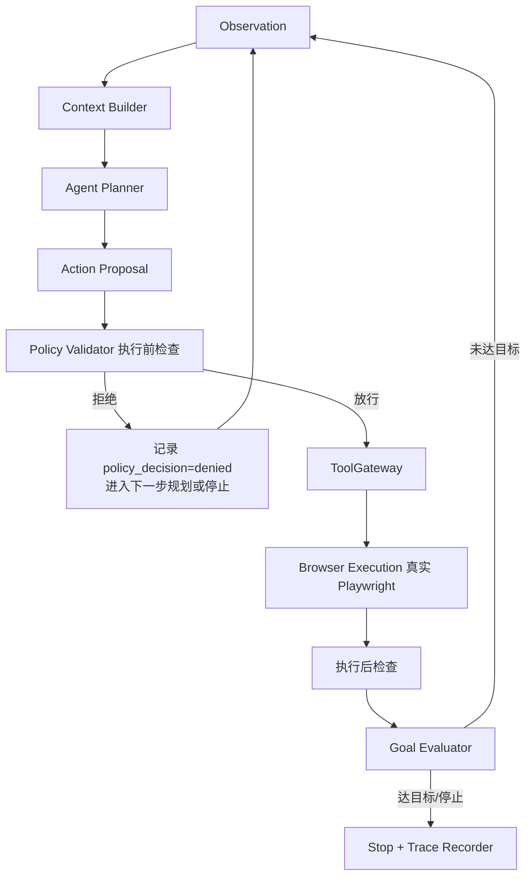
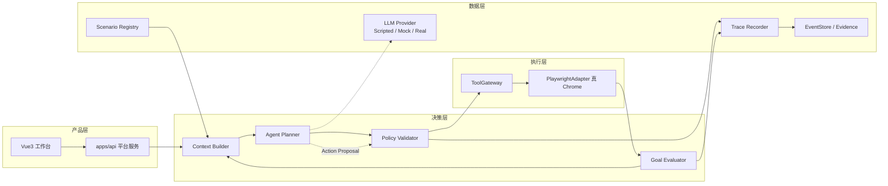
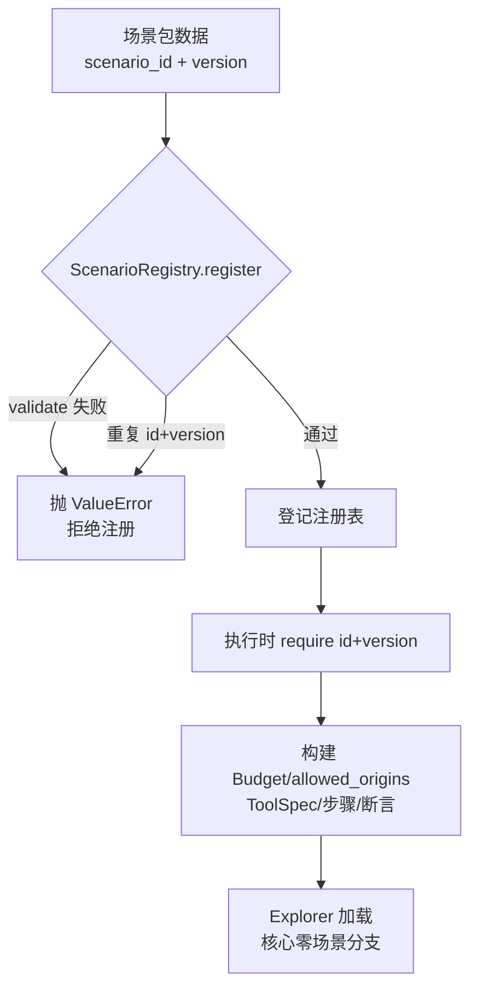
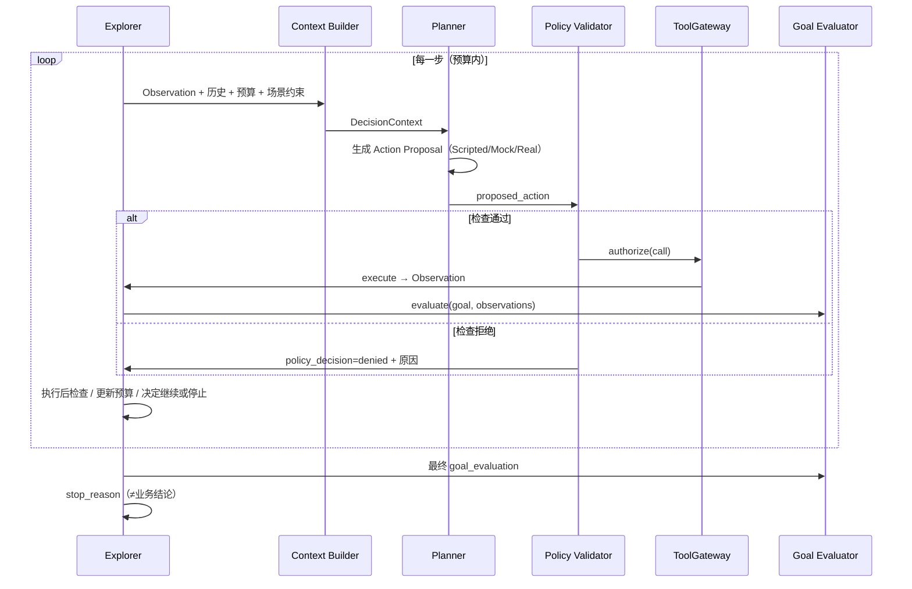
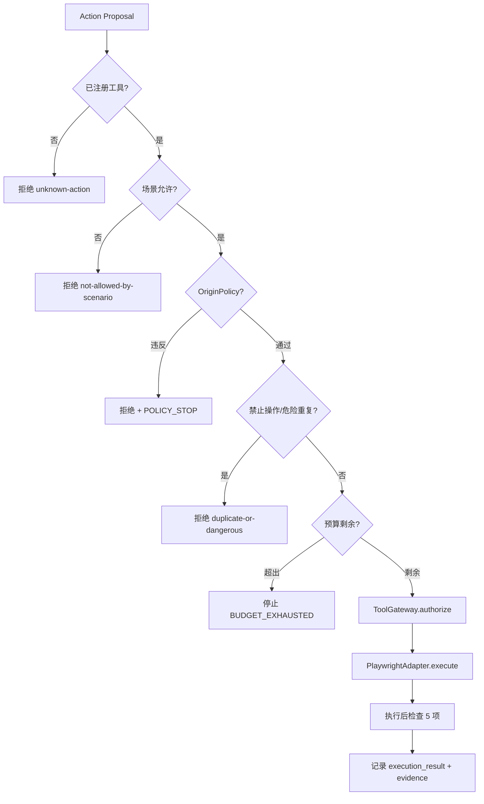
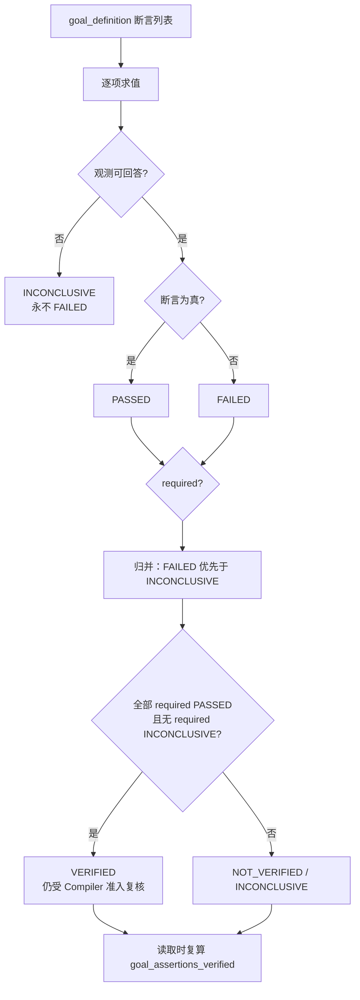
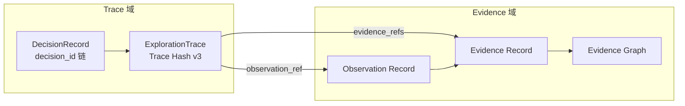
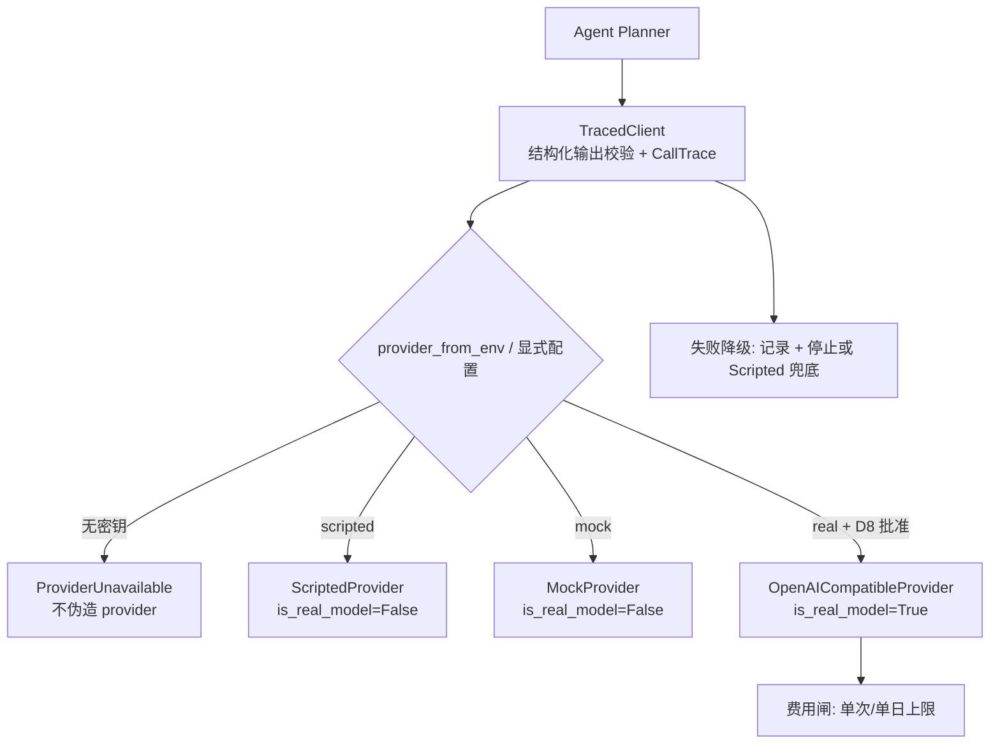

# R5-5.3 总体设计与实施规格

> 阶段名称：**Agent 决策与场景能力升级**
> 分支：`r5-5-product-completion`；基线 HEAD `6a21f47`（R5-5.1-R 最终验收收口提交）。
> 任务性质：**架构设计与开发准入**，不是功能开发。本轮不写业务代码、不启用真实模型、不解除 D8。
> 配套文档：`R5-5.3-接口与数据契约台账.md`（接口台账）、`R5-5.3-D8-真实LLM接入审批准备.md`（审批材料）、
> `R5-5.3-开发任务与验收矩阵.md`（M0～M5 任务与验收门槛）。
> 状态：**设计稿，等待源码及架构评审。未获评审结论前不进入 M1～M5 正式开发。**

---

## 0. 任务定位与设计边界

### 0.1 核心目标

将当前以 ScriptedProvider 为主的探索体系，升级为能够在严格约束下**理解目标、分析页面状态、
选择操作、执行操作、观察结果并动态调整决策**的 Agentic Testing 系统。

本轮只回答"怎么建、怎么验、怎么不越界"，不回答"现在就建"。

### 0.2 五个核心问题与设计响应

| # | 核心问题 | 设计响应 | 详见 |
|---|---|---|---|
| Q1 | 场景如何真正做到可扩展和可复用？ | Scenario Package v2：版本化场景包 + 数据生命周期 + Explorer 核心零场景分支 | §2 |
| Q2 | Agent 如何根据观察结果自主决定下一步？ | 决策闭环：Context Builder → Planner → Action Proposal → Policy → Gateway → Goal Evaluator | §4 |
| Q3 | 如何验证 Agent 是否真的完成业务目标？ | Goal Assertion v2：结构化 DOM Observation + 元素级断言 + 多步骤目标 + 证据完整性校验 | §3 |
| Q4 | 如何防止越权、重复、危险操作？ | 执行前 Policy Validation 六项检查 + 执行后五项检查 + 预算闸 + OriginPolicy 不变 | §4.3/§4.4 |
| Q5 | 如何让探索过程可追溯、可复验、可评估？ | 完整 Trace 结构（决策链关联、Trace Hash v3、Scripted 可重放 / Real 可复核不假装可复现） | §6 |

### 0.3 严格边界（本轮全程有效）

1. 不修改 `main`；不合并分支；不 force push。
2. 不删除正式数据（`data/`）。
3. **不修改 C05 冻结契约**（`packages/contracts/schemas/C05_Event.schema.json` 零改动）。
4. **不解除 D8**：Explorer `llm` 策略保持 409 BLOCKED，真实模型调用保持关闭。
5. 不启用真实模型；不擅自开放外部网站（OriginPolicy 仅放行本地已批准 origin）。
6. 不改变 Candidate 人工审批门禁（`review_confirmed` + `uncertainty_acknowledged` 服务端强制）。
7. 不启动完整 Repair 自动执行；不做全面前端重设计。
8. 不重复实现现有模块（优先复用，见 §7.2 复用矩阵）。
9. 不为通过测试而降低断言或修改安全边界。
10. 本轮交付 = 文档设计成果 + 任务矩阵；评审通过后才进入开发。

---

## 1. 现状基线（设计输入）

以 `README.md`「阶段状态冻结」表为准（2026-11-25 核查源码与验收证据后填写，此处摘录设计相关行）：

| 模块 | 已完成（设计可依赖） | 未完成（本阶段要补） | 限制 |
|---|---|---|---|
| Explorer | 目标驱动、ToolGateway、Trace Hash v2、Compiler 硬准入、场景注册表驱动 | 自主 LLM 决策 | 决策来自 ScriptedProvider |
| Scenario | 注册/查重/校验、4 场景真实浏览器验证 | project-edit、form-validation；四类用例矩阵 | 2 场景 `implemented=False` |
| Goal Assertion | 10 类结构化断言、组合、逐项证据、读取时复算 | 表格行数/列表计数/元素属性/多元素关系/状态转换 | `text_excerpt` 3000 截断 |
| Trace | Trace Hash v2、prompt_version 进哈希、脱敏 | 决策闭环全字段、token/费用 | v1 历史不可检 intent 篡改 |

设计前提（不可推翻的既有语义）：

- **StopReason 与 GoalStatus 分离**：`PLAN_EXHAUSTED` 说明脚本走完，不说明业务目标达成；
  只有 Goal Evaluator 能给 `GOAL_VERIFIED`。**不存在 `GOAL_REACHED` 这个值，本设计也不引入。**
- `INCONCLUSIVE` 永不冒充 `FAILED`；观测不可用 ≠ 断言失败。
- 断言只收紧 Compiler 准入（VERIFIED 也可被收紧为 NOT_VERIFIED/INCONCLUSIVE），不放宽。
- Agent 不能自行声明 VERIFIED；所有结论必须能回溯到证据路径。

---

## 2. R5-5.3-A：场景体系升级（Scenario Package v2）

### 2.1 设计原则

现有 `packages/agents/scenarios.py` 已确立正确原则——**场景业务逻辑不进 Explorer 核心**，
"The core loads and validates a scenario; it never branches on a scenario id"。
v2 不推翻它，只把场景从"模块内数据常量"升级为"可版本化、可复用、带数据生命周期的场景包"。

### 2.2 场景包结构（16 项要求 → 字段映射）

一个 Scenario Package 是一份自包含的声明式数据，加载即校验：

| # | 要求 | v2 字段 | 现状 | v2 变化 |
|---|---|---|---|---|
| 1 | 场景基本信息 | `scenario_id` / `name` / `description` | ✅ 有 | 增加 `version`（SemVer）与 `package_id` |
| 2 | TestIntent 模板 | `intent_templates` | ✅ 有 | 不自动注入（保持 R5-5.2 决策） |
| 3 | 被测应用及允许 Origin | `allowed_origins` | ✅ 有 | 不变；仍由 Budget 用真实 origin 覆盖 |
| 4 | 初始页面 | `initial_url` | ✅ 有 | 不变 |
| 5 | 前置条件 | `preconditions`（新增） | 🆕 | 声明式前置检查（已登录/存在种子数据等） |
| 6 | 测试数据准备 | `data_setup`（新增） | 🆕 | 种子/清理句柄，见 §2.4 |
| 7 | 允许执行的 Action | `allowed_actions` | ✅ 有 | 仍是 KNOWN_ACTIONS 的子集，必须含 navigate/snapshot |
| 8 | 禁止执行的 Action | `denied_actions`（新增） | 🆕 | 显式黑名单，Policy Validation 强制 |
| 9 | 预算和时间限制 | `timeout_budget_s` / `max_steps` | ✅ 有 | 增加 `max_tool_calls` / `max_cost_usd`（真实模型阶段用） |
| 10 | 目标断言 | `goal_definition` | ✅ 有 | 扩展新 kind（§3） |
| 11 | 证据要求 | `evidence_requirements` | ✅ 有 | 增加证据完整性校验（§3.4） |
| 12 | 清理策略 | `cleanup`（新增） | 🆕 | 见 §2.4 |
| 13 | 正常路径 | `paths.normal`（新增分组） | 部分 | 现 `steps` 归入正常路径 |
| 14 | 异常路径 | `paths.exception`（新增） | 🆕 | 错误密码/重复提交/服务端拒绝等 |
| 15 | 边界路径 | `paths.boundary`（新增） | 🆕 | 名称超长 200 字符等 |
| 16 | 恢复路径 | `paths.recovery`（新增） | 🆕 | 网络中断后恢复等 |

版本与 ID：

- `package_id` = `scenario_id`（slug 规则沿用 `^[a-z0-9][a-z0-9-]{1,47}$`）。
- `version`：SemVer（如 `1.0.0`）。**同一 `scenario_id` 允许多版本并存于注册表**，
  由 `(scenario_id, version)` 唯一索引；执行时锁定具体版本并写入 Trace（`scenario_version`）。
- 不兼容变更升 major，仅新增可选字段升 minor，文档/描述修订升 patch。
- 旧版场景记录的历史 Trace 仍按其记录的 `scenario_version` 解释，不要求重放。

### 2.3 加载与校验（延续 ScenarioRegistry 语义）

`ScenarioRegistry.register()` 保持：校验失败报错、重复注册报错（不静默覆盖）。
`validate()` 在 v2 增补：

- `version` 合法 SemVer；`(scenario_id, version)` 重复 → 拒绝；
- `denied_actions ∩ allowed_actions = ∅`；`denied_actions ⊆ KNOWN_ACTIONS`；
- `paths.*` 每条路径的步骤工具 ⊆ `allowed_actions` 且 ∉ `denied_actions`；
- `data_setup`/`cleanup` 声明的句柄必须在测试数据生命周期注册表中存在；
- `implemented=True` 时至少 `paths.normal` 非空。

### 2.4 两个未实现场景的解法（先明确 SUT 改造范围）

**原则：不为了让测试通过而伪造业务页面。** 场景能力必须由被测应用真实提供。

#### project-edit（项目编辑）

- **SUT 最小改造范围**（`apps/teamflow`，被测应用）：
  1. `GET /projects/{id}/edit`（或详情页内嵌编辑表单）——名称/描述可编辑；
  2. `POST /projects/{id}/update` ——保存并回详情页；
  3. 保存成功提示带 `data-testid=edit-success`；失败带 `data-testid=form-error`。
  不引入权限体系、不引入富文本，只做"最小编辑能力"。
- **场景包**：正常路径（打开→改名→保存→详情显示新名）；异常路径（清空名称→校验错误）；
  边界路径（名称 200 字符）；恢复路径（保存失败后重试成功）。
- **验收前提**：SUT 改造先行（属 M1 输入，不属于 Explorer 改动）。

#### form-validation（表单验证）

- **阻塞根因**：需要可重复的"已存在名称"种子，而探索流程不重置 SUT 数据。
- **解法：场景级数据生命周期**（`data_setup` / `cleanup`）：
  1. `data_setup`：运行前创建固定种子项目（如 `种子项目-form-validation`），返回句柄；
  2. 场景用该固定名称提交创建 → 服务端 409/校验错误 → `form-error` 可见；
  3. `cleanup`：运行后删除种子项目，无论成败（finally 语义）。
- 种子创建/删除走 **TeamFlow 已有 API**（项目创建/删除），不新增 SUT 能力；
  若删除接口缺失，则 `cleanup` 记 `BLOCKED` 并在下轮登记，不静默遗留数据。
- 数据生命周期执行器独立于 Explorer（挂在探索任务的 setup/teardown 钩子），保证可重复运行。

### 2.5 可复用性约束

- 同一 Explorer 核心加载不同场景：**禁止在 `explorer.py` / `exploration.py` / `explorer_api.py`
  增加任何 `if scenario_id == ...` 分支**。场景差异只能通过数据（步骤、断言、约束）表达。
- `{base_url}` / `{username}` / `{password}` / `{unique_suffix}` 等占位符替换逻辑保持在
  `explorer_api._substitute` 一处实现。
- 四类用例矩阵（正常/异常/边界/恢复）成为场景包的一等公民；每个 `implemented=True` 场景
  的四类路径在 M5 综合验收前必须齐备或显式登记缺口。

---

## 3. R5-5.3-B：Goal Assertion 升级

### 3.1 现状与问题

已支持 10 类断言（url_exact / url_regex / testid / element_exists / element_visible /
element_text / form_state / page_state / all_of / any_of / not）。
主要短板（L7 及衍生）：

- `evaluate_goal` 的文本比对基于 `text_excerpt`（**3000 字符截断**）——超长页面靠后的内容观察不到；
- `element_text` 基于有界标签（≤60 字），不是完整 innerText；
- 无法表达数量、属性、元素关系、状态转换、多步骤目标。

### 3.2 根本解法：结构化 DOM Observation（不是扩大截断）

**禁止用"把 3000 改成 30000"的方式解决 L7。** 截断字符串永远追不上页面结构化需求。

设计 `Observation v2`（在现有 `Observation` 上增量扩展，不改 C05）：

```jsonc
{
  "url": "...", "url_path": "...", "title": "...",
  "visible_testids": ["..."],
  "visible_elements": [ { "tag": "...", "testid": "...", "name": "...",
                          "visible": true, "disabled": false,
                          "attrs": {"role": "...", "aria-label": "..."} } ],
  "dom_counts": {                    // 结构化计数，不是文本
    "selector:project-item": 5,      // 由场景断言声明需要计数的 selector
    "selector:nav a": 7
  },
  "dom_relations": [                 // 由断言求值器按需采集
    { "kind": "sibling_of", "left": "project-title", "right": "project-status" }
  ],
  "text_excerpt": "..."              // 保留，仅作辅助证据，不再作为唯一判定源
}
```

采集原则：

- **按需采集**：只有断言声明需要的 selector 才进 `dom_counts`，避免观测膨胀；
- **不采集输入值**（延续红线：密码不是 observation）；
- 元素级断言优先读结构化字段；`text_excerpt` 降级为辅助证据。

### 3.3 新断言类型（10 项设计）

| # | kind | 语义 | 证据来源 | 备注 |
|---|---|---|---|---|
| 1 | `table_row_count` | 指定 selector 的匹配数 = / ≥ / ≤ N | `dom_counts` | 空列表 → 计数 0（可观测），不 INCONCLUSIVE |
| 2 | `list_item_count` | 同上，语义别名 | `dom_counts` | |
| 3 | `element_attr` | 元素某属性 = / 包含 / 正则 | `visible_elements[].attrs` | 仅白名单属性（role/aria-*/href 路径/data-*），不读 value |
| 4 | `element_relation` | 两元素兄弟/祖先/前后序关系 | `dom_relations` | relation 不可观测 → INCONCLUSIVE |
| 5 | `page_transition` | 前一观测 → 当前观测的 URL/标题变化 | `observations[-2]` + `[-1]` | 首步无前观测 → INCONCLUSIVE |
| 6 | `url_and_content` | URL 匹配 **且** 内容断言（组合宏） | 复合 | 展开为 all_of，保持逐项证据 |
| 7 | `multi_step_goal` | 有序子目标序列，每步一个断言组 | 分步观测 | 中间步失败即整体失败；中间步不可观测 → INCONCLUSIVE |
| 8 | `final_state` / `intermediate_state` | `stage: final\|intermediate` 标记 | 同目标断言 | intermediate 失败只记录不否决（对齐 optional 语义） |
| 9 | `dynamic_match` | 期望值引用运行时绑定（如 `{unique_suffix}` 项目名） | 绑定表 | 绑定缺失 → INCONCLUSIVE，不猜值 |
| 10 | `evidence_complete` | 断言自身证据完整性（evidence 路径存在且指向本次 observation） | Trace 自省 | 证据缺失 → INCONCLUSIVE |

### 3.4 语义保持（一票否决式约束）

以下规则在 v2 **原样保留**，新增类型必须遵守同一语义：

1. `INCONCLUSIVE` 不冒充 `FAILED`：观测不可用 → INCONCLUSIVE；
2. 断言只能收紧 Compiler 准入：即使 goal 评估 VERIFIED，断言失败仍收紧为 NOT_VERIFIED/INCONCLUSIVE；
3. Agent 不能自行声明 VERIFIED；
4. 每个结论可回溯证据路径（`evidence` 字段必填）；
5. 只有可选断言的 goal → INCONCLUSIVE（"通过"证明不了任何事）；
6. 必需断言失败 > 不可观测（FAILED 优先于 INCONCLUSIVE 归并）；
7. 读取时重新计算并比对（`goal_assertions_verified`），派生结果不当原始事实。

### 3.5 多步骤目标与中间状态

`multi_step_goal` 把"业务目标"表达为有序检查点：

```jsonc
{ "kind": "multi_step_goal", "name": "login_then_create",
  "steps": [
    { "stage": "intermediate", "assertions": [ {"kind": "url_exact", "value": "/projects"} ] },
    { "stage": "final",        "assertions": [ {"kind": "testid", "value": "success-message"} ] }
  ] }
```

- final 阶段全部 required 断言 PASSED 才 `VERIFIED`；
- intermediate 失败 → 记录并在 `goal_evaluation` 标注断点，整体不 VERIFIED；
- 与既有 `GoalCheck` / `AssertionReport` 结构兼容（新 kind 的结果仍走 `AssertionResult`）。

---

## 4. R5-5.3-C：Agent 决策引擎（本阶段最重要的架构任务）

### 4.1 决策闭环

现状链路：`Observation → LLMPolicy → ScriptedProvider → ToolGateway`。
目标闭环（真实 Agent，M4 后启用；M3 先用 Scripted/Mock 验证闭环本身）：



**红线：模型不能直接调用浏览器，也不能绕过 ToolGateway。**
所有动作必须以 Action Proposal 形式进入 Policy Validator → ToolGateway 单通道。

### 4.2 Agent 输入 / 输出

**输入（Context Builder 组装，进入 Planner）：**

| 输入 | 来源 | 说明 |
|---|---|---|
| TestIntent | C01 | goal / target / expected_outcomes / constraints |
| 当前页面 Observation | PlaywrightAdapter.observe | 结构化 DOM 观测（§3.2） |
| 历史 Action | ExplorationTrace | 已执行动作（脱敏后） |
| 历史结果 | ExplorationTrace | 每步 execution_result 摘要 |
| 剩余预算 | Budget | 步数 / 时长 / 工具调用 /（M4 起）费用 |
| 当前目标状态 | GoalEvaluator | 最近一次 goal_evaluation |
| Scenario 约束 | Scenario Package | allowed/denied_actions、constraints、paths |

**输出（结构化 Action Proposal，schema 强校验）：**

```jsonc
{
  "decision_id": "dec_<uuid>",
  "action": "click",                    // ∈ allowed_actions
  "arguments": { "selector": "[data-testid=create-submit]" },
  "rationale": "提交创建表单以完成项目创建目标",
  "expected_effect": { "url_path": "/projects", "testid": "success-message" },
  "confidence": 0.82,                   // 0~1，仅作审计，不作放行依据
  "prompt_version": "planner-v1",       // 真实模型阶段必填
  "model_version": "..."                // 真实模型阶段必填；Scripted 为 NOT-REAL 标记
}
```

- Structured Output（JSON Schema）校验不通过 → `StructuredOutputError`，**不产生决策**、不伪造动作；
- 模型失败 → 降级路径见 §5.4，禁止"失败了就随便挑个动作"。

### 4.3 执行前检查（Policy Validator，六项全过才放行）

| # | 检查 | 失败处理 |
|---|---|---|
| 1 | Action 是否注册（∈ KNOWN_ACTIONS） | 拒绝，记 `unknown-action` |
| 2 | 是否属于场景允许范围（∈ allowed_actions 且 ∉ denied_actions） | 拒绝，记 `not-allowed-by-scenario` |
| 3 | URL 是否符合 OriginPolicy（scheme+host+port 精确比对） | 拒绝，记 `origin-denied`，**升级为 POLICY_STOP** |
| 4 | 是否触及禁止操作（denied_actions / constraints 中的硬规则） | 拒绝，记 `denied-action` |
| 5 | 是否超出预算（步数 / 时长 / 工具调用 / 费用） | 停止，记 `BUDGET_EXHAUSTED` |
| 6 | 是否重复或危险操作（同参数连续重复 / 短时间高频写操作） | 拒绝，记 `duplicate-or-dangerous`；连续 2 次 → POLICY_STOP |

预算闸沿用 `Budget` / `ToolGateway.authorize` 既有实现，只新增费用维度（M4）。

### 4.4 执行后检查（五项）

1. 操作是否成功（HTTP/工具返回）；
2. 页面是否发生预期变化（`expected_effect` 与新 Observation 比对，宽松匹配：只查声明的字段）；
3. 是否产生新的异常（console error / 5xx / 崩溃）；
4. 是否需要重新规划（预期不符且非目标达成 → 回 Planner，带 mismatch 信息）；
5. 是否达到目标 / 是否需要停止（Goal Evaluator + 停止策略）。

### 4.5 停止策略

**先分域再定值：`StopReason`（循环为何停）与 `GoalStatus`（业务目标结论）是两个域，不合并。**
R5-5.3 的目标词表按域映射到既有枚举，**不引入 `GOAL_REACHED`**：

| 目标词表（规格用语） | 域 | 映射到现有值 | 说明 |
|---|---|---|---|
| GOAL_VERIFIED | StopReason | `GOAL_VERIFIED`（已有） | 仅当 Goal Evaluator 判定 VERIFIED 才允许 |
| NOT_VERIFIED | GoalStatus | `NOT_VERIFIED`（已有） | 业务结论，不是停止原因 |
| INCONCLUSIVE | GoalStatus | `INCONCLUSIVE`（已有） | 观测不足，不冒充失败 |
| POLICY_STOP | StopReason | `POLICY_STOP`（已有） | 越界/危险操作触发 |
| PLAN_EXHAUSTED | StopReason | `PLAN_EXHAUSTED`（已有） | 计划走完 ≠ 目标完成 |
| BUDGET_EXHAUSTED | StopReason | `STEP_BUDGET` / `TIME_BUDGET` / `TOOL_CALL_BUDGET`（已有） | 沿用细分值，语义层聚合为 BUDGET_EXHAUSTED |
| EXECUTION_FAILED | StopReason | `ERROR`（已有） | 执行层失败 |

- 兼容性：现有 7 个 StopReason 值**全部保留**；新词表是语义聚合层，不是替换。
- ExplorationTrace / C04 中记录仍用现有值字符串，避免契约涟漪；语义聚合仅用于报告与设计叙述。
- **不允许把脚本执行完等同于目标完成**：`PLAN_EXHAUSTED` 后仍必须跑 Goal Evaluator。

---

## 5. R5-5.3-D：真实 LLM 安全接入准备（详见 D8 文档）

本轮只做设计与验证准备，**不发起任何真实模型请求**。

### 5.1 三模式不可混淆

| 模式 | 实现 | `is_real_model` | 用途 | 标记 |
|---|---|---|---|---|
| ScriptedProvider | `llm.py`（已有） | False | 测试/开发确定性重放 | `provider="scripted"` / `NOT-REAL-INFERENCE` |
| MockProvider | 🆕 `llm.py` 新增 | False | 闭环验证用的确定性假模型（按观测返回预设结构化输出），区别于脚本回放 | `provider="mock"` / `NOT-REAL-INFERENCE` |
| RealProvider | `OpenAICompatibleProvider`（已有） | True | 真实推理（D8 批准后） | `provider="deepseek"` / `may_contain_real_inference=True` |

三者共用 `LLMProvider` Protocol 与 `TracedClient`，但 **agent_version / trace 标记严格区分**，
UI 与报告必须展示来源，Scripted/Mock 结果永不标注为真实推理。

### 5.2 真实 LLM 不得负责（禁止清单）

- 决定最终业务 verdict（GOAL_VERIFIED 只能来自 Goal Evaluator 的断言求值）；
- 绕过安全策略（OriginPolicy / denied_actions / 预算）；
- 自主审批 Candidate（人工门禁不动）；
- 修改 GT；
- 自动批准 Repair；
- 直接执行未经授权的危险动作。

### 5.3 本轮保持不动

- **llm 策略 409 BLOCKED 不解除**；
- `DEEPSEEK_API_KEY` 仅对 `scripts/verify_llm_provider.py` 连通性探测有意义；
- D8 审批材料独立成文（`R5-5.3-D8-真实LLM接入审批准备.md`），等待审批。

### 5.4 失败降级（先设计后实现）

模型调用失败（超时 / 结构化输出不合法 / HTTP 5xx）→ **不伪造决策**：

1. 记录失败事件（含 call trace、错误类别）；
2. 降级为 ScriptedProvider 兜底（若场景声明允许降级）或直接停止（`ERROR` / `EXECUTION_FAILED`）；
3. 降级发生的探索，其 trace 标注 `degraded_from=real`，报告不得当作真实推理结果统计。

---

## 6. R5-5.3-E：完整 Trace 设计

### 6.1 Trace 结构（决策链全字段）

在 ExplorationTrace / 决策记录上扩展（**增量可选字段**，不改 C05）：

| 字段 | 说明 | 现状 | v2 |
|---|---|---|---|
| `exploration_id` | 探索实例 | ✅ | 不变 |
| `test_intent` | C01 引用 | ✅ | 不变 |
| `scenario_id` / `scenario_version` | 场景包版本 | 部分 | 必填 |
| `agent_version` | 策略版本（含 NOT-REAL 标记） | ✅ | 不变 |
| `model_version` / `prompt_version` | 模型与提示词版本 | prompt ✅ | model 必填（真实阶段） |
| `observation_ref` | 观测证据引用 | ✅ | 不变 |
| `decision_id` | 决策唯一 ID | 🆕 | Action Proposal 携带 |
| `proposed_action` | 完整 Action Proposal | 🆕 | 含 rationale/expected_effect/confidence |
| `policy_decision` | 执行前检查结果（放行/拒绝+原因） | 部分 | 结构化 |
| `execution_result` | 执行后检查结果 | ✅ | 增补 mismatch/异常摘要 |
| `goal_evaluation` | Goal Evaluator 结论 | ✅ | 不变 |
| `evidence_refs` | 证据引用列表 | ✅ | 不变 |
| `token_usage` / `cost` | 模型用量与费用 | token 部分 | M4 起记账 |
| `stop_reason` | 停止原因（现有枚举） | ✅ | 不变 |

### 6.2 八项保证

1. **决策前后关联完整**：`decision_id` 串起 observation_ref → proposed_action → policy_decision
   → execution_result → goal_evaluation，单链可回放；
2. **观察与执行结果可核对**：每步 execution_result 引用执行后 observation 的 evidence 路径；
3. **Trace Hash 覆盖关键决策**：引入 **Trace Hash v3**（覆盖 proposed_action / policy_decision /
   decision_id）；v2 / v1 历史记录仍按各自版本校验，**不做迁移改写**；
4. **历史版本兼容**：读取旧 trace 按其 `trace_hash_version` 校验；新字段缺失视为"当时没有"，不判篡改；
5. **模型失败不产生伪造决策**：失败即空决策 + 失败事件（§5.4），trace 中留失败记录而非假动作；
6. **敏感内容不进入 Trace**：延续 `redact_actions` / `sanitize_action`；输入值从不采集；
   prompt 只存 sha256 与字符数（`CallTrace` 既有设计）；
7. **Scripted 决策可重放**：scripted/mock 输入确定 → 输出确定，允许字面重放并校验一致；
8. **Real LLM 决策可复核、不假装可复现**：提供"复核视图"（决策 + 当时上下文 + 模型/提示词版本），
   允许人工审计与重新推理对照，但**不承诺字面重放能复现模型随机输出**（temperature>0 时尤其）。

---

## 7. R5-5.3-F：架构与接口

### 7.1 架构图

#### 7.1.1 系统总体架构



#### 7.1.2 Scenario 加载流程



#### 7.1.3 Agent 决策流程



#### 7.1.4 Action 安全执行流程



#### 7.1.5 Goal Assertion 流程



#### 7.1.6 Trace 与 Evidence 关系



#### 7.1.7 LLM Provider 接入关系



### 7.2 复用矩阵（优先复用，不重复建设）

| 能力 | 复用现有 | 新增 |
|---|---|---|
| 动作授权/预算/URL 校验 | `ToolGateway` / `Budget` | 费用维度（M4） |
| 浏览器执行/观测 | `PlaywrightAdapter` | 结构化 DOM 观测采集 |
| 目标评估骨架 | `evaluate_goal` / `goal_assertions` | 新 kind + Observation v2 |
| 场景注册 | `ScenarioRegistry` | 版本化 + 数据生命周期 |
| 追溯/脱敏 | `ExplorationTrace` / `sanitize_action` / `redact_actions` | decision_id 链 + Hash v3 |
| 模型调用/结构化输出 | `LLMProvider` / `TracedClient` | MockProvider + 费用闸 |
| 契约 | C01 TestIntent / C04 Execution / C06 Evidence | 不改 C05；新结构走可选扩展字段 |

### 7.3 接口清单

8 个接口的输入/输出/依赖/权限/错误处理/测试要求/版本兼容性，
逐项台账见 **`R5-5.3-接口与数据契约台账.md`**（ScenarioRegistry / ContextBuilder / AgentPlanner /
PolicyValidator / ToolGateway / GoalEvaluator / TraceRecorder / LLMProvider）。

---

## 8. 开发阶段划分（M0～M5 概要）

详细输入/输出/依赖/交付物/验收门槛见 `R5-5.3-开发任务与验收矩阵.md`。

| 阶段 | 名称 | 一句话范围 | 前置 |
|---|---|---|---|
| M0 | 架构和需求冻结 | 本设计 + 数据契约 + 接口台账 + 风险 + 准入条件，**评审通过才开工** | 本文档 |
| M1 | 场景基础设施 | Scenario Package v2、测试数据生命周期、版本管理、project-edit SUT 最小改造、form-validation 种子 | M0 评审 |
| M2 | 目标评估增强 | Observation v2、10 类新断言、多步骤目标、证据完整性 | M1（场景包承载新断言） |
| M3 | Agent 决策抽象升级 | Context Builder、统一 Planner、Action Proposal、决策记录；**用 Scripted/Mock 验证闭环** | M2 |
| M4 | 真实 LLM 接入 | **仅 D8 正式批准后执行**：隔离试运行 → 逐步扩大；费用闸/脱敏/降级 | M3 + D8 批准 |
| M5 | 综合验收 | 真实浏览器、多场景、异常/边界/恢复路径、安全边界、模型失败、完整 Trace | M4（或 M3 后的受限验收） |

> 注：M4 若 D8 未获批，M5 中"真实模型"相关项记 BLOCKED，其余验收照常执行——不因 D8 阻塞整个阶段。

---

## 9. 风险清单（设计期识别）

| # | 风险 | 影响 | 缓解 | 阶段 |
|---|---|---|---|---|
| R1 | 结构化观测膨胀（dom_counts/relations 失控） | 观测延迟上升、trace 体积失控 | 按断言按需采集；观测体积上限；采样计数入长稳 | M2 |
| R2 | 新断言语义漏洞（把不可观测判成 FAILED） | 误判业务结论 | 语义保持 7 条作为验收铁律；INCONCLUSIVE 参数化测试先行 | M2 |
| R3 | Planner 绕过 Policy（直连工具） | 越权操作 | 单通道架构（唯一入口 ToolGateway）；接口层物理隔离 | M3 |
| R4 | Action Proposal schema 松动导致注入 | 危险动作混入 | JSON Schema 严格校验 + unknown 字段拒绝；denied_actions 白名单 | M3 |
| R5 | 费用失控（真实模型） | 成本风险 | 单次/单日上限 + 硬停；token 记账入 trace | M4 |
| R6 | 模型输出伪造成功（幻觉 claim） | 假 VERIFIED | 模型永不裁决 verdict；断言求值独立于模型输出 | M3/M4 |
| R7 | Trace Hash v3 与历史版本兼容被破坏 | 历史轨迹不可验 | 三版本并存校验；不迁移改写旧记录 | M3 |
| R8 | SUT 改造（project-edit）引入新故障面 | 被测应用不稳定影响场景验收 | 最小改造 + SUT 自身回归测试先行 | M1 |
| R9 | 种子数据清理失败污染环境 | form-validation 不可重复 | cleanup finally 语义 + 失败显式登记不静默 | M1 |
| R10 | 三模式混淆（Mock 被当真实推理） | 报告失真 | is_real_model 硬标记 + UI 强展示 + 验收断言 | M3/M4 |

---

## 10. 需求与阶段映射（总览）

| 需求域 | 对应核心问题 | 阶段 | 验收文档 |
|---|---|---|---|
| 场景可扩展可复用（Q1） | 五个核心问题 #1 | M1 | 验收矩阵 §M1 |
| Agent 自主决策（Q2） | #2 | M3（M4 真实化） | 验收矩阵 §M3/M4 |
| 业务目标验证（Q3） | #3 | M2 | 验收矩阵 §M2 |
| 防越权/重复/危险（Q4） | #4 | M3 | 验收矩阵 §M3 |
| 可追溯可复验可评估（Q5） | #5 | M3（Hash v3）/M5 | 验收矩阵 §M5 |
| 真实 LLM 安全接入 | 边界问题 | M4（D8 门禁） | D8 文档 + 验收矩阵 §M4 |

---

## 11. 本轮交付清单

| 交付物 | 文件 |
|---|---|
| 总体设计与实施规格（本文） | `docs/r5/R5-5.3-总体设计与实施规格.md` |
| 接口与数据契约台账 | `docs/r5/R5-5.3-接口与数据契约台账.md` |
| D8 真实 LLM 接入审批准备 | `docs/r5/R5-5.3-D8-真实LLM接入审批准备.md` |
| 开发任务与验收矩阵 | `docs/r5/R5-5.3-开发任务与验收矩阵.md` |
| README 状态收口 | `README.md` |
| 文档索引更新 | `docs/00-DOCUMENTATION-INDEX.md` |
| R5 阶段清单更新 | `docs/r5/R5-4-最终遗留问题与R5-5开发清单.md`（附 R5-5.2 收口与 R5-5.3 指向） |
| R5-5.2 报告修订记录 | `docs/r5/R5-5.2-通用AgenticTesting实施报告.md` §8 |

**评审要求**：源码及架构评审（含安全边界、Trace 兼容、SUT 改造范围、D8 条件）通过后，
方可进入 M1～M5 正式开发。评审前任何"顺手实现"都视为越界。
