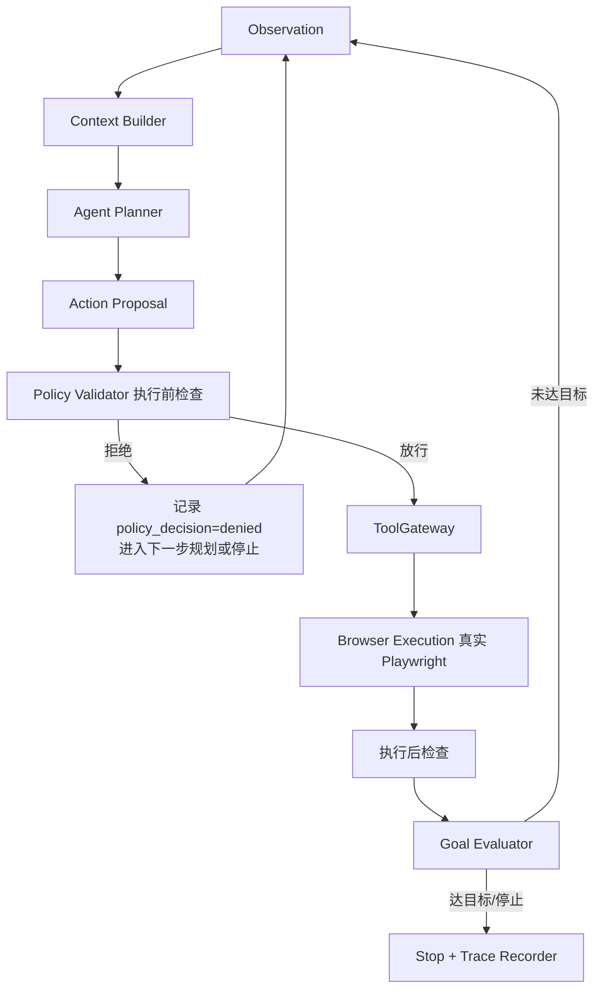
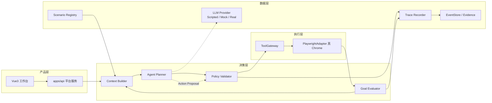
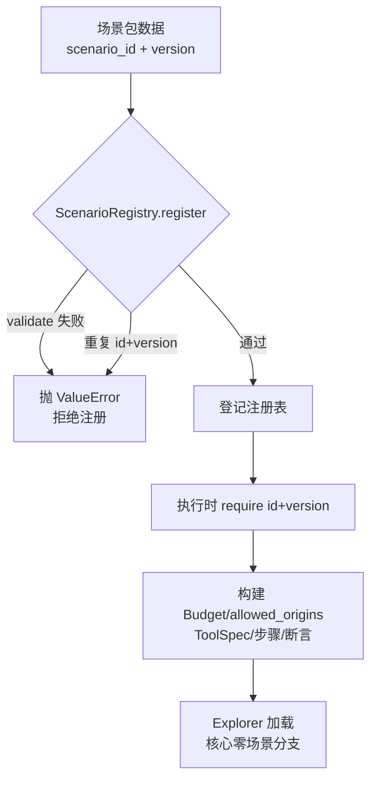
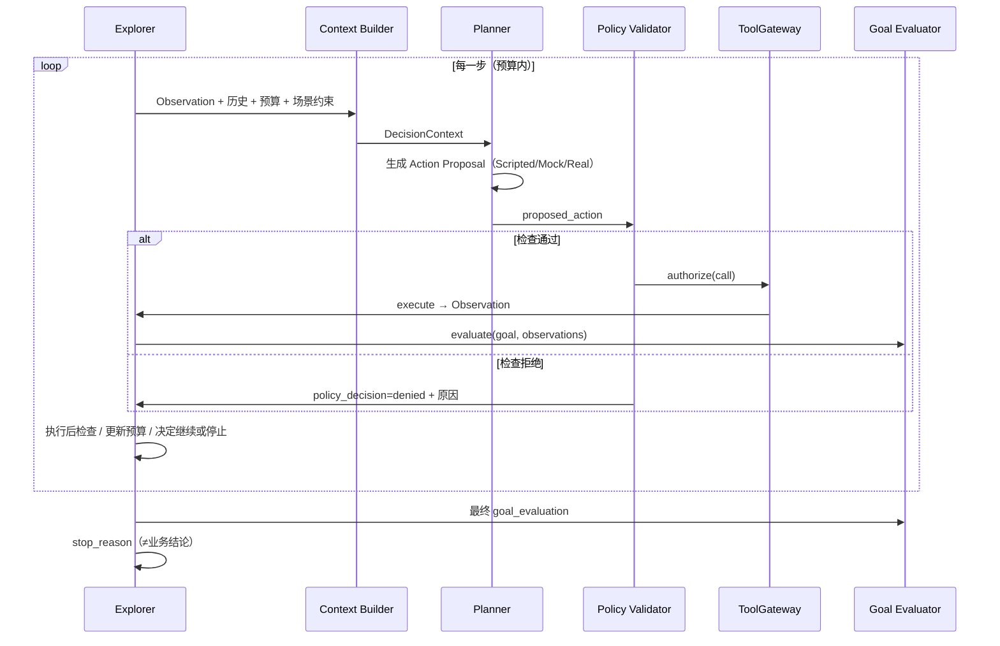
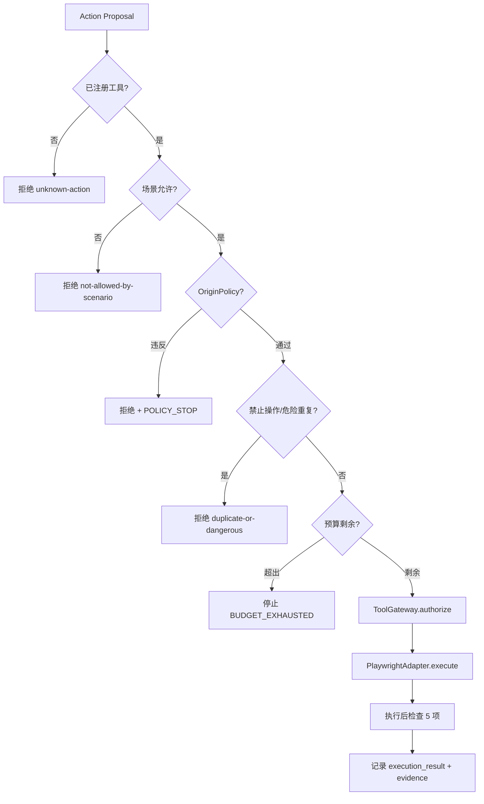
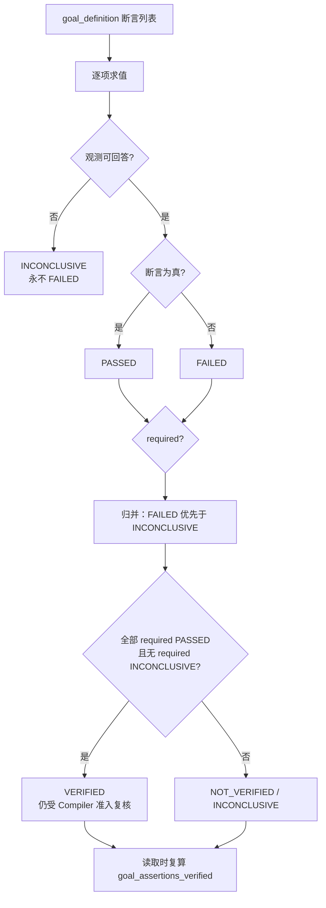
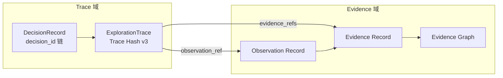
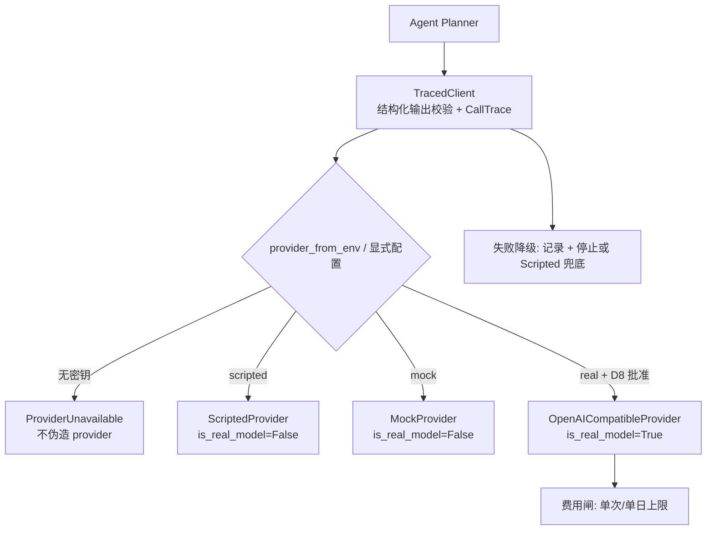

# R5-5.3 总体设计与实施规格

> 阶段名称：**Agent 决策与场景能力升级**
> 分支：`r5-5-product-completion`；基线 HEAD `6a21f47`（R5-5.1-R 最终验收收口提交）。
> 任务性质：**架构设计与开发准入**，不是功能开发。本轮不写业务代码、不启用真实模型、不解除 D8。
> 配套文档：`R5-5.3-接口与数据契约台账.md`（接口台账）、`R5-5.3-D8-真实LLM接入审批准备.md`（审批材料）、
> `R5-5.3-开发任务与验收矩阵.md`（M0～M5 任务与验收门槛）。
> 状态：**设计稿，DR2 + DR2.1 整改后等待 M0 独立架构评审。未获评审结论前不进入 M1～M5 正式开发。**
> DR2 整改记录见 `R5-5.3-DR2-第二轮设计一致性与安全准入整改记录.md`（DR2-01～DR2-12；
> DR2.1-01～DR2.1-09 收尾记录见同文件 §14）。

---

## 0. 任务定位与设计边界

### 0.1 核心目标

将当前以 ScriptedProvider 为主的探索体系，升级为能够在严格约束下**理解目标、分析页面状态、
选择操作、执行操作、观察结果并动态调整决策**的 Agentic Testing 系统。

本轮只回答"怎么建、怎么验、怎么不越界"，不回答"现在就建"。

### 0.2 五个核心问题与设计响应

| # | 核心问题 | 设计响应 | 详见 |
|---|---|---|---|
| Q1 | 场景如何真正做到可扩展和可复用？ | Scenario Package v2：版本化场景包 + 数据生命周期 + Explorer 核心零场景分支 | §2 |
| Q2 | Agent 如何根据观察结果自主决定下一步？ | 决策闭环：Context Builder → Planner → Action Proposal → Policy → Gateway → Goal Evaluator | §4 |
| Q3 | 如何验证 Agent 是否真的完成业务目标？ | Goal Assertion v2：结构化 DOM Observation + 元素级断言 + 多步骤目标 + 证据完整性校验 | §3 |
| Q4 | 如何防止越权、重复、危险操作？ | 执行前 Policy Validation 六项检查 + 执行后五项检查 + 预算闸 + OriginPolicy 不变 | §4.3/§4.4 |
| Q5 | 如何让探索过程可追溯、可复验、可评估？ | 完整 Trace 结构（决策链关联、Trace Hash v3、Scripted 可重放 / Real 可复核不假装可复现） | §6 |

### 0.3 严格边界（本轮全程有效）

1. 不修改 `main`；不合并分支；不 force push。
2. 不删除正式数据（`data/`）。
3. **不修改 C05 冻结契约**（`packages/contracts/schemas/C05_Event.schema.json` 零改动）。
4. **不解除 D8**：Explorer `llm` 策略保持 409 BLOCKED，真实模型调用保持关闭。
5. 不启用真实模型；不擅自开放外部网站（OriginPolicy 仅放行本地已批准 origin）。
6. 不改变 Candidate 人工审批门禁（`review_confirmed` + `uncertainty_acknowledged` 服务端强制）。
7. 不启动完整 Repair 自动执行；不做全面前端重设计。
8. 不重复实现现有模块（优先复用，见 §7.2 复用矩阵）。
9. 不为通过测试而降低断言或修改安全边界。
10. 本轮交付 = 文档设计成果 + 任务矩阵；评审通过后才进入开发。

---

## 1. 现状基线（设计输入）

以 `README.md`「阶段状态冻结」表为准（2026-11-25 核查源码与验收证据后填写，此处摘录设计相关行）：

| 模块 | 已完成（设计可依赖） | 未完成（本阶段要补） | 限制 |
|---|---|---|---|
| Explorer | 目标驱动、ToolGateway、Trace Hash v2、Compiler 硬准入、场景注册表驱动 | 自主 LLM 决策 | 决策来自 ScriptedProvider |
| Scenario | 注册/查重/校验、4 场景真实浏览器验证 | project-edit、form-validation；四类用例矩阵 | 2 场景 `implemented=False` |
| Goal Assertion | 11 类结构化断言（`SUPPORTED_KINDS`）、组合、逐项证据、读取时复算 | 表格行数/列表计数/元素属性/多元素关系/状态转换 | `text_excerpt` 3000 截断 |
| Trace | Trace Hash v2、prompt_version 进哈希、脱敏 | 决策闭环全字段、token/费用 | v1 历史不可检 intent 篡改 |

设计前提（不可推翻的既有语义）：

- **StopReason 与 GoalStatus 分离**：`PLAN_EXHAUSTED` 说明脚本走完，不说明业务目标达成；
  只有 Goal Evaluator 能给 `GOAL_VERIFIED`。**不存在 `GOAL_REACHED` 这个值，本设计也不引入。**
- `INCONCLUSIVE` 永不冒充 `FAILED`；观测不可用 ≠ 断言失败。
- 断言只收紧 Compiler 准入（VERIFIED 也可被收紧为 NOT_VERIFIED/INCONCLUSIVE），不放宽。
- Agent 不能自行声明 VERIFIED；所有结论必须能回溯到证据路径。

---

## 2. R5-5.3-A：场景体系升级（Scenario Package v2）

### 2.1 设计原则

现有 `packages/agents/scenarios.py` 已确立正确原则——**场景业务逻辑不进 Explorer 核心**，
"The core loads and validates a scenario; it never branches on a scenario id"。
v2 不推翻它，只把场景从"模块内数据常量"升级为"可版本化、可复用、带数据生命周期的场景包"。

### 2.2 场景包结构（16 项要求 → 字段映射）

一个 Scenario Package 是一份自包含的声明式数据，加载即校验：

| # | 要求 | v2 字段 | 现状 | v2 变化 |
|---|---|---|---|---|
| 1 | 场景基本信息 | `scenario_id` / `name` / `description` | ✅ 有 | 增加 `version`（SemVer）与 `package_id` |
| 2 | TestIntent 模板 | `intent_templates` | ✅ 有 | 不自动注入（保持 R5-5.2 决策） |
| 3 | 被测应用及允许 Origin | `allowed_origins` | ✅ 有 | 不变；仍由 Budget 用真实 origin 覆盖 |
| 4 | 初始页面 | `initial_url` | ✅ 有 | 不变 |
| 5 | 前置条件 | `preconditions`（新增） | 🆕 | 声明式前置检查（已登录/存在种子数据等） |
| 6 | 测试数据准备 | `data_setup`（新增） | 🆕 | 种子/清理句柄，见 §2.4 |
| 7 | 允许执行的 Action | `allowed_actions` | ✅ 有 | 仍是 KNOWN_ACTIONS 的子集，必须含 navigate/snapshot |
| 8 | 禁止执行的 Action | `denied_actions`（新增） | 🆕 | 显式黑名单，Policy Validation 强制 |
| 9 | 预算和时间限制 | `timeout_budget_s` / `max_steps` | ✅ 有 | 增加 `max_tool_calls` / `max_cost_usd`（真实模型阶段用） |
| 10 | 目标断言 | `goal_definition` | ✅ 有 | 扩展新 kind（§3） |
| 11 | 证据要求 | `evidence_requirements` | ✅ 有 | 增加证据完整性校验（§3.4） |
| 12 | 清理策略 | `cleanup`（新增） | 🆕 | 见 §2.4 |
| 13 | 正常路径 | `paths.normal`（新增分组） | 部分 | Path Specification（目标/前置/预期/允许操作/覆盖）；`scripted_fixture` 可选（DR2-05） |
| 14 | 异常路径 | `paths.exception`（新增） | 🆕 | 同上；`expected_goal_status=NOT_VERIFIED`（DR2-01） |
| 15 | 边界路径 | `paths.boundary`（新增） | 🆕 | 同上；极限值处按声明预期 |
| 16 | 恢复路径 | `paths.recovery`（新增） | 🆕 | 同上；恢复后 `expected_goal_status=VERIFIED` |

版本与 ID（DR2-06 修订：历史身份保障）：

- `package_id` = `scenario_id`（slug 规则沿用 `^[a-z0-9][a-z0-9-]{1,47}$`）。
- `version`：SemVer（如 `1.0.0`）。**同一 `scenario_id` 允许多版本并存于注册表**，
  由 `(scenario_id, version)` 唯一索引；执行时锁定具体版本并写入 Trace（`scenario_version`）。
- **SemVer 规则（DR2-06 明确）**：
  - **行为不兼容变更升 Major**（如改变断言语义、改变预期结果）；
  - **向后兼容的能力增加升 Minor**（如新增可选字段、新增路径）；
  - **仅非行为性修订升 Patch**（如文档、描述措辞）。
- **scenario_digest（DR2-06 新增，DR2.1-05 补全算法）**：
  - 对 Scenario 的**语义载荷**做规范化 JSON 序列化后取 SHA-256（完整算法见 §2.2.2，
    字段白名单见台账 §9-A.1，算法标识 `digest_algorithm="canonical-json-v1"`）；
  - 新 Trace 必须保存 `scenario_id`、`scenario_version`、`scenario_digest` 三元组；
  - Trace Hash v3 覆盖上述三字段（见 §6.3）；**注意阶段性**：M1/M2 期间三字段照常持久化但**不参与哈希**
    （仍为 v2），v3 覆盖能力在 **M3-7** 一次性落地（§6.3.1）；
  - **相同版本的行为定义不得静默修改**——一旦 digest 与登记值不一致，说明该版本内容被改动，
    必须升版本，不允许覆盖；
  - 行为发生变化必须升级版本（不允许"同版本改行为"）；
  - **digest 只证明"内容相同"，不证明"谁发布的"**（见本节末签名评估）。
- 旧版场景记录的历史 Trace 仍按其记录的 `scenario_version` 解释，不要求重放。

### 2.2.1 Scenario Package 版本化 API 设计（DR1-02 完善）

#### (scenario_id, version) 唯一性

- `ScenarioRegistry` 内部键从 `dict[str, Scenario]` 升级为 `dict[tuple[str, str], Scenario]`；
- `register()` 对 `(scenario_id, version)` 查重，重复抛 `ValueError`；
- 同 `scenario_id` 不同 `version` 允许共存。

#### API 传入 scenario_version

**向后兼容的可选字段**（不破坏现有客户端）：

| 接口 | 变化 | 兼容策略 |
|---|---|---|
| `RunExplorationRequest` | 新增可选字段 `scenario_version: str = ""` | 空字符串 = 不指定版本 |
| `GET /explorations/policies` | 返回增加 `scenario_versions` 字段 | 旧字段 `supported_scenarios` 保留不变 |
| Trace 记录 | 新增 `scenario_version` 字段 | 旧记录无此字段 = 历史记录 |

```jsonc
// RunExplorationRequest 新增字段
{
  "scenario": "teamflow-login",
  "scenario_version": "",    // 🆕 可选。空 = 最新已注册版本；指定 = 精确版本
  ...
}
```

#### 旧客户端不传版本时的兼容

- `scenario_version` 为空 → 自动解析为该 `scenario_id` 的**最高 SemVer 版本**（latest）；
- 解析结果写入 Trace 的 `scenario_version` 字段，保证 Trace 锁定真实执行版本；
- 不传版本且该 `scenario_id` 无任何注册版本 → 返回 `UNSUPPORTED_SCENARIO`（与现状一致）。

#### public_view 保留旧格式 + 版本查询

```jsonc
// 旧格式（保留）：dict[str, str]，id → description
"supported_scenarios": {
  "teamflow-login": "登录 TeamFlow 并进入项目列表（已实现...）",
  ...
}

// 新增版本信息（增量字段）
"scenario_versions": {
  "teamflow-login": ["1.0.0", "1.1.0"],
  "project-create": ["1.0.0"]
}
```

旧客户端只读 `supported_scenarios` 不受影响；新客户端可从 `scenario_versions` 选择精确版本。

#### Trace 锁定真实执行版本

- 执行时解析出的实际 `(scenario_id, version)` **必须**写入 Trace：
  ```jsonc
  "scenario": "teamflow-login",
  "scenario_version": "1.1.0",   // 🆕 真实执行的版本
  ```
- Trace Hash v3 覆盖 `scenario_version`（防篡改；v3 于 **M3-7** 实施，见 §6.3.1）；
- 读取 Trace 时按 `scenario_version` 解释场景定义，不按"当前最新版本"回溯。

#### 不存在的版本如何返回

```
HTTP 400 ValidationError
{
  "code": "UNSUPPORTED_SCENARIO_VERSION",
  "scenario": "teamflow-login",
  "requested_version": "2.0.0",
  "available_versions": ["1.0.0", "1.1.0"]
}
```

- 请求了不存在的版本 → 明确错误，不静默回退到其他版本；
- 请求了存在的 `scenario_id` 但该版本 `implemented=False` → 返回 `UNSUPPORTED_SCENARIO` + `blocked_reason`（现状语义保持）。

#### 历史无 scenario_version 的记录（DR2-06 修订：legacy-unversioned 映射）

旧 Trace 无 `scenario_version` 时，**不得使用当前最新版本伪造历史解释**。处理规则：

1. **标记身份**：无版本 Trace 显式标记 `scenario_identity: "legacy-unversioned"`；
2. **映射规则**：`legacy-unversioned` Trace **不绑定任何具体版本**，不按"最低已实现版本"
   或"当前最新版本"解释其行为定义——因为无法证明历史 Trace 对应的实际场景定义；
3. **可做什么**：可按 `scenario_id` 做**存在性检查**（该场景曾被测过）；
   可复算断言时使用**记录中自带的断言结果与证据**（Trace 自含证据）；
   **不可**用当前注册表的任何版本定义去覆盖解释历史 Trace 的行为语义；
4. **不可做什么**：不得把 `legacy-unversioned` Trace 与某一具体版本的验收结果混计；
   不得声称历史 Trace 的行为与当前某版本一致；
5. **错误语义区分（三种不同错误）**：

| 情况 | 错误码 | 语义 |
|---|---|---|
| 场景版本缺失（Trace 无 `scenario_version`） | `LEGACY_UNVERSIONED`（标记，非错误） | 身份不明的历史记录，按 legacy 规则处理 |
| Digest 不匹配（版本存在但内容与登记值不符） | `SCENARIO_DIGEST_MISMATCH`（错误） | 该版本内容被静默修改，拒绝解释 |
| 版本不存在（请求了未注册的 version） | `UNSUPPORTED_SCENARIO_VERSION`（错误） | 明确错误，不静默回退 |

**是否需要场景包签名**：首期**不需要**数字签名。
当前信任边界为：场景包随代码一起发布（`packages/agents/scenarios/` 目录），
来源可信由构建/发布流程保证；`scenario_digest`（SHA-256）只提供**内容完整性校验**
（检测是否被改动），**不提供发布者真实性认证**。
不得宣称仅凭 SHA-256 就具备发布者身份认证能力。
若未来引入用户上传场景或远程场景源，必须另行引入签名机制（列为 M5 后开放项）。

### 2.2.2 scenario_digest 规范化算法（DR2.1-05 唯一权威）

DR2 只写了"规范化 JSON + SHA-256"，没有定义**计算范围**。范围不定，同一份场景在不同实现
下会算出不同摘要，版本身份保障等于没有。本节把算法钉死。

#### (1) 计算范围：语义字段进入、派生字段排除

| 类别 | 字段 | 处理 |
|---|---|---|
| **语义字段（参与摘要）** | `scenario_id`、`version`、`name`、`description`、`allowed_origins`、`initial_url`、`intent_templates`、`goal_definition`、`allowed_actions`、`denied_actions`、`constraints`、`success_conditions`、`stop_conditions`、`timeout_budget_s`、`max_steps`、`max_tool_calls`、`max_cost_usd`、`evidence_requirements`、`preconditions`、`data_setup`、`cleanup`、`secret_refs`、`sensitive_selectors`、`secret_bindings`、`destructive_authorized`、`paths`、`implemented`、`blocked_reason` | 全部纳入（字段白名单的唯一实现清单见台账 §9-A.1） |
| **必须排除** | `scenario_digest`（自引用）、`digest_algorithm`（算法标识，换算法不应改变内容身份）、`registered_at`、`loaded_from`（文件路径）、`last_verified_at`、注册表索引键、任何 `run_id`/`trace_id`/观测缓存 | 排除，且**不补 null 占位**（补 null 会改变摘要） |

**判据只有一条**：该字段是否影响"执行时会发生什么"或"能得出什么结论"。是 → 语义字段。
"实现方便"不是判据。

#### (2) 序列化规则（8 条，全部强制）

| # | 规则 | 说明 |
|---|---|---|
| S1 | UTF-8 编码，`ensure_ascii=False` | 不得先转 UTF-16/本地编码；中文断言名不得被转义成 `\uXXXX` 而与他实现不一致 |
| S2 | `sort_keys=True`，**递归到嵌套 dict** | 键顺序不参与语义 |
| S3 | 列表**保持声明顺序**，禁止排序 | 顺序是语义（`expect` 序列、`paths` 列表、`allowed_actions` 顺序均影响行为） |
| S4 | `separators=(",", ":")` 紧凑格式 | 禁止默认 `", "` / `": "`，禁止 `indent=` |
| S5 | `allow_nan=False` | NaN/Infinity 不是合法 JSON；出现即拒绝注册，**不静默转 null** |
| S6 | `None` → `null`；**缺失字段不补 null** | 补 null 会让"删字段"与"置空"无法区分（静默改行为可绕过） |
| S7 | 浮点按最短往返 JSON 表示参与摘要，**禁止**先 `round`/量化/转 `Decimal` | 掩盖 `60.0` 与 `60.0000001` 的差异属于篡改 |
| S8 | `digest = "sha256:" + sha256(canonical_bytes).hexdigest()`（小写十六进制） | 前缀固定，便于未来换算法时区分 |

#### (3) 幂等与登记纪律

- 相同内容重复计算必须得到**相同** digest（跨进程、跨平台、跨解释器小版本）；
- 注册时由注册表**计算**并登记，不接受人工写入的 hex（避免"抄一个值当校验"）；
- 与声明值不一致 → `SCENARIO_DIGEST_MISMATCH`（内容被改而未升版本），拒绝注册；
- digest 相同**不代表**同一发布者——无签名时它只回答"内容是否一致"。

#### (4) 合法样例

```python
import hashlib, json

payload = {  # 只含语义字段；无 scenario_digest/digest_algorithm
    "scenario_id": "teamflow-login",
    "version": "1.0.0",
    "allowed_actions": ["navigate", "snapshot", "fill", "click"],
    "max_steps": 8,
    "paths": {
        "normal": [
            {
                "path_id": "normal-1",
                "expected_goal_status": "VERIFIED",
                "expect": [{"name": "ok", "kind": "testid", "value": "welcome", "required": True}],
            }
        ]
    },
}

canonical = json.dumps(
    payload, ensure_ascii=False, sort_keys=True, separators=(",", ":"), allow_nan=False
)
digest = "sha256:" + hashlib.sha256(canonical.encode("utf-8")).hexdigest()
# 同内容两次调用 → 相同 digest
# 改动 paths.normal[0].expect[0].required（True→False）→ digest 必须变化
# 交换 allowed_actions 中两个元素位置 → digest 必须变化（列表顺序是语义）
```

> 样例刻意**不写出具体 hex**：把某个 hex 写死在文档里，会诱导实现"对答案"而不是"对算法"，
> 反而掩盖序列化差异。验收时以"同内容同值、任一语义字段改动必变值"为判据。

#### (5) 非法样例（九类，全部必须拒绝或被判定为错误实现）

| # | 错误做法 | 后果 |
|---|---|---|
| 1 | 把 `scenario_digest` 自身纳入序列化 | 自引用，永远算不出稳定值 |
| 2 | `sort_keys=False` 或依赖 dict 插入顺序 | 同内容不同 digest，版本身份失效 |
| 3 | 对 `expect` / `paths.*` 列表排序 | 顺序语义丢失（不同内容可能同 digest） |
| 4 | 与规范不一致的 `ensure_ascii=True` | 跨实现 digest 不同（中文断言场景必然踩） |
| 5 | 使用 `indent=` 或默认 separators | 与规范不符，实现间不可互验 |
| 6 | 缺失字段补 `null` | 删字段与置空无法区分，静默改行为可通过 |
| 7 | `allow_nan=True` | 写出非标准 JSON，其他解析器读取失败 |
| 8 | 先 `round(x, 2)` 再序列化 | 掩盖预算精度改动 |
| 9 | 宣称 digest 提供发布者身份认证 | 无签名 SHA-256 可被重算，属夸大（见 §2.2.1 签名评估） |

---

### 2.3 加载与校验（延续 ScenarioRegistry 语义）

`ScenarioRegistry.register()` 保持：校验失败报错、重复注册报错（不静默覆盖）。
`validate()` 在 v2 增补（DR2 同步）：

- `version` 合法 SemVer；`(scenario_id, version)` 重复 → 拒绝；
- `scenario_digest` 加载时计算并登记；同版本 digest 不一致 → `SCENARIO_DIGEST_MISMATCH`；
- `denied_actions ∩ allowed_actions = ∅`；`denied_actions ⊆ KNOWN_ACTIONS`；
- `paths.*` 每条路径必须声明 `expected_goal_status`（只允许 `VERIFIED` / `NOT_VERIFIED`）与
  `expect`；`expect` 非空且**至少一个 `required=true`**；不得在路径里声明 `test_case_verdict`（DR2.1-01）；
- 有 `scripted_fixture` 时其步骤工具 ⊆ `allowed_actions` 且 ∉ `denied_actions`；
- `data_setup`/`cleanup` 声明的句柄必须在测试数据生命周期注册表中存在；
- `secret_refs` 引用的命名空间必须符合 `secret://{scenario_id}/{name}` 规则（DR2-03）；
- `sensitive_selectors` / `secret_bindings` 的键必须是合法 selector 形态，绑定值必须 ∈ `secret_refs`，
  且绑定值不得含 `env://`、路径穿越、跨场景前缀（DR2.1-02）；
- `destructive_authorized` 操作必须显式声明（DR2-02）；
- `implemented=True` 时至少 `paths.normal` 非空（legacy 有 `steps` 无 `paths` 时由 §2.6.2 适配层
  先补齐再校验，不是放宽）。

### 2.4 两个未实现场景的解法（以源码为准，DR1-03 修订）

**原则：不为了让测试通过而伪造业务页面。** 场景能力必须由被测应用真实提供。

#### project-edit（项目编辑）—— 复用已有后端能力

**源码事实**（`apps/teamflow/api.py` + `apps/teamflow/service.py`）：
- ✅ `PUT /api/v1/projects/{project_id}` 已存在（`api.update_project` → `service.update_project()`）
- ✅ `service.update_project(session, project_id, name, description)` 已实现并可工作
- ✅ `GET /api/v1/projects/{project_id}` 已存在（详情查询）
- ❌ Web UI 无编辑页面（`apps/teamflow/web.py` 只有 `/projects`、`/projects/new`、`/projects/{id}`）
- ❌ 无 Web 表单提交路由（`POST /projects/{id}/edit` 或类似）

**修订方案**：**只增加必要的 Web 编辑页面和表单提交路由，复用已有后端逻辑。**

- **SUT 最小改造范围**（`apps/teamflow`，仅 Web 层）：
  1. `GET /projects/{id}/edit` —— 编辑表单页面（预填当前 name/description）；
  2. `POST /projects/{id}/edit` —— 表单提交，调用已有 `service.update_project()`，成功后 303 回详情页；
  3. 保存成功提示带 `data-testid=edit-success`；校验失败带 `data-testid=form-error`。
  4. **不重复实现后端项目更新业务逻辑**——直接复用 `service.update_project()`。
  不引入权限体系、不引入富文本，只做"最小编辑页面"。
- **场景包**：正常路径（打开→改名→保存→详情显示新名）；异常路径（清空名称→校验错误）；
  边界路径（名称 200 字符）；恢复路径（保存失败后重试成功）。
- **验收前提**：SUT 改造先行（属 M1 输入，不属于 Explorer 改动）。

#### form-validation（表单验证）—— 种子数据生命周期

**源码事实**：
- ✅ `service.create_project()` 存在（含重名 ConflictError 检查）
- ❌ **无 DELETE 项目 API**（业务 API 中不存在 DELETE 路由）
- ✅ `service.reset_data()` 存在但会清空全部项目（过于粗暴，不适合种子清理）
- 现状 `blocked_reason` 正确描述了问题：需要可重复的"已存在名称"种子

**种子数据清理方案评估（DR2-04 修订：并发安全）**：

| 方案 | 描述 | 风险 | 可验证性 | 并发安全 |
|---|---|---|---|---|
| A. 每个 Run 独立测试数据库 | 每个 Run 创建独立 DB，清理=删除 DB | 低 | 中（需 SUT 支持多 DB） | 天然隔离 |
| **B′. 共享隔离测试数据库 + run_id 所有权 + 活动租约** ✅ | 共享测试库，数据带 run_id 所有权，活动租约保护，租约判定孤儿 | **低（修订后）** | **高** | **租约保证** |

**选定方案 B′**（修订版，取代 DR1 的方案 B）：

为什么不是 A：方案 A 要求 TeamFlow 支持"每个 Run 一个独立数据库"的拓扑，
超出 SUT 最小改造范围（现有 `service` 绑定单一 DB session），且测试环境搭建成本高、
可验证性反而更低。方案 B′ 在共享测试库上用**所有权 + 活动租约 + 清理锁**解决并发安全，
不改 SUT DB 拓扑，改造面最小。

为什么修订 B：DR1 的"按命名前缀扫描孤儿数据"存在并发风险——
下次运行扫描 `种子项目-form-validation-*` 时，可能误删**另一个正在运行的 Run** 的种子数据。
命名前缀**不能**作为孤儿判定依据；孤儿判定必须依据**租约状态**。

**B′ 机制（8 项）**：

1. **run_id 唯一**：每次 Run 使用独立 `run_id`（UUID 前 8 位），种子数据携带 `run_id` 标记；
2. **数据所有权**：种子数据由创建它的 Run 的适配器持有，只有该适配器有权清理自己的数据；
3. **活动租约**：Run 启动时在租约登记表写入 `{run_id, owner, acquired_at, heartbeat_at, status=active}`；
   运行期间定期心跳（间隔 ≤ 30s）；Run 正常结束/失败结束时置 `status=released`；
4. **孤儿判定**：孤儿 = 种子数据所属 `run_id` 的租约 `status=released` **或**心跳超时
   （> 3×心跳间隔）**且**该 Run 不在活动进程列表。**禁止仅凭命名前缀认定孤儿**；
5. **活动保护**：存在 `status=active` 且心跳未超时的租约的 Run，其数据**不允许被其他 Run 清理**；
6. **清理锁**：孤儿清理持有清理锁（`cleanup_lock`，同一时刻仅一个清理者），
   避免两个 Run 同时清理同一孤儿数据；
7. **并发隔离**：并发 Run 各自管理各自租约下的种子，互不触碰；
8. **清理失败登记**：清理失败 → `CLEANUP_FAILED` + run_id + 项目 ID，不静默遗留。

**权限与适用范围**：
- 方案 B′ 仅在**测试/隔离环境**使用（测试 Fixture 路径），不暴露远程 API；
- **禁止通过清空正式数据库（`reset_data()`）解决测试数据清理问题**；
- 适配器的 DB 操作仅限于自身租约下创建的种子项目，不触碰其他数据。
- **租约参数（心跳间隔 / 超时倍数，即 D4）只用于数据生命周期**。§4.3 的 Execution Lock（`run_lock`）
  是**进程内锁**，作用域是同一 `run_id` 的 Action 串行性，**不读**本节的租约参数，也不需要心跳或
  超时回收（进程退出即失效）。二者不得共用配置键（见 M0 预审记录 §9 O2 解耦节）。

**并发与崩溃语义（5 个必答场景）**：

| # | 场景 | 行为 |
|---|---|---|
| 1 | 两个 Run 并发执行 | 各自持有独立 run_id + 租约，种子名互不冲突；各自只清理自己的数据；互不可见对方数据为孤儿 |
| 2 | Run-A 正常结束、Run-B 仍在运行 | Run-A 清理仅限自己的种子（run_id=A）；Run-B 租约 active → Run-B 数据受保护，Run-A 不触碰 |
| 3 | 进程崩溃后的恢复 | 崩溃 Run 的租约心跳停止 → 超时后判为孤儿；下次任一 Run 的适配器在 setup 阶段可清理该孤儿（持清理锁）；活动 Run 不受影响 |
| 4 | 清理过程中再次崩溃 | 已删除的数据不需要回滚（删除是幂等的）；未删完的残留数据其租约仍是 `released`/超时 → 下次清理继续（幂等重试）；清理锁随进程退出释放（租约登记表标记 lock 持有者，锁超时自动释放） |
| 5 | 重复运行 / 重复清理幂等性 | 每次运行新 run_id，不与历史冲突；对同一 run_id 的重复清理是 no-op（数据已不存在 → 记 INFO 不报错）；`CLEANUP_FAILED` 登记的数据下次清理重试，仍失败则升级登记（不无限重试） |

**时间线样例（场景 2）**：
```
T0  Run-A setup: 种子A(run_id=A) + 租约A(active)
T0  Run-B setup: 种子B(run_id=B) + 租约B(active)
T1  Run-A 结束 → 清理种子A → 租约A(released)
T1  Run-B 仍在运行 → 租约B(active, 心跳正常)
T2  Run-C setup: 扫描孤儿 → 租约B active → 跳过种子B（活动保护）→ 仅可清理已 released 的历史孤儿
T3  Run-B 结束 → 清理种子B → 租约B(released)
```

### 2.5 可复用性约束

- 同一 Explorer 核心加载不同场景：**禁止在 `explorer.py` / `exploration.py` / `explorer_api.py`
  增加任何 `if scenario_id == ...` 分支**。场景差异只能通过数据（步骤、断言、约束）表达。
- `{base_url}` / `{username}` / `{password}` / `{unique_suffix}` 等占位符替换逻辑保持在
  `explorer_api._substitute` 一处实现。
- 四类用例矩阵（正常/异常/边界/恢复）成为场景包的一等公民；每个 `implemented=True` 场景
  的四类路径在 M5 综合验收前必须齐备或显式登记缺口。

### 2.5.1 四类路径语义（P1 完善，DR2-01 扩展）

| 路径类型 | 语义 | `expected_goal_status`（目标预期） | `expect`（独立证据断言） | 示例 |
|---|---|---|---|---|
| `paths.normal` | 正常业务流程 | `VERIFIED` | 成功标记可见、终态正确 | 登录成功→进入项目列表 |
| `paths.exception` | 异常/错误输入 | `NOT_VERIFIED` | 错误反馈可见、未越权成功 | 错误密码→登录失败提示 |
| `paths.boundary` | 边界条件 | 按声明（`VERIFIED` 或 `NOT_VERIFIED`） | 极限值处的正确反馈 | 名称恰 200 字符→成功；201 字符→校验错误 |
| `paths.recovery` | 故障恢复 | `VERIFIED`（恢复后终态） | 恢复后终态正确、故障反馈曾出现 | 保存失败→重试→成功 |

- 每条路径是独立的**路径规格（Path Specification）**：目标、前置条件、预期行为、允许操作、覆盖要求
  （不是固定动作步骤列表——见 §2.5.2 三概念分离）；
- `paths.normal` 是 `implemented=True` 的必要条件（见 §2.3 校验）；
- **异常路径的预期 `NOT_VERIFIED` 不等于测试用例失败**——它验证的是"系统正确拒绝了非法操作"；
  判定测试用例通过与否的是 **TestCaseVerdict**（见 §3.6），不是 GoalStatus；
- 恢复路径可包含前置异常步骤（制造故障）+ 恢复步骤（验证恢复）。

### 2.5.2 真实 Agent 动态规划 vs 固定 Scripted 步骤（P1 完善，DR2-05 三概念分离）

**必须区分三个概念，不得混用：**

| 概念 | 定义 | 载体 | 使用者 |
|---|---|---|---|
| **A. Path Specification（路径规格）** | 描述测试路径的**目标、前置条件、预期行为（`expected_goal_status` + `expect` 证据断言）、允许操作和覆盖要求** | `paths.normal/exception/boundary/recovery` 各条目的非步骤字段 | 所有决策来源（声明"测什么、期望什么"） |
| **B. Scripted Fixture（脚本夹具）** | 仅用于确定性测试与回归的**固定 Action 步骤序列** | `scripted_fixture` 可选字段（`list[dict]`） | ScriptedPolicy / ScriptedAgentPolicy 回归回放 |
| **C. Real Agent Planner** | 根据当前 Observation、历史执行结果、剩余预算和场景约束**动态生成 Action Proposal** | `propose(context)`（M4 后真实模型；M3 用 MockProvider 验证） | 真实 Agent |

**红线：**
- **不得让 Real Agent 退化为读取固定 `steps` 列表**——Real Planner 的输入是 DecisionContext
  （含 Observation），输出由模型推理产生，与 `scripted_fixture` 无关；
- **不得让固定脚本冒充自主探索**——Scripted 运行的 Trace 标记 `decision_source=scripted`，
  报告不得列为自主决策成绩；
- **每种路径必须能够描述预期行为**（`expected_goal_status` + `expect`），
  路径覆盖要求（coverage）不能直接变成强制动作脚本——覆盖要求描述"必须验证到什么"，
  不描述"必须执行哪些动作"；
- Scripted / Mock / Real 三种决策来源必须在 Trace、UI、报告中清楚区分（见 §5.1）；
- **M3 验收必须能证明 Observation 改变后 MockProvider 的 Action Proposal 随之改变**
  （Mock 是"观测响应"，不是顺序回放）。

| 维度 | ScriptedPolicy / ScriptedAgentPolicy | MockProvider（M3） | 真实 Agent（M4 后） |
|---|---|---|---|
| 决策来源 | B. Scripted Fixture 固定步骤 | 按观测返回预设结构化输出 | C. LLM 动态生成 Action Proposal |
| 是否"看"页面 | ScriptedPolicy 不看；ScriptedAgentPolicy 看（expect 匹配） | 看（按 Observation 选择响应） | 看（Context Builder 组装 Observation） |
| 步骤可变性 | 固定不可变 | 随观测变化 | 每步动态决定 |
| Trace 标记 | `decision_source=scripted` | `decision_source=mock` | `decision_source=real` |
| 权限 | 不因"是脚本"而放宽：仍走 ToolGateway 全量校验 | 同左 | 同左 |

**关键约束**：真实 Agent 的动态规划**不能绕过** TestIntent 和 Scenario 约束：
- Planner 输入包含 `constraints`、`allowed_actions`、`denied_actions`；
- 即使模型输出了约束外的动作，PolicyValidator 也会拒绝；
- TestIntent 的 `goal`/`target` 是 Planner 的目标指引，不是可修改的权限来源。

### 2.5.3 Preconditions、Data Setup 与 Cleanup 三者分离（P1 完善，DR2-12 修订）

原设计让数据生命周期适配器统一执行 preconditions，混淆了"数据准备"与"前置检查"。
修订为三个独立职责：

| 职责 | 组件 | 做什么 | 不做什么 | 失败状态 |
|---|---|---|---|---|
| **Data Setup（数据准备）** | 数据生命周期适配器（测试 Fixture） | 创建测试数据（种子项目等），返回句柄 | 不做页面状态检查 | `SETUP_FAILED` |
| **Precondition Evaluator（前置检查器）** | 独立于适配器的检查器 | 执行前置条件检查（已登录/页面可达/存在种子数据等） | 不创建/修改数据 | `PRECONDITION_FAILED` |
| **Cleanup Adapter（清理适配器）** | 数据生命周期适配器（与 Setup 同层） | 清理本 Run 创建的数据 | 不清他 Run 的数据（见 §2.4） | `CLEANUP_FAILED` |

**执行顺序**：
1. `Data Setup` → 成功得句柄，失败 `SETUP_FAILED`（探索不启动）；
2. `Precondition Evaluator` → 逐项检查并写入 Trace `precondition_results: [{name, status, detail}]`，
   失败 `PRECONDITION_FAILED`（探索不启动）；
3. 探索执行；
4. `Cleanup Adapter` → 清理本 Run 数据（finally 语义），失败 `CLEANUP_FAILED`。

- 前置条件中**页面状态类**（如"已登录""页面可达"）由 Precondition Evaluator 通过
  只读检查完成（navigate + snapshot 观测，不进决策环）；
- 前置条件中**数据存在类**（如"种子项目已创建"）引用 Data Setup 返回的句柄校验，
  不重复创建；
- precondition 结果受 Trace Hash 保护（独立字段 `precondition_results`）。

### 2.5.4 Scenario Package 加载格式与可信来源（P1 完善）

| 项 | 规则 |
|---|---|
| 加载格式 | Python dataclass（现状）→ M1 起支持 JSON/YAML 文件加载（同构字段） |
| 可信来源 | **仅进程内构建期**（`build_default_registry` / 测试装配）；不暴露远程注册 API |
| 加载校验 | `validate()` 全量校验，失败拒绝注册（不静默忽略） |
| 文件来源 | 部署时随代码一起发布（`packages/agents/scenarios/` 目录），不做运行时热加载 |
| 不可信来源 | 用户上传、运行时远程拉取的场景定义一律拒绝 |

---

### 2.6 与当前源码的迁移映射（DR2.1-06）

设计与源码之间目前存在六处"名字或形状不一致"。不写清映射，M1 开工第一周就会在
"照文档改代码"和"照代码改文档"之间来回摇摆。本节逐条钉死：**哪些保持不变、哪些新增、
哪些用适配层过渡、哪些绝不为了兼容而退化**。

| # | 源码事实（当前 HEAD） | 设计表述 | 迁移结论 |
|---|---|---|---|
| 1 | `GoalEvaluation.status`（四值，含 `NOT_EVALUATED`） | `goal_status` | **源码字段名不变**；`goal_status` 是语义名，M1～M3 不重命名 |
| 2 | `Scenario.steps: tuple[dict]` | `paths.*` + `scripted_fixture` | 适配层把 `steps` 视为 `paths.normal[0].scripted_fixture`，`steps` 字段保留可读 |
| 3 | `validate()` 要求 `implemented=True` 时 `steps` 非空 | 要求 `paths.normal` 非空 | 校验规则切换 + 适配层补齐，见 §2.6.2 |
| 4 | `ToolGateway.authorize(call)` 无凭证参数 | 凭证 6 项验证 | 保留 `authorize` 语义，新增 `execute(call, token)` 为唯一执行入口，见 §2.6.6 |
| 5 | Trace `HASH_VERSION=2`（v1 legacy 并存） | Hash v3 | 新增 v3，不迁移 v1/v2；读取按 `hash_version` 分派；**v3 只在 M3-7 实施，M1/M2 保持 v2（§6.3.1）** |
| 6 | 4 个 `implemented=True` 场景共用 `_LOGIN_STEPS` | Path Specification + 可选 fixture | 迁移后仍以 Scripted 模式跑通 34 项回归 |

#### 2.6.1 GoalEvaluation.status 到统一 GoalStatus 的映射

| 源码字段与取值 | 设计语义名 | 处理 |
|---|---|---|
| `status = "VERIFIED"` | GoalStatus.VERIFIED | 值不变、语义不变 |
| `status = "NOT_VERIFIED"` | GoalStatus.NOT_VERIFIED | 值不变；**不等于用例失败**（§3.6） |
| `status = "INCONCLUSIVE"` | GoalStatus.INCONCLUSIVE | 值不变；观测不足 |
| `status = "NOT_EVALUATED"` | GoalStatus.NOT_EVALUATED | **保留**（源码既有语义：完全没有声明可判定目标 → 拒绝编译）。设计三态叙述中的"三态"仅指 TestCaseVerdict，不指 GoalStatus |
| 字段名 | — | 源码 `status` 不改名；设计文档里的 `goal_status` 一律读作 `status`。对外序列化仍是 `status`，C04/C06 零影响 |

**新增的 `test_case_verdict` 必须是与 `status` 并列的独立字段**，不得合并（合并即无法表达
"目标未达成但用例通过"）。

#### 2.6.2 Scenario.steps 迁移为 scripted_fixture

**映射规则（注册期适配层，一次成型，不在运行期猜）**：

```
若 scenario.paths 已声明：
    steps 仅为兼容字段保留，不参与执行（读取时标注 migrated_from="paths"）
否则（legacy 场景）：
    paths.normal = [{
        path_id: "normal-legacy",
        goal: scenario.description,
        expected_goal_status: "VERIFIED",     # legacy 语义：脚本跑完就期待目标达成
        expect: [ ...由 goal_definition 派生，至少一个 required=true... ],
        scripted_fixture: list(scenario.steps),   # ← 原 steps 原样搬入
    }]
    标注 migrated_from="steps"（进 Trace 与报告，让审查者知道这是迁移来的）
```

| 项 | 规则 |
|---|---|
| `steps` 字段 | **保留可读**（`to_dict()` 不删），但执行器不再直接读它；读它的是适配层 |
| `validate()` 的 `implemented and not steps` 规则 | **替换为** `implemented and not paths.normal`；对 legacy 场景由适配层先补齐 `paths.normal` 再校验 |
| `steps` 中工具越界的检查 | 保留，改为检查 `scripted_fixture` 的工具 ⊆ `allowed_actions` 且 ∉ `denied_actions` |
| 迁移是否算行为变化 | 不算（fixture 与 steps 逐一对应），因此**不升 Major**；`version` 从 `1.0.0` 起算即可 |
| 迁移失败（steps 非空但无法派生 expect） | 拒绝注册并给出明确原因，**不静默跳过**（跳过等于让用例没有独立证据） |

#### 2.6.3 Path Specification 不要求固定动作步骤

这是本次迁移最容易退化的地方，明确三条：

1. `paths.*` 条目**只要求** `path_id` / `goal` / `expected_goal_status` / `expect`（≥1 个 required）；
2. `scripted_fixture` 是**可选**字段，缺失即"该路径不提供服务固定脚本"；
3. 覆盖要求 `coverage` 描述"必须验证到什么"，**不得**被实现成"必须执行哪些动作"。

#### 2.6.4 无 scripted_fixture 的场景如何进入动态 Planner 路径

执行器按"是否有 fixture × decision_source"选择路径，规则唯一：

| decision_source | 有 `scripted_fixture` | 无 `scripted_fixture` |
|---|---|---|
| `scripted` | 按 fixture 回放（现状语义） | **不执行**，停止 `PLAN_EXHAUSTED` + reason `no-scripted-fixture`（不临时编脚本） |
| `mock` | 允许：fixture 只作对照基线，决策仍来自 MockProvider | 正常：MockProvider 按 Observation 产出 Proposal |
| `real` | **忽略 fixture**（Real 不得读固定步骤） | 正常：Planner 动态决策 |

结论：**新增路径可以完全没有固定动作**，这不会阻塞任何场景注册；阻塞的只是
"以为没脚本就跑不了"的旧假设。

#### 2.6.5 Trace v1/v2 读取兼容

| 记录版本 | 读取行为 |
|---|---|
| v1（无 `hash_version` 或 =1） | 按 v1 字段集校验；intent/decisions 不在哈希内（L6 已知代价，不补写历史） |
| v2（`hash_version=2`） | 按 v2 字段集校验；无 `scenario_version` → 标 `scenario_identity="legacy-unversioned"` |
| v3（新记录） | 按 v3 字段集校验（§6.3）；缺失新增字段按缺失占位 + `missing_fields` 标注 |

- **不做迁移改写**：任何"批量把 v2 升级成 v3"的做法都等于重写历史证据，禁止；
- 新记录默认写 v3；v1/v2 记录照旧可读、可复算；
- 读取端的唯一分派依据是 `hash_version`，不得用"有没有某字段"猜版本。

#### 2.6.6 授权凭证在 M3 接入且不破坏旧测试路径

| 关注点 | 方案 |
|---|---|
| 旧调用点 `gateway.authorize(call)` | **签名与抛错语义保持不变**（安全断言类测试直接受益），但它不再单独构成"可以执行"的许可 |
| 执行入口 | 新增 `execute(call, token)` 作为唯一执行入口（内部固定 `verify → reserve → execute`）；`PlaywrightAdapter` 不再被外层直接调用 |
| 旧测试要真正执行动作 | 由测试装配签发**真实签名**的凭证（同一签名器 + 同一校验代码），**不提供关闭校验的开关** |
| `decision_source=real` | 无任何免凭证路径、无 legacy 例外 |
| 失败语义 | 无凭证 → `invalid-authorization`；伪造 → `forged-decision`；参数改 → `args-mismatch`；跨 Run → `cross-run-token`；重放 → `token-replayed`（与 DR2-02 一致，不新增宽松分支） |

**兼容 ≠ 放行**：可以为了不破坏测试而提供"签发合法凭证的 helper"，
但不可以提供"跳过凭证校验的模式"。前者不改变安全边界，后者直接取消它。

#### 2.6.7 现有 Scripted 场景如何保持可运行

迁移后必须仍满足：

1. 4 个 `implemented=True` 场景（`teamflow-login` / `project-create` / `project-query` /
   `page-navigation`）在 Scripted 模式下行为不变：迁移只改"步骤存放位置"，不改步骤内容与顺序；
2. `tests/test_agentic_scenarios.py` 34 项与 `test_scripted_agent.py` / `test_planner.py` 全过；
3. Trace 中新出现的 `migrated_from="steps"` 标注**不改变 Hash 覆盖字段**（它是派生标注，
   与 `scenario_digest` 的语义载荷无关），避免历史记录因迁移而全部失配；
4. 两个 `implemented=False` 场景（`project-edit` / `form-validation`）保持 `blocked_reason`，
   不因迁移而"看起来能跑"。

#### 2.6.8 迁移红线

- **不得为了兼容 `steps` 而让 Real Agent 退化为读固定脚本**：`steps` 只喂 Scripted 回放，
  `decision_source=real` 时 fixture 一律被忽略（§2.6.4）；
- **不得在 Explorer 核心新增 `if scenario_id == ...`**（§2.5 既有纪律），迁移逻辑只允许存在于
  注册期适配层；
- **不得改写历史 Trace**；**不得放宽 ToolGateway / OriginPolicy**；
- **不得把 `NOT_EVALUATED` 从 GoalStatus 里删掉**——它是源码既有语义，删掉会让
  "未声明目标却编译通过"重新变成可能。

---

## 3. R5-5.3-B：Goal Assertion 升级

### 3.1 现状与问题

已支持 **11 类断言**（`SUPPORTED_KINDS`：url_exact / url_regex / testid / element_exists / element_visible /
element_text / form_state / page_state / all_of / any_of / not）。
（DR2-11 修正：源码 `goal_assertions.py` `SUPPORTED_KINDS` 实为 11 种，此前文档记为"10 类"系计数错误。）
主要短板（L7 及衍生）：

- `evaluate_goal` 的文本比对基于 `text_excerpt`（**3000 字符截断**）——超长页面靠后的内容观察不到；
- `element_text` 基于有界标签（≤60 字），不是完整 innerText；
- 无法表达数量、属性、元素关系、状态转换、多步骤目标。

### 3.2 根本解法：结构化 DOM Observation（不是扩大截断）

**禁止用"把 3000 改成 30000"的方式解决 L7。** 截断字符串永远追不上页面结构化需求。

设计 `Observation v2`（在现有 `Observation` 上增量扩展，不改 C05）：

```jsonc
{
  "url": "...", "url_path": "...", "title": "...",
  "visible_testids": ["..."],
  "visible_elements": [ { "tag": "...", "testid": "...", "name": "...",
                          "visible": true, "disabled": false,
                          "attrs": {"role": "...", "aria-label": "..."} } ],
  "dom_counts": {                    // 结构化计数，不是文本
    "selector:project-item": 5,      // 由场景断言声明需要计数的 selector
    "selector:nav a": 7
  },
  "dom_relations": [                 // 由断言求值器按需采集
    { "kind": "sibling_of", "left": "project-title", "right": "project-status" }
  ],
  "text_excerpt": "..."              // 保留，仅作辅助证据，不再作为唯一判定源
}
```

采集原则：

- **按需采集**：只有断言声明需要的 selector 才进 `dom_counts`，避免观测膨胀；
- **不采集输入值**（延续红线：密码不是 observation）；
- 元素级断言优先读结构化字段；`text_excerpt` 降级为辅助证据。

### 3.2.1 Observation v2 采集契约（DR1-05 完善）

#### dom_counts 采集规则

| 约束 | 值 | 说明 |
|---|---|---|
| selector 白名单 | 仅 `[data-testid=...]`、`.class`、`#id`、`tag` 及其简单组合 | 禁止复杂 CSS 伪类、XPath、JS 表达式 |
| 单 selector 计数上限 | 200 | 超出截断并标注 `truncated: true` |
| 单次观测 dom_counts 条目上限 | 20 个 selector | 超出部分不采集，标注 `omitted_selectors` |
| 采集方式 | `page.eval_on_selector_all(selector, "els => els.length")` | 不取 DOM 内容，只取计数 |

#### dom_relations 数据结构

```jsonc
{
  "kind": "sibling_of" | "ancestor_of" | "preceding" | "following",
  "left": "<testid>",       // 左元素 testid
  "right": "<testid>",      // 右元素 testid
  "observed": true | false  // 是否实际观测到该关系
}
```

- 仅采集断言声明需要的关系对，单次观测上限 10 条；
- 关系不可观测（元素缺失）→ `observed: false`，断言求值 → INCONCLUSIVE。

#### element_attr 属性白名单

| 允许属性 | 采集方式 | 脱敏规则 |
|---|---|---|
| `role` | 直接读取 | 无 |
| `aria-label` | 直接读取（≤60 字） | 敏感词检测 → REDACTED |
| `href` | **仅路径部分**（去掉 query/hash） | query 参数全部丢弃 |
| `data-*`（非 testid） | 直接读取（≤60 字） | 敏感词检测 → REDACTED |
| `type` / `name` | 直接读取 | name 含敏感词 → REDACTED |
| `placeholder` | 直接读取（≤60 字） | 敏感词检测 → REDACTED |

**禁止采集**：`value`（输入值红线）、`style`、`onclick` 等事件属性、`src`（外部资源 URL）、
`action`（表单提交目标）、`data-password` / `data-token` 等敏感 data 属性（SENSITIVE_HINT 匹配 → 丢弃）。

#### Observation 体积与超时上限

| 约束 | 值 |
|---|---|
| `text_excerpt` 上限 | 3000 字符（保持现状） |
| `visible_elements` 上限 | 40 个元素（保持现状） |
| `dom_counts` 序列化后总大小 | ≤ 4 KB |
| `dom_relations` 序列化后总大小 | ≤ 2 KB |
| `attrs` 每元素序列化后大小 | ≤ 512 字节 |
| Observation v2 序列化后总大小 | ≤ 32 KB |
| 单次页面采集超时 | 5000ms（含 DOM 查询、属性读取） |

超限处理：截断 + 在 `observation.truncated_fields` 中标注被截断的字段名。

#### table_row_count / list_item_count 统一比较规则

| 操作符 | 语义 | 空列表行为 |
|---|---|---|
| `eq` | count == expected | count=0 可观测，0==N 或 0!=N 判定 |
| `gte` | count >= expected | 0>=N 按实际比较 |
| `lte` | count <= expected | 0<=N 按实际比较 |

- 两者语义完全相同（`list_item_count` 是 `table_row_count` 的别名）；
- selector 未在 dom_counts 中采集 → INCONCLUSIVE（不是 count=0）；
- selector 已采集但匹配 0 个元素 → count=0（可观测，不 INCONCLUSIVE）。

#### dynamic_match 绑定来源

| 绑定来源 | 示例 | 缺失行为 |
|---|---|---|
| 运行时 `{unique_suffix}` | `R5-5 探索项目 a1b2c3d4` | 绑定缺失 → INCONCLUSIVE |
| 场景声明的 `bindings` 字段 | `{"project_name": "..."}` | 绑定缺失 → INCONCLUSIVE |
| 禁止从页面反推绑定值 | — | 不猜值、不回退 |

#### page_transition 历史观测要求（DR2-10：稳定关联）

- 必须存在**前一观测**与**当前观测**两条记录，通过 `observation_ref` 稳定关联定位
  （不按 `step_index` 推导——动作步数与观察数量不保证一一对应）；
- 无前观测（首条观测）→ INCONCLUSIVE；
- 断言声明 `from_ref` / `to_ref`（两个 `observation_ref`），由求值器按引用取观测比较；
- 比较字段：`url_path` 变化 + `title` 变化（两者都可选，声明哪个比哪个）。

#### evidence_complete 独立校验语义（无循环依赖）

`evidence_complete` 断言**不依赖其他断言的求值结果**，只检查 Observation 自身的证据完整性：

1. 声明的 evidence 路径在当前 observation 中是否存在；
2. evidence 路径指向的字段是否有非空值；
3. evidence 的 `observation_ref` 是否属于本次 exploration 的观察记录集合（**按引用判定，不按下标**）；

**不检查**："其他断言是否 PASSED"（避免循环依赖）。
evidence_complete 的 PASSED/FAILED/INCONCLUSIVE 只反映"证据是否存在且可读"，
不反映"业务结论是否正确"。其归并规则与其他断言一致（§3.4）。

#### 每种新断言的完整契约（Schema + 样例 + 三态 + Evidence 路径 + 复算规则）

以 `table_row_count` 为例（其余 kind 同构）：

```jsonc
// JSON Schema（简化）
{
  "kind": "table_row_count",
  "name": "project_rows",
  "selector": "project-item",        // 必填，dom_counts key
  "op": "gte",                       // 必填，枚举 eq/gte/lte
  "value": 1,                        // 必填，非负整数
  "required": true                   // 可选，默认 true
}
// 合法样例：{"kind": "table_row_count", "name": "rows", "selector": "project-item", "op": "gte", "value": 1}
// 非法样例：{"kind": "table_row_count", "name": "rows"}  ← 缺 selector/op/value
// 非法样例：{"kind": "table_row_count", "name": "rows", "selector": "x", "op": "gt", "value": 1}  ← op 不在枚举内

// PASSED: dom_counts["selector:project-item"]=3, op="gte", value=1 → 3>=1 → PASSED
// FAILED: dom_counts["selector:project-item"]=0, op="gte", value=1 → 0>=1 不成立 → FAILED
// INCONCLUSIVE: dom_counts 中无 "selector:project-item" → 无法判定 → INCONCLUSIVE
// Evidence 引用: observation_ref="ob_0007" + field_path="dom_counts.selector:project-item"
//   （稳定引用，不用数组下标；规范见 §3.2.2）
// 复算规则: 读取持久化 observation 的 dom_counts 字段，重跑比较逻辑，比对存储的 verdict
```

### 3.2.2 Evidence 引用规范（DR2.1-04：全文唯一写法）

DR2-10 已经给出 `step_id → observation_ref → evidence_ref` 三元组，但文档里仍残留
`observations[step_index]`、`observations[-2]`、`observations[-1]` 等下标写法。下标不是身份：
动作步数与观察条数不一一对应，重放时顺序也可能不同。因此**下标写法在本设计全文无效**。

**唯一允许的引用形式**：

```jsonc
// AssertionResult.evidence（四字段固定）
{
  "step_id": "step-2",                                    // 子目标步骤稳定标识
  "observation_ref": "ob_0007",                            // 执行时显式记录的观察 ID
  "field_path": "dom_counts.selector:project-item",        // 该记录内的字段路径
  "evidence_ref": "ob_0007#dom_counts.selector:project-item"  // 串形式，便于日志与报告
}
```

| # | 规则 |
|---|---|
| V1 | `observation_ref` 在执行时显式写入 Observation 记录，**不由 `step_index`、列表长度或"最近一条"推导** |
| V2 | 每个 `AssertionResult` 必须同时给出 `observation_ref` 与 `field_path`；只给 `evidence_ref` 串也算合法但需可反解 |
| V3 | **禁止**：任何以数组下标索引 observation 列表的写法——包括用 `step_index` 变量、负数索引（取倒数第一/第二条）、字面量索引（取第 N 条）。这类写法在本设计全文无效 |
| V4 | `page_transition` 必须显式声明 `from_ref` / `to_ref` 两个 `observation_ref`；缺 `from_ref` → `INCONCLUSIVE` |
| V5 | 无对应 Observation（ref 缺失或解析不到记录）→ 断言 `INCONCLUSIVE`，**不允许**绑定其他观察兜底 |
| V6 | 读取复算按 `observation_ref` 取回记录；引用不可解析 → `goal_assertions_verified=False` + `unresolvable-evidence-ref` |

完整的 E1～E7 校验清单与复算一致性要求见台账 §6.5.2（与本节同源，不得各自演化）。
**验收时必须做一次全文静态检查**：设计、台账、验收矩阵中不得再出现**以数组下标索引 observation 列表**
的实际引用（禁止性条款本身与 DR2.1 差异记录除外，这两处是"举例说明不许这么写"）。

### 3.3 新断言类型（DR2-11 修正计数：9 项新增 + 1 项已有 = 表格 10 行）

> **计数口径（DR2-11）**：下表 10 行中，第 10 行 `form_state` 是 **v1 已有类型**（`SUPPORTED_KINDS` 中已有），
> **不计为新增**。**实际新增断言类型 = 9 种**（第 1～9 行）。
> 现有断言 11 类 + 新增 9 类 = v2 共 20 类（进 `SUPPORTED_KINDS`）。
> `url_and_content` 为组合宏（展开为 `all_of`），计为新增声明形式。
> `final`/`intermediate` **不是独立断言类型**，是 `multi_step_goal.stage` 的取值（见 §3.5）。

| # | kind | 新增/已有 | 语义 | 证据来源 | 备注 |
|---|---|---|---|---|---|
| 1 | `table_row_count` | 🆕 新增 | 指定 selector 的匹配数 = / ≥ / ≤ N | `dom_counts` | 空列表 → 计数 0（可观测），不 INCONCLUSIVE |
| 2 | `list_item_count` | 🆕 新增 | 同上，语义别名（比较规则同 table_row_count） | `dom_counts` | |
| 3 | `element_attr` | 🆕 新增 | 元素某属性 = / 包含 / 正则 | `visible_elements[].attrs` | 仅白名单属性（见 §3.6），不读 value |
| 4 | `element_relation` | 🆕 新增 | 两元素兄弟/祖先/前后序关系 | `dom_relations` | relation 不可观测 → INCONCLUSIVE |
| 5 | `page_transition` | 🆕 新增 | 前一观测 → 当前观测的 URL/标题变化 | `from_ref` + `to_ref` 指向的两条 Observation 记录 | 声明缺 `from_ref`（首步）→ INCONCLUSIVE；**不用数组位置推断前后观察** |
| 6 | `url_and_content` | 🆕 新增（组合宏） | URL 匹配 **且** 内容断言 | 复合 | 展开为 all_of，保持逐项证据 |
| 7 | `multi_step_goal` | 🆕 新增 | 有序子目标序列，每步含 `stage: "intermediate"\|"final"` + 断言组 | 分步观测 | `stage` 是本 kind 的字段，不是独立 kind（见 §3.5） |
| 8 | `dynamic_match` | 🆕 新增 | 期望值引用运行时绑定（如 `{unique_suffix}` 项目名） | 绑定表 | 绑定缺失 → INCONCLUSIVE，不猜值 |
| 9 | `evidence_complete` | 🆕 新增 | 断言自身证据完整性（evidence 路径存在且指向本次 observation） | Trace 自省 | 证据缺失 → INCONCLUSIVE；独立校验，见 §3.6 |
| 10 | `form_state` | ✅ 已有（v1） | 表单元素 present/absent/visible/disabled | `visible_elements` | 不读取输入值；**不计新增** |

> **v1 的 `final_state`/`intermediate_state` 独立 kind 取消**：其语义被 `multi_step_goal` 的
> `stage` 字段完全覆盖（见 §3.5），避免两套表达互相矛盾。原 v1 中已有 `form_state` 不受影响。

### 3.4 语义保持（一票否决式约束，v2 原样保留 + 新增统一归并规则）

以下规则在 v2 **原样保留**，新增类型必须遵守同一语义：

1. `INCONCLUSIVE` 不冒充 `FAILED`：观测不可用 → INCONCLUSIVE；
2. 断言只能收紧 Compiler 准入：即使 goal 评估 VERIFIED，断言失败仍收紧为 NOT_VERIFIED/INCONCLUSIVE；
3. Agent 不能自行声明 VERIFIED；
4. 每个结论可回溯证据路径（`evidence` 字段必填）；
5. 只有可选断言的 goal → INCONCLUSIVE（"通过"证明不了任何事）；
6. 必需断言失败 > 不可观测（FAILED 优先于 INCONCLUSIVE 归并）；
7. 读取时重新计算并比对（`goal_assertions_verified`），派生结果不当原始事实。

**统一状态归并规则（v2 新增，适用于所有断言和多步骤目标）：**

| 优先级 | 条件 | 整体结论 |
|---|---|---|
| 1（最高） | 存在任一 `required=True` 断言 `FAILED` | `NOT_VERIFIED` |
| 2 | 无 required FAILED，但存在任一 `required=True` 断言 `INCONCLUSIVE` | `INCONCLUSIVE` |
| 3 | 仅有 `required=False` 断言 | `INCONCLUSIVE`（"通过"证明不了任何事） |
| 4（最低） | 所有 `required=True` 断言 `PASSED` | `VERIFIED` |

- `required` 与 `stage` 是**正交**的：`required` 控制是否影响结论，`stage` 控制该断言在多步骤流程中的
  检查点位置。一个 final 阶段断言可以是 optional，一个 intermediate 阶段断言也可以是 required。
- 多步骤目标中，所有阶段的 required 断言都必须 PASSED 才 `VERIFIED`。

**合法样例：**
```jsonc
// ✅ 合法：登录→创建两步目标，每步有 intermediate/final 标记
{ "kind": "multi_step_goal", "name": "login_then_create",
  "steps": [
    { "stage": "intermediate", "assertions": [
        {"name": "on_projects", "kind": "url_exact", "value": "/projects", "required": true} ] },
    { "stage": "final", "assertions": [
        {"name": "created", "kind": "testid", "value": "success-message", "required": true},
        {"name": "row_count", "kind": "table_row_count", "selector": "project-item",
         "op": "gte", "value": 1, "required": false} ] }
  ] }
```

**非法样例：**
```jsonc
// ❌ 非法：stage 值不在枚举内
{ "stage": "middle", "assertions": [...] }
// ❌ 非法：steps 为空数组
{ "kind": "multi_step_goal", "name": "empty", "steps": [] }
// ❌ 非法：steps 中断言列表为空
{ "stage": "final", "assertions": [] }
// ❌ 非法：required 与 stage 混淆（用 stage 代替 required）
{ "stage": "intermediate", "required_for_stage": true, "assertions": [...] }
```

### 3.5 多步骤目标与中间状态（统一语义）

`multi_step_goal` 把"业务目标"表达为有序检查点：

```jsonc
{ "kind": "multi_step_goal", "name": "login_then_create",
  "steps": [
    { "stage": "intermediate", "assertions": [ {"kind": "url_exact", "value": "/projects", "required": true} ] },
    { "stage": "final",        "assertions": [ {"kind": "testid", "value": "success-message", "required": true} ] }
  ] }
```

**统一语义（消除原 v1 中间步失败的三种矛盾表述）：**

1. **`stage: "intermediate"`** = 流程路径检查点。验证目标流程是否按预期路径推进。
2. **`stage: "final"`** = 终态检查点。验证最终业务状态是否达成。
3. **两者的归并规则完全相同**（见 §3.4 统一归并规则）：
   - 任一阶段的 required 断言 `FAILED` → 整体 `NOT_VERIFIED`（流程未按预期推进或终态错误）
   - 任一阶段的 required 断言 `INCONCLUSIVE` → 整体 `INCONCLUSIVE`
   - 所有阶段的 required 断言 `PASSED` → `VERIFIED`
4. **中间步失败 IS 否决**（`NOT_VERIFIED`），不是"只记录不否决"。
   修正 v1 中"intermediate 失败只记录不否决"和"中间步失败即整体失败"的矛盾表述。
5. **INCONCLUSIVE 传播**：intermediate 步的 required 断言不可观测 → 整体 INCONCLUSIVE。
   例如：首步无前观测导致 `page_transition` 不可判 → 该步 INCONCLUSIVE → 整体 INCONCLUSIVE。
6. **optional + intermediate 组合**：`required: false` 的 intermediate 断言仅作信息记录，
   不影响任何结论。optional 断言的 FAILED/INCONCLUSIVE/PASSED 都写入报告，但不参与归并。
7. **执行顺序**：步骤按声明顺序求值，但所有断言独立求值、不短路（与 v1 `evaluate_assertions` 一致）。
   每步的断言通过稳定引用（`observation_ref` + `field_path`）关联该步实际对应的 Observation
   （**禁止** `observations[step_index].field` 这类下标写法，规范见 §3.2.2）。
8. **逐项关联真实 Observation 和 Evidence（DR2-10 稳定关联）**：每个 `AssertionResult.evidence`
   必须由 `observation_ref` + `field_path` 两字段定位（如 `observation_ref="ob_0007"`、
   `field_path="visible_testids"`），**不得**用 `observations[2].visible_testids` 形式。
   **多步骤断言不得用 `step_index` 推导 observation index**（动作步数和观察数量不保证一一对应），
   改用稳定关联三元组：
   - `step_id`：子目标步骤的稳定标识（不随执行顺序重排）；
   - `observation_ref`：该步骤实际对应的 Observation 记录 ID（执行时显式记录，不推导）；
   - `evidence_ref`：该步骤断言的证据引用（指向 Observation 字段路径）。
   每个子目标能定位其实际观察来源；**若没有对应 Observation，返回 `INCONCLUSIVE`，
   不允许随意绑定最近一条观察**。读取时复算规则不变（§3.4 第 7 条）。

---

## 3.6 GoalStatus 与 TestCaseVerdict 分离（DR2-01，本轮最重要业务语义）

### 3.6.1 两个独立判断体系

**必须建立两个独立判断，不允许混为一谈：**

| 判断 | 域 | 取值 | 裁决者 | 回答的问题 |
|---|---|---|---|---|
| **GoalStatus** | 被测业务目标 | `VERIFIED` / `NOT_VERIFIED` / `INCONCLUSIVE` / `NOT_EVALUATED`（第四值是源码既有语义：完全没有声明可判定的目标，见 §2.6.1） | Goal Evaluator（断言求值） | 被测业务目标是否达成？ |
| **TestCaseVerdict** | 本条测试用例 | `PASSED` / `FAILED` / `INCONCLUSIVE` | **独立证据断言**（非 Agent 裁决） | 系统是否满足本条测试用例的**预期行为**？ |

**核心原则：**
1. **不改变已有 GoalStatus 语义**（四值域、归并规则、只收紧不放宽，全部保持）；
2. **不允许 Agent 自行裁决 TestCaseVerdict**——TestCaseVerdict 只来自场景路径声明的
   `expected_goal_status` + `expect` 独立证据断言的求值结果；
3. **`NOT_VERIFIED` 不自动等同于 TestCaseVerdict=FAILED**；
4. TestCaseVerdict 是**新增字段**，GoalStatus 保持原字段不变（向后兼容）。

### 3.6.2 TestCaseVerdict 求值规则

每条路径（Path Specification）声明：
- `expected_goal_status`：本路径预期的 GoalStatus（`VERIFIED` / `NOT_VERIFIED`）；
- `expect`：独立证据断言列表（如"错误提示可见""未跳转到成功页"）。

**两个输入都必须是完整域**（DR2.1-01 修正，此前只覆盖三项，遗漏 `NOT_EVALUATED` 与
required expect `INCONCLUSIVE`）：

| 输入 | 取值域 |
|---|---|
| GoalStatus（源码字段 `GoalEvaluation.status`，见 §2.6.1） | `VERIFIED` / `NOT_VERIFIED` / `INCONCLUSIVE` / `NOT_EVALUATED`（**四值**） |
| `expected_goal_status`（路径声明） | `VERIFIED` / `NOT_VERIFIED`（**只允许二值**，`INCONCLUSIVE` / `NOT_EVALUATED` 不允许作为预期） |
| `expect`（独立证据断言） | 每条 `PASSED` / `FAILED` / `INCONCLUSIVE`；归并后为 `expect_merge` ∈ {`PASSED`, `FAILED`, `INCONCLUSIVE`} |
| TestCaseVerdict | `PASSED` / `FAILED` / `INCONCLUSIVE`（**不含 `NOT_EVALUATED`**——用例判定不存在"未评估"这一结论，不可观测即 `INCONCLUSIVE`） |

**求值优先级（唯一权威，五级，自上而下首个命中即结论）**：

| 优先级 | 条件 | TestCaseVerdict | 理由 |
|---|---|---|---|
| **1** | GoalStatus ∈ {`VERIFIED`, `NOT_VERIFIED`} **且** GoalStatus ≠ `expected_goal_status` | `FAILED` | 明确的预期状态不匹配：业务终态与声明相反，这是确定的失败 |
| **2** | `expect_merge` = `FAILED`（存在 required expect 的明确失败证据） | `FAILED` | 明确的证据失败：即使 GoalStatus 与预期一致，独立证据已证否 |
| **3** | GoalStatus ∈ {`INCONCLUSIVE`, `NOT_EVALUATED`} | `INCONCLUSIVE` | 目标本身未被判定（观测不足或未声明目标），无法断言"符合预期"，但**也不可判失败** |
| **4** | `expect_merge` = `INCONCLUSIVE`（无明确失败，但 required expect 不可观测或证据缺失） | `INCONCLUSIVE` | 证据不足以支撑 PASSED，也不足以支撑 FAILED |
| **5** | GoalStatus == `expected_goal_status` **且** `expect_merge` = `PASSED` | `PASSED` | 预期状态一致且独立证据全部通过 |

**归并规则**：`expect_merge` 依 §3.4 统一归并规则计算（任一 required `FAILED` → `FAILED`；
无 required FAILED 但有 required `INCONCLUSIVE` → `INCONCLUSIVE`；全部 required `PASSED` → `PASSED`）。
注册期已禁止"全 optional"路径，因此 `expect_merge` 不会落入 §3.4 第 3 档（仅 optional）。

**为什么 FAILED 优先于 INCONCLUSIVE（不可反复调换）**：
明确的失败证据不能被另一处的不可观测"稀释"成不可判定；反过来，不可观测也绝不允许被
自动升级为失败。两条方向都必须由优先级表固定，不能交给实现者"看情况"。

**`NOT_EVALUATED` 的四条边界（勘误 N1–N4，消除"是否可直接判失败"的读法歧义）**：

| # | 命题 | 依据（由上表推出，不是特例） |
|---|---|---|
| **N1** | `NOT_EVALUATED` **本身不能产生 `PASSED`** | 优先级 3 先于优先级 5 命中；见样例 5 |
| **N2** | `NOT_EVALUATED` **本身不能直接产生 `FAILED`** | 优先级 1 的前提是 GoalStatus 已给出**明确判定**（`VERIFIED` 或明确未达成）；`NOT_EVALUATED` 不进入该比较，因此不构成"预期状态不匹配" |
| **N3** | 但 **required `expect` 存在明确 `FAILED` 证据时，仍按优先级 2 判 `FAILED`** | FAILED 证据优先于"目标未被判定"（优先级 2 > 3），与"FAILED 优先于 INCONCLUSIVE"是同一条纪律；见样例 8 |
| **N4** | **没有明确失败证据**时，`NOT_EVALUATED` 判 `INCONCLUSIVE` | 优先级 3：不可观测绝不自动升级为失败 |

一句话读法：`NOT_EVALUATED` 只说明**目标域没有结论**，不说明**证据域没有失败**；
证据域的明确失败结论独立成立，所以优先级 2 仍先命中。实现不得为 N1–N4 另设分支或开关。

**注册期强制条件（缺一即拒绝注册，不是运行期补救）**：

| # | 条件 | 违反后果 |
|---|---|---|
| R1 | 每条 Path Specification 必须声明 `expected_goal_status`，且 ∈ {`VERIFIED`, `NOT_VERIFIED`} | `ValueError`，拒绝注册（定义错误） |
| R2 | 每条路径的 `expect` **至少一个**断言（空数组拒绝） | 拒绝注册 |
| R3 | 每条路径**至少一个** `required=true` 的独立证据断言 | 拒绝注册（全 optional 无法支撑 PASSED） |
| R4 | `expect` 中 `required` 缺省视为 `true`（不允许省略后变成"无人负责"的可选断言） | 按 `true` 处理，不另设第三态 |
| R5 | `expect` 断言的 kind 必须 ∈ `SUPPORTED_KINDS` 且定义合法 | 拒绝注册（同 §3.1 纪律） |
| R6 | 路径不得声明 `test_case_verdict` 字段（裁决权不在声明方） | 拒绝注册（`unknown-field`） |

**裁决权归属（红线）**：Agent / Planner / 模型**不得**裁决 TestCaseVerdict——
Proposal 中出现 `test_case_verdict` 字段即拒绝（§3.6.6）。TestCaseVerdict 只能由
"路径声明 + Goal Evaluator 结论 + expect 断言求值"三者按上表计算得出。

**判定样例矩阵（`expected_goal_status` 与 `expect` 全组合的代表性取样）**：

| # | expected | GoalStatus | expect_merge | TestCaseVerdict | 命中优先级 | 场景解释 |
|---|---|---|---|---|---|---|
| 1 | VERIFIED | NOT_VERIFIED | FAILED | `FAILED` | 1 | 正常路径未达成目标（且证据也失败） |
| 2 | NOT_VERIFIED | VERIFIED | PASSED | `FAILED` | 1 | 异常路径竟然成功越权——预期状态不匹配优先于证据 |
| 3 | VERIFIED | VERIFIED | FAILED | `FAILED` | 2 | 目标达成但独立证据证否（如成功提示缺失） |
| 4 | NOT_VERIFIED | INCONCLUSIVE | INCONCLUSIVE | `INCONCLUSIVE` | 3 | 观测不足，既不能说"正确拒绝"也不能说"失败" |
| 5 | VERIFIED | NOT_EVALUATED | PASSED | `INCONCLUSIVE` | 3 | 未声明目标 → 目标域无结论，**不可能** PASSED |
| 6 | VERIFIED | VERIFIED | INCONCLUSIVE | `INCONCLUSIVE` | 4 | 目标一致但 required 证据不可观测 |
| 7 | NOT_VERIFIED | NOT_VERIFIED | PASSED | `PASSED` | 5 | 负向测试通过（系统正确拒绝） |
| 8 | VERIFIED | NOT_EVALUATED | FAILED | `FAILED` | 2 | 目标未判定但 required 证据已明确失败——FAILED 不被"未评估"稀释（勘误追加格） |

> 样例 2、样例 5、样例 8 是最易写错的三格：样例 2 证明"预期不匹配"压过证据，
> 样例 5 证明 `NOT_EVALUATED` 不会被当成"没失败就算通过"，
> 样例 8 证明 `NOT_EVALUATED` 也不会把**明确的 FAILED 证据**稀释成 `INCONCLUSIVE`。
> 样例 5 与样例 8 合起来才是 N1–N4 的完整读法：前者管"没有失败证据"，后者管"有失败证据"。

### 3.6.3 四类路径合法样例

**正常路径：**
```jsonc
// 测试目标：使用正确密码登录，系统应成功登录
{
  "kind": "normal",
  "expected_goal_status": "VERIFIED",
  "expect": [
    { "name": "landed_projects", "kind": "url_exact", "value": "/projects", "required": true },
    { "name": "welcome_visible", "kind": "testid", "value": "welcome-message", "required": true }
  ]
}
// ✅ 正确行为：GoalStatus=VERIFIED → TestCaseVerdict=PASSED
// ❌ 错误行为：GoalStatus=NOT_VERIFIED（登录失败）→ TestCaseVerdict=FAILED
```

**异常路径（负向测试）：**
```jsonc
// 测试目标：使用错误密码登录时，系统必须拒绝登录
{
  "kind": "exception",
  "expected_goal_status": "NOT_VERIFIED",
  "expect": [
    { "name": "error_shown", "kind": "testid", "value": "login-error", "required": true },
    { "name": "stayed_login", "kind": "url_exact", "value": "/login", "required": true }
  ]
}
// ✅ 正确行为：GoalStatus=NOT_VERIFIED（用户未成功登录）
//              + expect 全 PASSED（错误提示可见、仍在登录页）
//              → TestCaseVerdict = PASSED（系统正确拒绝了非法登录）
// ❌ 错误行为：GoalStatus=VERIFIED（错误密码竟然成功登录）→ TestCaseVerdict = FAILED
//    （注意：此时 GoalStatus 与 expected_goal_status 不符，且 expect 断言大概率 FAILED）
```

**边界路径：**
```jsonc
// 测试目标：项目名称恰好 200 字符时应成功
{
  "kind": "boundary",
  "expected_goal_status": "VERIFIED",
  "expect": [
    { "name": "success_shown", "kind": "testid", "value": "edit-success", "required": true }
  ]
}
// 测试目标：项目名称 201 字符时应校验错误
{
  "kind": "boundary",
  "expected_goal_status": "NOT_VERIFIED",
  "expect": [
    { "name": "error_shown", "kind": "testid", "value": "form-error", "required": true }
  ]
}
```

**恢复路径：**
```jsonc
// 测试目标：保存失败后重试应成功（故障已恢复）
{
  "kind": "recovery",
  "expected_goal_status": "VERIFIED",
  "expect": [
    { "name": "failure_was_seen", "kind": "testid", "value": "save-error", "required": true },
    { "name": "recovered", "kind": "testid", "value": "edit-success", "required": true }
  ]
}
// ✅ GoalStatus=VERIFIED（恢复后终态达成）+ 故障反馈曾出现 + 恢复成功 → PASSED
```

### 3.6.4 负向测试通过时如何形成有效测试证据

负向测试（异常/边界路径）的 TestCaseVerdict=PASSED 本身就是**有效的测试结论**，
其证据链由以下部分组成（全部进入 Trace 与 Evidence）：

1. **路径声明**：`expected_goal_status=NOT_VERIFIED`（预期目标未达成，因为系统正确拒绝）；
2. **GoalStatus 求值记录**：Goal Evaluator 判定 `NOT_VERIFIED`（与预期一致）；
3. **`expect` 证据断言**：独立证据（错误提示可见、未越权跳转等）逐项 PASSED；
4. **TestCaseVerdict 求值记录**：`GoalStatus == expected_goal_status` 且 expect 全 PASSED → `PASSED`；
5. **证据路径完整**：每条 expect 断言带 `evidence` 路径（`observation_ref` + 字段路径），可回溯。

**这些证据构成"系统行为符合预期"的完整证明**——虽然业务目标未达成（用户没登录成功），
但测试用例验证的是"系统必须拒绝非法登录"，系统做到了，测试通过。

### 3.6.5 与 Candidate Compiler 的关系

- **Compiler 编译准入条件从"goal VERIFIED"扩展为"TestCaseVerdict=PASSED"**：
  - 正常路径：`TestCaseVerdict=PASSED` ⟺ `GoalStatus=VERIFIED`（与旧规则完全一致，语义不变）；
  - 异常/边界/恢复路径：`TestCaseVerdict=PASSED` 允许 `GoalStatus=NOT_VERIFIED`
    （当且仅当与 `expected_goal_status` 一致且 expect 证据齐全）；
- **这是扩展不是放宽**：旧规则作为正常路径的特例被完整保留；
  新增的是"负向测试通过也能形成有效 Candidate"的能力；
  **不是**允许 GoalStatus=NOT_VERIFIED 的随便什么结果都准入——
  必须 TestCaseVerdict=PASSED（含独立证据断言全部通过）；
- Compiler 仍可**收紧**（与既有语义一致）：任何证据不完整、断言 INCONCLUSIVE
  都不允许编译准入；
- **注意**：此扩展涉及"编译准入=goal VERIFIED"既有口径的修订，
  标记为 **需项目负责人确认的决策**（见 DR2 记录 §10）。

### 3.6.6 非法样例（红线）

```jsonc
// ❌ 非法：Agent 自行声明 TestCaseVerdict（裁决权不在 Agent）
{ "decision_id": "dec_1", "test_case_verdict": "PASSED" }   // Proposal 中出现 verdict 字段 → 拒绝

// ❌ 非法：把 NOT_VERIFIED 自动映射为 FAILED
// 正确：NOT_VERIFIED 只有在 != expected_goal_status 时才导致 TestCaseVerdict=FAILED

// ❌ 非法：路径未声明 expected_goal_status（无法判定 TestCaseVerdict）
{ "kind": "exception", "expect": [...] }   // 缺 expected_goal_status → 定义错误，拒绝注册

// ❌ 非法：用 GoalStatus 冒充 TestCaseVerdict 写入同一字段
// 两者必须是独立字段：goal_status 与 test_case_verdict
```

---

## 4. R5-5.3-C：Agent 决策引擎（本阶段最重要的架构任务）

### 4.1 决策闭环

现状链路：`Observation → LLMPolicy → ScriptedProvider → ToolGateway`。
目标闭环（真实 Agent，M4 后启用；M3 先用 Scripted/Mock 验证闭环本身）：



**红线：模型不能直接调用浏览器，也不能绕过 ToolGateway。**
所有动作必须以 Action Proposal 形式进入 Policy Validator → ToolGateway 单通道。

### 4.2 Agent 输入 / 输出

**输入（Context Builder 组装，进入 Planner）：**

| 输入 | 来源 | 说明 |
|---|---|---|
| TestIntent | C01 | goal / target / expected_outcomes / constraints |
| 当前页面 Observation | PlaywrightAdapter.observe | 结构化 DOM 观测（§3.2） |
| 历史 Action | ExplorationTrace | 已执行动作（脱敏后） |
| 历史结果 | ExplorationTrace | 每步 execution_result 摘要 |
| 剩余预算 | Budget | 步数 / 时长 / 工具调用 /（M4 起）费用 |
| 当前目标状态 | GoalEvaluator | 最近一次 goal_evaluation |
| Scenario 约束 | Scenario Package | allowed/denied_actions、constraints、paths |

**输出（结构化 Action Proposal，schema 强校验）：**

```jsonc
{
  "decision_id": "dec_<uuid>",
  "action": "click",                    // ∈ allowed_actions
  "arguments": { "selector": "[data-testid=create-submit]" },
  "rationale": "提交创建表单以完成项目创建目标",
  "expected_effect": { "url_path": "/projects", "testid": "success-message" },
  "confidence": 0.82,                   // 0~1，仅作审计，不作放行依据
  "prompt_version": "planner-v1",       // 真实模型阶段必填
  "model_version": "..."                // 真实模型阶段必填；Scripted 为 NOT-REAL 标记
}
```

- Structured Output（JSON Schema）校验不通过 → `StructuredOutputError`，**不产生决策**、不伪造动作；
- 模型失败 → 降级路径见 §5.4，禁止"失败了就随便挑个动作"。

#### Action Proposal 每类 Action 的参数 Schema（P1 完善，DR2-03 修订 fill/secret_ref）

| action | required 参数 | optional 参数 | 约束 |
|---|---|---|---|
| `navigate` | `url` | — | URL ≤ 2048 字符，经 ToolGateway `_check_url` 校验 |
| `fill` | `selector` +（`value` **或** `secret_ref` 二选一） | — | selector ≤ 200 字符；value ≤ 500 字符（仅非敏感输入）；敏感输入**必须**用 `secret_ref` |
| `click` | `selector` | — | selector ≤ 200 字符 |
| `wait` | — | `ms` | 0 ≤ ms ≤ 5000 |
| `snapshot` | — | — | 无参数 |
| `assert_text` | `selector`, `text` | `value` | text 非空 |
| `assert_visible` | `selector` | — | selector ≤ 200 字符 |
| `assert_not_visible` | `selector` | — | selector ≤ 200 字符 |

- 未知参数 → 拒绝（`unknown-argument`）；
- 缺少 required 参数 → 拒绝（`missing-argument`）；
- 以上与 `TOOL_SPECS`（`exploration.py`）保持一致，不另立标准。

**DR2-03 Secret Reference 机制（fill 的敏感输入）**：

D8 规定密码等敏感输入不能进入模型上下文；但 `fill` 原要求 `value` 必填，
与 D8 矛盾。修订为**秘密引用机制**：

| 项 | 规则 |
|---|---|
| **非敏感输入** | 允许模型提供 `value` 明文（如项目名称、描述） |
| **敏感输入**（密码、Token、凭据） | **禁止**模型提供明文 `value`；只能提交 `secret_ref`（授权的秘密引用） |
| **`secret_ref` 命名空间** | `secret://{scenario_id}/{secret_name}`（如 `secret://teamflow-login/password`） |
| **允许访问的秘密集合** | 场景声明 `secret_refs: ["secret://teamflow-login/password"]`；引用必须在此集合内 |
| **引用权限** | 模型只能引用场景声明的秘密；**不允许通过任意环境变量名称读取服务器秘密** |
| **解析** | 服务端**受信 Secret Resolver** 在执行阶段解析 `secret_ref` → 真实值 |
| **注入时机** | 解析出的真实值**仅在执行阶段注入 ToolGateway**（Playwright fill），不回传模型 |
| **模型上下文** | Proposal、DecisionContext、prompt 中只出现 `secret_ref` 字符串，不出现真实值 |
| **Trace/日志/错误** | `secret_ref` 进 Trace（作为引用记录）；真实值**永不**进入 Trace、CallTrace、日志、错误消息 |
| **解析失败** | `SECRET_RESOLUTION_FAILED` → 拒绝执行该动作，记安全事件（非模型可重试项） |
| **无权限引用** | `SECRET_ACCESS_DENIED` → 拒绝执行，记 `unauthorized-secret-ref`，`POLICY_STOP` |
| **Trace 脱敏** | `secret_ref` 字段保留（可审计引用了哪个秘密）；值字段显示 `REDACTED` |
| **重放处理** | 重放时重新解析 `secret_ref`（秘密存储不变则值不变）；秘密已轮换 → 重放标注 `secret-rotated`，不伪造历史值 |

**合法样例：**
```jsonc
// ✅ 非敏感输入：模型提供 value
{ "action": "fill", "arguments": { "selector": "[data-testid=project-name]", "value": "R5-5 探索项目 a1b2c3d4" } }

// ✅ 敏感输入：模型只提交 secret_ref
{ "action": "fill", "arguments": { "selector": "[data-testid=password-input]", "secret_ref": "secret://teamflow-login/password" } }
```

**非法样例：**
```jsonc
// ❌ 非法：敏感输入由模型提供明文 value（判定链命中：DOM type=password / autocomplete / 声明 / 敏感词）
{ "action": "fill", "arguments": { "selector": "[data-testid=password-input]", "value": "MyP@ssw0rd" } }

// ❌ 非法：value_ref 冒充 secret_ref（value_ref 是脱敏标记，不是秘密引用）
{ "action": "fill", "arguments": { "selector": "[data-testid=password-input]", "value_ref": "redacted-3f2a" } }

// ❌ 非法：引用未声明的秘密（不在场景 secret_refs 集合内）
{ "action": "fill", "arguments": { "selector": "[data-testid=password-input]", "secret_ref": "secret://teamflow-login/db_admin_password" } }

// ❌ 非法：通过环境变量名读取服务器秘密
{ "action": "fill", "arguments": { "selector": "[data-testid=password-input]", "secret_ref": "env://DATABASE_URL" } }
```

**与既有 `value_ref` 的区别**（两者职责不同，不得混用）：

| | `value_ref`（既有） | `secret_ref`（DR2-03 新增） |
|---|---|---|
| 产生时机 | `sanitize_action` 脱敏后保留的标记 | 模型在 Proposal 中**主动提交**的引用 |
| 用途 | Compiler 后续绑定真实值（重放用） | 敏感输入的授权引用（执行时解析） |
| 信任级别 | 脱敏产物，无授权语义 | 受信 Secret Resolver 解析，有授权检查 |
| 出现位置 | Trace 中（脱敏后） | Proposal + Trace（引用记录，无真实值） |

#### 敏感输入识别（DR2.1-02：从"看名字猜"升级为服务端判定链）

DR2 只要求"敏感输入用 `secret_ref`"，但没有定义**谁判定敏感**。若仅凭 selector 里出现
`password`/`token` 就判敏感，改个 testid 即可绕过；反之若只信模型自述，等于把安全边界交给模型。
因此把判定收敛为**服务端权威判定链**，模型不参与判定。

**判定链（四路证据，任一命中即 sensitive）**：

| 优先级 | 证据源 | 判定规则 | 可信来源 |
|---|---|---|---|
| **1** | 浏览器侧 DOM 事实 | `input[type=password]` → 敏感；`autocomplete` ∈ {`current-password`, `new-password`, `one-time-code`, `cc-number`, `cc-csc`, `cc-exp`} → 敏感；`type=hidden` 且 name/id 命中敏感词 → 敏感 | `PlaywrightAdapter`（受信执行层，只读属性，**不读 value**） |
| **2** | 场景声明 `sensitive_selectors` | 场景显式标注的 selector 列表 → 敏感（覆盖语义命名不规范的真实字段） | Scenario Package |
| **3** | 场景声明 `secret_bindings` | `selector → secret_ref` 绑定 → 该 selector 敏感，且**只接受该 ref** | Scenario Package |
| **4** | 服务端敏感词规则 | selector / testid / name / id / placeholder / aria-label 命中 `SENSITIVE_HINT`（password / passwd / pwd / secret / token / credential / api_key / otp / cvv …）→ 敏感 | 服务端常量，不接受场景或模型覆盖 |

**判定结果三态（缺一不可）**：

| 结果 | 何时成立 | 模型明文 `value` |
|---|---|---|
| `sensitive` | 上述任一路命中 | **一律拒绝**（`plaintext-value-for-sensitive-field`），空串同样拒绝 |
| `not_sensitive` | DOM 明确该元素非密码型、`autocomplete` 非敏感、未命中任何敏感证据、未在声明列表内 | 允许（仍经 `_check_value` 长度/类型校验 + 脱敏） |
| `unknown` | DOM 检查失败 / 元素未找到 / 跨 frame / 采集超时 / 属性不可读 / 场景未声明且无法确认 | **fail-closed：按 sensitive 处理** |

**fail-closed 的三条硬规则**：

1. `unknown` 永不降级为 `not_sensitive`——无法证明"非敏感"就不许明文；
2. `unknown` 且该 selector 无 `secret_bindings` → 该动作被拒绝（`sensitive-field-unverified`，
   计入 PolicyValidator 拒绝预算），Planner 只能改走已声明的秘密或放弃该步；
3. 判定链自身异常（DOM 查询抛错、规则表加载失败）→ 视为 `unknown`，不放行——
   **不做"检查失败就当作非敏感"的便利处理**。

**Secret Resolver 契约（DR2.1-02 明确输入/输出/权限/错误）**：

| 项 | 内容 |
|---|---|
| **输入** | `secret_ref`（原始字符串）+ `scenario`（含 `secret_refs` 与 `scenario_id`）+ `run_id` + `step_id` |
| **输出** | `ResolvedSecret{ value, source, secret_name, digest_prefix, resolved_at }`；`value` 只存在于执行期对象内，`__repr__`/`to_dict()` 恒为 `REDACTED` |
| **权限校验（顺序执行，任一失败即拒）** | ① 语法：`^secret://{scenario_id}/{secret_name}$`，`scenario_id` 符合 slug 规则，`secret_name` 匹配 `^[a-z0-9][a-z0-9_-]{0,63}$`；② 命名空间归属：ref 内的 `scenario_id` 必须等于当前执行的 `scenario_id`（禁跨场景）；③ 集合成员：ref ∈ `scenario.secret_refs`；④ 来源受限：只从受信后端（进程环境变量按白名单前缀 / M3 后的 KMS）解析，**不接受**任意环境变量名、文件路径、URL；⑤ 不落盘：解析结果只进 ToolGateway 的 fill 参数，不进 Observation / Trace / 日志 / 错误消息 |
| **错误处理** | `SECRET_REF_INVALID`（语法非法、含 `..`/`%2e`/`\`/多段/绝对路径）→ 拒绝 + `POLICY_STOP`；`SECRET_NOT_DECLARED`（不在集合内或跨场景）→ `SECRET_ACCESS_DENIED` + `unauthorized-secret-ref` + `POLICY_STOP`；`SECRET_RESOLUTION_FAILED`（后端缺失/不可用）→ 拒绝该动作 + 安全事件（不可由模型重试绕过）；`secret-rotated`（重放时值已轮换）→ 标注，不伪造历史值 |
| **禁止项** | `env://` 与任何形如 `echo $VAR` 的间接取值；`file://` 与相对路径；`secret://` 下出现 `%`、`..`、`\`、空段、超过两段；从页面内容推断 secret 名 |

**不得采集真实密码进入 Observation（与 §3.2.1 白名单联动）**：

- `Observation` 采集器永不读取 `value`（既有红线），DR2.1 增补：`input[type=password]`
  元素的 `placeholder` / `name` / `aria-label` / 任意文本内容若命中敏感证据 → 一律 `REDACTED`；
- `dom_counts` 对敏感 selector **只计数**，不返回值、不返回文本；
- 敏感 selector 的 `visible_elements` 条目只保留 `tag` + `visible`/`disabled`，
  `attrs` 整块丢弃（避免 `name="user_password"` 之类字段名泄漏到模型上下文）。

**模型输出不能绕过 TestIntent 和 Scenario 约束（P1 关键红线）**：
- Planner 输入中的 `constraints` / `allowed_actions` / `denied_actions` 是**硬约束**；
- 模型输出的 Proposal 中即使声明了约束外的 action/args，PolicyValidator 也一律拒绝；
- TestIntent 的 `goal`/`target` 是目标指引，**不是可修改的权限来源**——模型不能通过
  修改 Proposal 中的"目标"字段来扩大权限；
- `expected_effect` 是执行后检查的参考，**不是业务 verdict 的裁决来源**（verdict 只属 Goal Evaluator）。

### 4.3 执行前检查（Policy Validator，六项全过才放行）

**职责分离（DR1-04 明确）：**

| 组件 | 职责 | 不做什么 |
|---|---|---|
| **PolicyValidator** | 对 Action Proposal 进行执行前策略检查；输出结构化 `PolicyDecision`；记录拒绝原因 | **不执行浏览器操作**；不直接调用 Playwright |
| **ToolGateway** | 保留**唯一执行授权入口**；再次执行必要的权威安全检查；对 URL、selector、value、预算等进行最终校验 | 不做策略层面的场景约束检查（那是 PolicyValidator 的事）；不允许 Planner 绕过 |

**避免重复校验导致规则不一致的约定**：
- PolicyValidator 负责**策略层**检查（场景约束、重复/危险检测、Proposal schema）；
- ToolGateway 负责**安全层**检查（URL/selector/value/预算的权威校验）；
- 两层各自独立、不交叉：PolicyValidator 不做 URL 安全校验，ToolGateway 不做场景约束检查；
- ToolGateway 的检查是**最终防线**——即使 PolicyValidator 放行，ToolGateway 仍然可以拒绝。

| # | 检查 | 负责组件 | 失败处理 |
|---|---|---|---|
| 1 | Action 是否注册（∈ KNOWN_ACTIONS） | PolicyValidator | 拒绝，记 `unknown-action` |
| 2 | 是否属于场景允许范围（∈ allowed_actions 且 ∉ denied_actions） | PolicyValidator | 拒绝，记 `not-allowed-by-scenario` |
| 3 | URL 是否符合 OriginPolicy（scheme+host+port 精确比对） | **ToolGateway（权威）** | 拒绝，记 `origin-denied`，**升级为 POLICY_STOP** |
| 4 | 是否触及禁止操作（denied_actions / constraints 中的硬规则） | PolicyValidator | 拒绝，记 `denied-action` |
| 5 | 是否超出预算（步数 / 时长 / 工具调用 / 费用） | **ToolGateway（权威）** | 停止，记 `BUDGET_EXHAUSTED` |
| 6 | 是否重复或危险操作（同参数连续重复 / 短时间高频写操作） | PolicyValidator | 拒绝，记 `duplicate-or-dangerous` |

#### 补充约束（DR1-04 完善，DR2-02 执行授权凭证）

**DR2-02 问题**：PolicyValidator 负责场景约束，ToolGateway 不负责场景约束。
若内部调用者绕过 PolicyValidator 直接调用 ToolGateway，可能跳过 `allowed_actions`/`denied_actions` 检查。

**DR2-02 方案：执行授权凭证（Execution Authorization Token）**

引入**可信、不可由模型伪造的执行授权凭证**，由 PolicyValidator 在放行时签发，
ToolGateway 执行前**必须**验证。凭证至少绑定：

| 绑定项 | 说明 |
|---|---|
| `run_id` | 当前 Run |
| `decision_id` | 本次决策 |
| `scenario_id` + `scenario_version` | 场景身份（版本锁定） |
| `action` | 批准的动作 |
| 规范化参数摘要（`args_digest`） | 对脱敏后参数做规范化序列化再 SHA-256 |
| 预算状态版本（`budget_state_version`） | 签发时刻的预算版本号 |
| 授权有效期 + 一次性使用标记 | `expires_at` + `nonce`（一次性） |

**ToolGateway 执行前必须验证（6 项）：**

1. 授权凭证来自**受信 PolicyValidator**（HMAC 签名验证，签名密钥仅服务端持有）；
2. 凭证属于**当前 Run**（`run_id` 匹配）；
3. **Action 与参数摘要一致**（调用的 action/args 与凭证绑定值相同）；
4. **Scenario Version 一致**（凭证与当前执行的场景版本相同）；
5. 凭证**未过期、未重复消费**（一次性 nonce，消费后作废）；
6. **预算没有发生未经授权的变化**（`budget_state_version` 未变）。

**验证失败 → 拒绝执行**（`invalid-authorization`），不放行、不降级。
ToolGateway 仍然负责最终的 URL、OriginPolicy、selector、value、预算等**权威安全校验**——
凭证只证明"PolicyValidator 已批准此动作"，不替代安全校验。

#### 授权凭证的原子性与并发语义（DR2.1-03：封堵 TOCTOU 与重复提交）

上一节规定了"验证 6 项"，但没有规定**并发下如何保证 6 项同时成立**。签名正确不等于
"只执行了一次"：两个线程可以同时把同一 `nonce` 验成"未消费"，再各自执行一遍。
以下 9 条是凭证机制的原子性契约，实施时不得拆分。

| # | 契约 | 落地要求 | 违反表现 |
|---|---|---|---|
| **A1** | **同一 Run 默认串行执行 Action** | 每个 `run_id` 持有一把执行锁（`run_lock`）；同一时刻只有一个 Action 处于 verify→execute 区间 | 同一 Run 两个动作交错执行，预算与观测顺序不可信 |
| **A2** | **nonce 消费必须原子** | `consume(nonce) -> bool` 必须是单次原子操作（唯一约束插入 / 单临界区 CAS），返回 `true` 的调用方才有执行权 | 同一 nonce 被并发验成"可用"，动作执行两次 |
| **A3** | **预算校验与预留不可分离** | `reserve(cost, expected_budget_version)` 在**同一临界区**内完成"版本比对 + 扣减预留"；不允许"先 check 再 reserve" | TOCTOU：两次扣减都基于同一预算快照，超支 |
| **A4** | **同一授权凭证并发提交只允许一个成功** | A2 的唯一约束是唯一裁判；失败方得到 `token-replayed`，不是"也成功一次" | 幂等性失效，重复写操作 |
| **A5** | **禁止先执行后补验** | ToolGateway 唯一执行入口的固定顺序：`verify(签名/绑定/时效) → reserve(版本+nonce) → execute`；任一步失败都不进入浏览器 | 事后补验等于没有验证（动作已发生） |
| **A6** | **args_digest 覆盖完整 Action 与全部实际执行参数** | 覆盖 `action` + 规范化后的**全部**参数键值，**包含** `secret_ref` 字符串本身（引用而非解析后明文）；`value_ref` 一并纳入；未知参数不得在验证后追加 | 加参数/换 selector/换 ref 仍复用旧凭证（`args-mismatch` 漏检） |
| **A7** | **摘要计算时点在解析之前** | 以 `secret_ref` 字面量参与摘要 → 秘密轮换不改变 `args_digest`，历史凭证不会被误判为篡改 | 轮换后所有重放请求被误判 `args-mismatch` |
| **A8** | **HMAC 密钥仅服务端持有** | 密钥来自受控配置（环境/KMS），不落 Trace、不落日志、不进错误消息、不回传模型；进程内只保留在签名器对象 | 模型或日志侧拿到密钥即可伪造放行 |
| **A9** | **密钥生成/轮换/失效机制明确** | 生成：服务端随机 ≥32 字节，写入受控配置；轮换：双密钥并行验证窗口（新凭证用新键签，旧键只验不签），窗口结束旧键退役；失效：紧急情况下清空非当前键，使未过期凭证立即被拒 | 密钥永久不变（泄露即全失）或轮换即全量失效（可用性事故） |

**关键区分（易被写成错误的实现）**：`budget_state_version` 的检查**不能**放在
`verify` 与 `reserve` 两处各做一次就以为安全——只要"检查"和"扣减"之间还有窗口，
两次并发都能看到同一个版本号。**唯一的正确做法是让扣减本身带版本前置条件**
（CAS/乐观锁），版本不符则整笔失败并要求重新决策，而不是在旧版本上强行扣减。

**M3 补充测试（六类，缺一不算完成）**：

| # | 用例 | 期望 |
|---|---|---|
| T1 | 同一 nonce 并发提交两次 | 恰好 1 次执行；另 1 次 `token-replayed` + `POLICY_STOP` |
| T2 | 同一 Run 两个 Proposal 竞争同一预算版本 | 1 个成功预留；另 1 个 `budget-state-changed`，需重新决策（不得静默重签） |
| T3 | 参数被修改后执行（含加参数、改 selector、改 `secret_ref`） | 全部 `args-mismatch`，均不执行 |
| T4 | 授权过期（`expires_at` 已过） | `token-expired`，不执行 |
| T5 | 预算版本在签发与执行之间被合法变更（他处扣减） | `budget-state-changed`，拒绝执行，不静默重签 |
| T6 | 直接调用 ToolGateway 执行入口（无凭证/伪造凭证） | `invalid-authorization` / `forged-decision`，不执行、记安全事件 |

**兼容旧测试路径但不留绕过口（与 §2.6.6 一致）**：不提供"关闭凭证校验"的开关。
既有 `ToolGateway.authorize(call)` 保留原签名与原抛错语义（供安全断言类测试直接调用），
但执行入口收拢为 `execute(call, token)`；旧测试若需要真正执行动作，改为经测试装配签发
**真实签名**的凭证（同一校验代码路径），而不是跳过校验。`decision_source=real` 时
不存在任何免凭证路径。

**危险操作策略（DR2-02 修订）**：

| 要求 | 说明 |
|---|---|
| 通用 `click` 不能仅凭工具名称判断业务影响 | 需结合 selector 的语义标注（场景声明该 selector 的业务影响级别） |
| 删除、清空、破坏性提交不能靠重复次数判断安全 | **首次出现即需显式授权**，不靠"重复 2 次才停"兜底 |
| **首期默认禁止未明确授权的破坏性操作** | `destructive` 级别操作（删除、清空表单后提交、批量修改）默认 denied |
| 放行条件（三项全满足） | ① 场景显式授权（`allowed_actions` 含该动作 + `destructive_authorized: true`）；② 测试数据隔离（仅操作本 Run 种子数据）；③ 执行范围满足（selector 在场景声明范围内） |
| 不削弱现有 ToolGateway 和 OriginPolicy | 凭证机制是**增加**一层，不替代、不放宽任何现有校验 |

**非法样例（5 类，全部必须拒绝）：**

| # | 非法行为 | 检测点 | 结果 |
|---|---|---|---|
| 1 | **直接绕过 PolicyValidator 调用 ToolGateway** | ToolGateway 发现无授权凭证 | 拒绝（`invalid-authorization`），记安全事件 |
| 2 | **伪造 PolicyDecision**（模型/脚本伪造放行记录） | 凭证 HMAC 签名验证失败 | 拒绝，记 `forged-decision`，`POLICY_STOP` |
| 3 | **修改参数后复用授权**（凭证 args_digest ≠ 实际 args） | 摘要比对不一致 | 拒绝，记 `args-mismatch` |
| 4 | **跨 Run 使用授权凭证**（Run-A 凭证用于 Run-B） | `run_id` 不匹配 | 拒绝，记 `cross-run-token`，`POLICY_STOP` |
| 5 | **重复消费授权凭证**（同一 nonce 二次使用） | nonce 已消费 | 拒绝，记 `token-replayed`，`POLICY_STOP` |

**fail-closed 行为**：
- PolicyValidator 检查自身异常（如预算状态缺失、场景约束不可读）→ **拒绝放行**（fail-closed），
  记 `invalid-proposal`；校验器崩溃必须让探索以 `ERROR`/`EXECUTION_FAILED` 停止，不静默继续。
- ToolGateway 检查异常同理：任何校验代码抛出非预期异常 → 拒绝执行，不放行。

**重复拒绝次数限制**：
- 同一 `decision_id` 或同参数 Proposal 被拒绝 → 允许 Planner 重新规划 1 次；
- **连续 2 次拒绝**（同参数或同类 reason_code）→ `POLICY_STOP`，不再接受新 Proposal；
- 累计拒绝次数 ≥ 5（不同参数）→ `POLICY_STOP`（防无限重试循环）。

**最大重规划次数**：
- 单步最大重规划：2 次（即 1 次原始 Proposal + 2 次重规划 = 最多 3 次尝试）；
- 全局最大重规划：`max_steps` 的 50%（如 max_steps=10 → 最多 5 次重规划）；
- 超出上限 → 停止，记 `POLICY_STOP`，reason 标注 `max-replan-exceeded`。

**危险操作分类（DR2-02 修订：破坏性操作默认禁止）**：

| 类别 | 示例 | 处理 |
|---|---|---|
| 越界导航 | navigate 到非允许 origin | 拒绝 + `POLICY_STOP`（一次即停） |
| 高频写操作 | 短时间内连续 click/fill 同一表单 ≥ 3 次 | 拒绝，记 `duplicate-or-dangerous` |
| **破坏性操作** | 删除、清空表单后提交、批量修改 | **首期默认拒绝**（denied）；仅当场景显式授权（`destructive_authorized`）+ 测试数据隔离 + 执行范围满足三项全过才允许；未授权的破坏性操作一次即 `POLICY_STOP` |
| 重复操作 | 同 (tool, args) 连续出现 | 第 2 次拒绝 |

**注意**：通用 `click` 不能仅凭工具名称判断业务影响——场景须为关键 selector 标注
业务影响级别（`normal` / `destructive`），PolicyValidator 按标注判断，
不按工具名或重复次数兜底。

**合法重试与重复危险操作的区分**：
- 合法重试：前一次操作**执行失败**（ERROR），Planner 根据新的 Observation 调整参数后重试
  → 允许（args 不同即视为不同操作）；
- 重复危险操作：前一次操作**被策略拒绝**（REJECTED），Planner 提交相同参数 → 拒绝；
- 判定依据：比较**脱敏后的完整 args**（selector + value_ref + url），不同则视为合法重试。

**页面内容永远是不可信输入**：
- PolicyValidator 和 ToolGateway 都**不从页面文本/DOM 内容中提取权限、预算或约束**；
- 页面内容只能作为 Observation 传给 Planner，Planner 产出的 Proposal 仍受完整校验；
- prompt injection 通过页面文本试图放宽约束 → 无效（安全检查不读页面内容）。

预算闸沿用 `Budget` / `ToolGateway.authorize` 既有实现，只新增费用维度（M4）。

### 4.4 执行后检查（五项）

1. 操作是否成功（HTTP/工具返回）；
2. 页面是否发生预期变化（`expected_effect` 与新 Observation 比对，宽松匹配：只查声明的字段）；
   **注意：`expected_effect` 仅是执行后检查的信号源，不是业务 verdict 的裁决来源**。
   预期变化不匹配 → 标注 `effect_mismatch` 并可能触发重规划，但**不直接判定 FAILED**。
   业务结论只属于 Goal Evaluator（§3 断言体系）；
3. 是否产生新的异常（console error / 5xx / 崩溃）；
4. 是否需要重新规划（预期不符且非目标达成 → 回 Planner，带 mismatch 信息；
   重规划次数受 §4.3 最大重规划限制）；
5. 是否达到目标 / 是否需要停止（Goal Evaluator + 停止策略）。

### 4.5 停止策略

**先分域再定值：`StopReason`（循环为何停）与 `GoalStatus`（业务目标结论）是两个域，不合并。**
R5-5.3 的目标词表按域映射到既有枚举，**不引入 `GOAL_REACHED`**：

| 目标词表（规格用语） | 域 | 映射到现有值 | 说明 |
|---|---|---|---|
| GOAL_VERIFIED | StopReason | `GOAL_VERIFIED`（已有） | 仅当 Goal Evaluator 判定 VERIFIED 才允许 |
| NOT_VERIFIED | GoalStatus | `NOT_VERIFIED`（已有） | 业务结论，不是停止原因 |
| INCONCLUSIVE | GoalStatus | `INCONCLUSIVE`（已有） | 观测不足，不冒充失败 |
| POLICY_STOP | StopReason | `POLICY_STOP`（已有） | 越界/危险操作触发 |
| PLAN_EXHAUSTED | StopReason | `PLAN_EXHAUSTED`（已有） | 计划走完 ≠ 目标完成 |
| BUDGET_EXHAUSTED | StopReason | `STEP_BUDGET` / `TIME_BUDGET` / `TOOL_CALL_BUDGET`（已有） | 沿用细分值，语义层聚合为 BUDGET_EXHAUSTED |
| EXECUTION_FAILED | StopReason | `ERROR`（已有） | 执行层失败 |

- 兼容性：现有 7 个 StopReason 值**全部保留**；新词表是语义聚合层，不是替换。
- ExplorationTrace / C04 中记录仍用现有值字符串，避免契约涟漪；语义聚合仅用于报告与设计叙述。
- **不允许把脚本执行完等同于目标完成**：`PLAN_EXHAUSTED` 后仍必须跑 Goal Evaluator。

---

## 5. R5-5.3-D：真实 LLM 安全接入准备（详见 D8 文档）

本轮只做设计与验证准备，**不发起任何真实模型请求**。

### 5.1 三模式不可混淆

| 模式 | 实现 | `is_real_model` | `may_contain_real_inference` | 用途 | 标记 |
|---|---|---|---|---|---|
| ScriptedProvider | `llm.py`（已有） | False | False | 测试/开发确定性重放 | `provider="scripted"` / `NOT-REAL-INFERENCE` |
| MockProvider | 🆕 `llm.py` 新增 | False | False | 闭环验证用的确定性假模型（按观测返回预设结构化输出），区别于脚本回放 | `provider="mock"` / `NOT-REAL-INFERENCE` |
| RealProvider | `OpenAICompatibleProvider`（已有） | True | True | 真实推理（D8 批准后） | `provider="deepseek"` / `may_contain_real_inference=True` |

三者共用 `LLMProvider` Protocol 与 `TracedClient`，但 **agent_version / trace 标记严格区分**，
UI 与报告必须展示来源，Scripted/Mock 结果永不标注为真实推理。

#### ScriptedProvider vs MockProvider 明确区别（P1 完善）

| 维度 | ScriptedProvider | MockProvider |
|---|---|---|
| 输入-输出关系 | 固定脚本：第 N 次调用返回第 N 条预设文本 | **观测响应**：根据输入的 Observation 返回对应预设结构化输出 |
| 是否"看"观测 | **不看**（纯顺序回放） | **看**（按观测内容选择预设响应） |
| 用途 | 回归测试、确定性重放 | 决策闭环验证（验证"观测变了→提案变了"） |
| 耗尽行为 | 脚本用完抛 `ProviderUnavailable` | 无匹配响应时抛 `ProviderUnavailable` |
| agent_version | `scripted-agent-1.0.0-NOT-REAL-INFERENCE` | `mock-agent-1.0.0-NOT-REAL-INFERENCE` |

#### is_real_model 与 may_contain_real_inference 统一权威标记（P1 完善）

- **`is_real_model`**：Provider 属性，标识"底层是否是真实 LLM"。
  - `ScriptedProvider.is_real_model = False`（硬编码）
  - `MockProvider.is_real_model = False`（硬编码）
  - `OpenAICompatibleProvider.is_real_model = True`（硬编码）
  - **权威来源是 Provider 类本身**，不由调用方设置。
- **`may_contain_real_inference`**：`LLMResponse` 字段，标识"本次响应是否可能包含真实推理结果"。
  - Scripted/Mock 的响应固定为 `False`；
  - Real 的响应固定为 `True`。
  - **权威来源是 Provider 的 `complete()` 返回值**，`TracedClient` 原样传递不修改。
- UI/报告判断"是否真实推理"时：`response.may_contain_real_inference == True` 是唯一权威条件；
  `is_real_model` 是 Provider 能力声明，两者不混用。

### 5.2 真实 LLM 不得负责（禁止清单）

- 决定最终业务 verdict（GOAL_VERIFIED 只能来自 Goal Evaluator 的断言求值）；
- 绕过安全策略（OriginPolicy / denied_actions / 预算）；
- 自主审批 Candidate（人工门禁不动）；
- 修改 GT；
- 自动批准 Repair；
- 直接执行未经授权的危险动作。

### 5.3 本轮保持不动

- **llm 策略 409 BLOCKED 不解除**；
- `DEEPSEEK_API_KEY` 仅对 `scripts/verify_llm_provider.py` 连通性探测有意义；
- D8 审批材料独立成文（`R5-5.3-D8-真实LLM接入审批准备.md`），等待审批。

### 5.4 失败降级（先设计后实现）

模型调用失败（超时 / 结构化输出不合法 / HTTP 5xx）→ **不伪造决策**：

1. 记录失败事件（含 call trace、错误类别）；
2. 降级为 ScriptedProvider 兜底（若场景声明允许降级）或直接停止（`ERROR` / `EXECUTION_FAILED`）；
3. 降级发生的探索，其 trace 标注 `degraded_from=real`，报告不得当作真实推理结果统计。

### 5.5 Prompt 截断安全（DR2-08）

输入超过 `max_prompt_tokens` 时的截断规则——**安全上下文不可截断**：

| 优先级 | 上下文内容 | 可否截断 |
|---|---|---|
| 1（最高，**不可截断**） | 系统安全约束（红线、禁止清单） | ❌ 不可截断 |
| 2（**不可截断**） | Scenario 约束（`allowed_actions` / `denied_actions` / `constraints`） | ❌ 不可截断 |
| 3（**不可截断**） | 预算状态（剩余步数/时长/工具调用/费用）与 OriginPolicy 信息 | ❌ 不可截断 |
| 4（**不可截断**） | TestIntent（goal/target/expected_outcomes） | ❌ 不可截断 |
| 5（可裁剪） | 历史上下文（历史 Action + 结果摘要，从最旧开始裁剪） | ✅ 优先裁剪 |
| 6（可裁剪） | 低优先级 Observation（text_excerpt、非关键 visible_elements） | ✅ 其次裁剪 |
| 7（可裁剪） | Observation 辅助字段（dom_relations、attrs） | ✅ 最后裁剪 |

**截断顺序**：先裁 5 → 再裁 6 → 最后裁 7；**安全上下文（1-4）永远保留**。

**安全上下文仍无法容纳时**：
- **必须停止推理**，记录明确错误 `PROMPT_SAFETY_CONTEXT_OVERFLOW`；
- **不得**截掉安全约束继续推理；
- 该决策记 `decision_id` + 失败事件，按 §5.4 降级或停止；
- 报告标注 `prompt_truncated_safety=true`，不得当作正常决策统计。

---

## 6. R5-5.3-E：完整 Trace 设计

### 6.1 Trace 结构（决策链全字段）

在 ExplorationTrace / 决策记录上扩展（**增量可选字段**，不改 C05）：

| 字段 | 说明 | 现状 | v2 |
|---|---|---|---|
| `exploration_id` | 探索实例 | ✅ | 不变 |
| `test_intent` | C01 引用 | ✅ | 不变 |
| `scenario_id` / `scenario_version` | 场景包版本 | 部分 | 必填 |
| `agent_version` | 策略版本（含 NOT-REAL 标记） | ✅ | 不变 |
| `model_version` / `prompt_version` | 模型与提示词版本 | prompt ✅ | model 必填（真实阶段） |
| `decision_source` | **决策来源标记**：`scripted` / `mock` / `real` | 🆕 | 每条决策记录必填 |
| `observation_ref` | 观测证据引用 | ✅ | 不变 |
| `decision_id` | 决策唯一 ID | 🆕 | Action Proposal 携带 |
| `proposed_action` | 完整 Action Proposal | 🆕 | 含 rationale/expected_effect/confidence |
| `policy_decision` | 执行前检查结果（放行/拒绝+原因） | 部分 | 结构化 |
| `execution_result` | 执行后检查结果 | ✅ | 增补 mismatch/异常摘要 |
| `goal_evaluation` | Goal Evaluator 结论 | ✅ | 不变 |
| `evidence_refs` | 证据引用列表 | ✅ | 不变 |
| `token_usage` / `cost` | 模型用量与费用 | token 部分 | M4 起记账 |
| `stop_reason` | 停止原因（现有枚举） | ✅ | 不变 |

**Trace 区分真实模型决策与 Scripted 决策（P1）**：
- 每条 `agent_decisions` 记录携带 `decision_source` 字段（`scripted` / `mock` / `real`）；
- Trace 级别也携带 `decision_source`（整条 Trace 的决策来源，应与 agent_version 一致）；
- 报告和 UI 必须按 `decision_source` 分列统计，Scripted/Mock 结果不得混入真实推理成绩；
- Trace Hash v3 覆盖 `decision_source`（防篡改）。

### 6.2 八项保证

1. **决策前后关联完整**：`decision_id` 串起 observation_ref → proposed_action → policy_decision
   → execution_result → goal_evaluation，单链可回放；
2. **观察与执行结果可核对**：每步 execution_result 引用执行后 observation 的 evidence 路径；
3. **Trace Hash 覆盖关键决策**：引入 **Trace Hash v3**（覆盖字段唯一清单见 §6.3：
   v2 + proposed_action / policy_decision / decision_id / decision_source /
   scenario_id / scenario_version / scenario_digest）；v2 / v1 历史记录仍按各自版本校验，**不做迁移改写**；
4. **历史版本兼容**：读取旧 trace 按其 `hash_version` 校验；新字段缺失视为"当时没有"，不判篡改；
5. **模型失败不产生伪造决策**：失败即空决策 + 失败事件（§5.4），trace 中留失败记录而非假动作；
6. **敏感内容不进入 Trace**：延续 `redact_actions` / `sanitize_action`；输入值从不采集；
   prompt 只存 sha256 与字符数（`CallTrace` 既有设计）；
7. **Scripted 决策可重放**：scripted/mock 输入确定 → 输出确定，允许字面重放并校验一致；
8. **Real LLM 决策可复核、不假装可复现**：提供"复核视图"（决策 + 当时上下文 + 模型/提示词版本），
   允许人工审计与重新推理对照，但**不承诺字面重放能复现模型随机输出**（temperature>0 时尤其）。

### 6.3 Trace Hash v1/v2/v3 版本处理（DR1-06 完善，DR2-09 唯一字段清单）

**DR2-09：Hash v3 覆盖字段的唯一权威清单**（此前 §6.1/§6.2/§6.3/台账 §7.2.1 描述不完全一致，
尤以 `decision_source` 时有时无；本节为**唯一权威**，其他章节不得另行定义）：

| 版本 | 哈希覆盖字段（完整清单） | 历史处理 | 校验方式 |
|---|---|---|---|
| **v1**（legacy） | `exploration_id`, `action_sequence`, `observations`, `security_events`, `stop_reason` | 保持原样，不迁移 | 按 v1 字段集重算比对 |
| **v2**（R5-4.6） | v1 全部 + `test_intent`, `agent_decisions`, `agent_version`, `prompt_version`, `tool_version`, `application_version`, `browser_version` | 保持原样，不迁移 | 按 v2 字段集重算比对 |
| **v3**（R5-5.3） | v2 全部 + `proposed_action`, `policy_decision`, `decision_id`, `decision_source`, `scenario_id`, `scenario_version`, `scenario_digest` | 新记录默认使用 v3 | 按 v3 字段集重算比对 |

**v3 新增字段逐项（7 项）**：

| 字段 | 说明 | 来源 |
|---|---|---|
| `proposed_action` | 完整 Action Proposal（脱敏后） | DecisionRecord |
| `policy_decision` | PolicyDecision（放行/拒绝+原因） | DecisionRecord |
| `decision_id` | 决策唯一 ID | Action Proposal |
| `decision_source` | 决策来源（`scripted`/`mock`/`real`） | DecisionRecord（每条必填） |
| `scenario_id` | 场景身份 | Scenario Package |
| `scenario_version` | 场景版本（SemVer） | Scenario Package |
| `scenario_digest` | 场景内容摘要（规范化 JSON 的 SHA-256） | Scenario Package（DR2-06） |

**规范化序列化规则（三个版本统一）**：
- `json.dumps(payload, ensure_ascii=False, sort_keys=True)` 后取 SHA-256；
- 嵌套 dict 的 key 递归排序；
- 列表保持原始顺序（列表顺序是语义的一部分）；
- `None` 值序列化为 JSON `null`；
- **字段缺失语义**：v3 记录缺失任一 v3 新增字段 → 按"当时没有"处理（不判篡改），但 `hash_version=3` 的记录缺失字段时校验器必须用**缺失值占位**（空串/null）参与哈希，并在 `verify_trace_record` 中标注 `missing_fields`（审计可见）。

**完整性保障的准确描述**：
- Trace Hash 提供的是**完整性校验**（detect tampering）：任何覆盖字段被篡改 → Hash 不匹配 → `verify_trace_record=False`；
- **不是真实性认证**：未签名的 SHA-256 不能抵御"恶意重新计算"（攻击者可同时改数据和哈希）；
- Hash 的价值在于：配合 append-only 纪律和受控访问，提供**非恶意场景下的篡改检测**
  （如误操作、程序 bug、审计对账）；
- **不得**把未签名的 SHA-256 描述成能够抵御恶意重新计算的真实性认证。

**决策链完整性**：
- v3 覆盖 `decision_id` → `proposed_action` → `policy_decision` 的完整链；
- 任何一环被篡改 → Hash 不匹配 → `verify_trace_record=False`。

**历史篡改识别**：
- v1 记录：intent/decisions 不在哈希内 → 篡改 intent 不可检出（v1 兼容的代价，L6 登记）；
- v2 记录：intent/decisions 在哈希内 → 篡改可检出；
- v3 记录：proposal/policy_decision/decision_source/scenario 身份在哈希内 → 决策链与场景身份篡改可检出。

**新旧记录兼容**：
- 读取时按 `hash_version` 字段分派校验器；
- `hash_version` 缺失 → 按 v1 校验（与现状 `verify_trace_record` 一致）；
- 不要求历史记录升级到 v3。

### 6.3.1 实施阶段归属（R1 明确：v3 只在 M3-7）

设计先于实现，但**版本归属不能含糊**——v3 会改变"哈希覆盖字段集"，一旦在早期阶段提前落地，
所有既有 v2 记录的摘要语义都会被牵连。因此本节钉死阶段边界：

| 阶段 | `HASH_VERSION` | 允许做什么 | 禁止做什么 |
|---|---|---|---|
| M1 | **2**（不变） | 持久化 `scenario_id` / `scenario_version` / `scenario_digest` 作为**普通字段**（不参与哈希）；实现 Digest 计算与校验（O1） | 新增 v3 常量；新增 v3 分支；把 `scenario_*` 三字段并入 v2 字段集 |
| M2 | **2**（不变） | 产出 `Observation` v2 / `TestCaseVerdict` / 稳定 Evidence 引用（均不入哈希） | 同上；不得"顺手"把新字段加进 v2 |
| **M3-7** | **3**（新记录默认） | 按本节字段清单实现 v3；`decision_*` 与 `scenario_*` 一次性纳入；三版本并存校验 | 迁移/改写/重签 v1、v2 历史记录 |

**为什么必须"一次性"而不是"渐进加字段"**：哈希是**全字段覆盖**的。若 M1 把 `scenario_version`
加进 v2 字段集，则所有已存在的 v2 记录会因"缺字段"而摘要失配——而它们当时**根本不存在这个字段**。
判定器只能二选一：判为篡改（冤枉历史），或用缺失占位（等于改写了历史记录的校验语义）。
两条路都违反"历史记录不迁移、不改写"这条硬约束。因此新字段只能随**新版本号**一起出现。

**验收证据要求**（M3-7）：
- v1、v2、v3 三份样本各自可校验通过，且 `hash_version` 分派正确；
- 篡改 v3 任一新增字段 → `verify_trace_record=False`；
- 存在缺字段的 v3 记录 → `missing_fields` 非空但**不判篡改**；
- v1/v2 记录在 v3 上线前后校验结论**完全一致**（回归比对）。

### 6.4 DecisionContext Snapshot（DR1-06 新增：D8 审计支撑）

**问题**：D8 要求真实模型决策可复核，但当前 `CallTrace` 只保留 prompt hash 和字符数，
审计人员无法检查决策时的上下文来源和版本。

**方案：脱敏后的 DecisionContext Snapshot**（不存 prompt 明文，不存敏感原文）：

```jsonc
// DecisionRecord 中新增（增量可选字段）
{
  "decision_id": "dec_<uuid>",
  "proposed_action": { ... },          // 脱敏后
  "policy_decision": { ... },
  "decision_context_snapshot": {       // 🆕 脱敏上下文快照
    "context_version": "ctx-v1",
    "intent_summary": {
      "goal": "登录并进入项目列表",     // 来自 TestIntent，非敏感
      "target": "/projects",
      "constraints_count": 3
    },
    "observation_summary": {
      "url_path": "/projects",
      "title": "项目列表",
      "testids_count": 5,
      "elements_count": 12
      // 不含 text_excerpt 原文、不含元素 text 原文
    },
    "budget_remaining": { "steps": 5, "duration_s": 22.5 },
    "scenario_ref": { "id": "teamflow-login", "version": "1.1.0" },
    "prompt_template_ref": "planner-v1",    // 模板版本号，非模板内容
    "model_ref": "deepseek-chat",
    "evidence_refs": ["obs_003", "obs_004"] // 指向 observation 记录的引用
  }
}
```

**设计红线**：
- Snapshot **不含**密码、输入值、密钥、GT、页面敏感文本原文；
- Snapshot 只保留"上下文的来源和版本"（哪个 observation、哪个场景版本、哪个 prompt 模板），
  不保留"上下文的内容原文"；
- 审计人员可检查"决策时基于什么来源和版本做的判断"，但**不能从记录中恢复敏感原文**；
- 真实需要查看原始 Observation 时，通过 `evidence_refs` 指向的 observation 记录（本身已脱敏）；
- 与 `CallTrace`（prompt_sha256 + 字符数）互补：CallTrace 证明 prompt 未被篡改，
  Snapshot 证明决策的上下文来源可追溯。

**受信 Evidence 引用**（替代方案，M4 可选）：
- 当 Snapshot 体积仍过大时，改为存储 `evidence_ref` 列表（指向 Evidence Store 的内容寻址 Blob）；
- 审计时按引用拉取脱敏后的 Evidence 记录；
- Evidence Blob 本身受 Trace Hash 保护，篡改可检出。

---

## 7. R5-5.3-F：架构与接口

### 7.1 架构图

#### 7.1.1 系统总体架构



#### 7.1.2 Scenario 加载流程



#### 7.1.3 Agent 决策流程



#### 7.1.4 Action 安全执行流程



#### 7.1.5 Goal Assertion 流程



#### 7.1.6 Trace 与 Evidence 关系



#### 7.1.7 LLM Provider 接入关系



### 7.2 复用矩阵（优先复用，不重复建设）

| 能力 | 复用现有 | 新增 |
|---|---|---|
| 动作授权/预算/URL 校验 | `ToolGateway` / `Budget` | 费用维度（M4） |
| 浏览器执行/观测 | `PlaywrightAdapter` | 结构化 DOM 观测采集 |
| 目标评估骨架 | `evaluate_goal` / `goal_assertions` | 新 kind + Observation v2 |
| 场景注册 | `ScenarioRegistry` | 版本化 + 数据生命周期 |
| 追溯/脱敏 | `ExplorationTrace` / `sanitize_action` / `redact_actions` | decision_id 链 + Hash v3 |
| 模型调用/结构化输出 | `LLMProvider` / `TracedClient` | MockProvider + 费用闸 |
| 契约 | C01 TestIntent / C04 Execution / C06 Evidence | 不改 C05；新结构走可选扩展字段 |

### 7.3 接口清单

8 个接口的输入/输出/依赖/权限/错误处理/测试要求/版本兼容性，
逐项台账见 **`R5-5.3-接口与数据契约台账.md`**（ScenarioRegistry / ContextBuilder / AgentPlanner /
PolicyValidator / ToolGateway / GoalEvaluator / TraceRecorder / LLMProvider）。

### 7.4 部署边界与监听保护（DR2.1 后补充：N1 / M1-0）

本设计的所有"人工审批"承诺都建立在**部署边界**上。当前源码的实际情况（预审记录 §5.6 有逐行取证）：

```text
scripts/serve.py:90        --host 默认 127.0.0.1，但取值无校验，0.0.0.0 被接受
scripts/serve.py:75        host 直接传给 uvicorn.Config —— 一个参数即改变暴露面
packages/core/config.py:63 api_host 存在但全仓无读取点（死配置）
apps/api/main.py:47        唯一中间件是 RequestIdMiddleware，无认证
```

**首期部署边界（M1-0 必须实现）**：

| # | 要求 | 失败行为 |
|---|---|---|
| 1 | 默认且仅允许 `127.0.0.1` / `localhost` / `::1` | 非 loopback 且未显式授权 → **启动即拒**，错误信息指明原因 |
| 2 | `app_env=prod` 且未配置身份认证 | **拒绝启动**（fail-closed），不得降级为告警 |
| 3 | `api_host` 死配置处置 | 二选一：删除，或让 `serve.py` 以它为准；**不得两套并存** |
| 4 | 非 loopback 启动 | 日志显式警示"当前无身份认证，审批门禁不可信" |
| 5 | 上述行为 | 必须有**负向测试**（拒绝路径可复现） |

**明确不做的**：首期**不实现**身份认证与 RBAC。其后果必须如实表述——
审批主体仍是请求体自由文本，因此**"审批人可信"不得作为任何对外声明的能力**；
在具备服务端认证 + RBAC 之前，平台**只能**以单用户本机形态部署，不得置于反向代理后或对外网卡监听。

---

## 8. 开发阶段划分（M0～M5 概要）

详细输入/输出/依赖/交付物/验收门槛见 `R5-5.3-开发任务与验收矩阵.md`。

| 阶段 | 名称 | 一句话范围 | 前置 |
|---|---|---|---|
| M0 | 架构和需求冻结 | 本设计 + 数据契约 + 接口台账 + 风险 + 准入条件，**评审通过才开工** | 本文档 |
| M1 | 场景基础设施 | Scenario Package v2、测试数据生命周期、版本管理、project-edit SUT 最小改造、form-validation 种子 | M0 评审 |
| M2 | 目标评估增强 | Observation v2、**9 种新断言**（现有 11 + 新增 9 = v2 共 20 种）、多步骤目标、证据完整性、TestCaseVerdict | M1（场景包承载新断言） |
| M3 | Agent 决策抽象升级 | Context Builder、统一 Planner、Action Proposal、决策记录；**用 Scripted/Mock 验证闭环** | M2 |
| M4 | 真实 LLM 接入 | **仅 D8 正式批准后执行**：隔离试运行 → 逐步扩大；费用闸/脱敏/降级 | M3 + D8 批准 |
| M5 | 综合验收 | 真实浏览器、多场景、异常/边界/恢复路径、安全边界、模型失败、完整 Trace | M4（或 M3 后的受限验收） |

> 注：M4 若 D8 未获批，M5 中"真实模型"相关项记 BLOCKED，其余验收照常执行——不因 D8 阻塞整个阶段。

---

## 9. 风险清单（设计期识别）

| # | 风险 | 影响 | 缓解 | 阶段 |
|---|---|---|---|---|
| R1 | 结构化观测膨胀（dom_counts/relations 失控） | 观测延迟上升、trace 体积失控 | 按断言按需采集；观测体积上限；采样计数入长稳 | M2 |
| R2 | 新断言语义漏洞（把不可观测判成 FAILED） | 误判业务结论 | 语义保持 7 条作为验收铁律；INCONCLUSIVE 参数化测试先行 | M2 |
| R3 | Planner 绕过 Policy（直连工具） | 越权操作 | 单通道架构（唯一入口 ToolGateway）；接口层物理隔离 | M3 |
| R4 | Action Proposal schema 松动导致注入 | 危险动作混入 | JSON Schema 严格校验 + unknown 字段拒绝；denied_actions 白名单 | M3 |
| R5 | 费用失控（真实模型） | 成本风险 | 单次/单日上限 + 硬停；token 记账入 trace | M4 |
| R6 | 模型输出伪造成功（幻觉 claim） | 假 VERIFIED | 模型永不裁决 verdict；断言求值独立于模型输出 | M3/M4 |
| R7 | Trace Hash v3 与历史版本兼容被破坏 | 历史轨迹不可验 | 三版本并存校验；不迁移改写旧记录 | M3 |
| R8 | SUT 改造（project-edit）引入新故障面 | 被测应用不稳定影响场景验收 | 最小改造 + SUT 自身回归测试先行 | M1 |
| R9 | 种子数据清理失败污染环境 | form-validation 不可重复 | cleanup finally 语义 + 失败显式登记不静默 | M1 |
| R10 | 三模式混淆（Mock 被当真实推理） | 报告失真 | is_real_model 硬标记 + UI 强展示 + 验收断言 | M3/M4 |

---

## 10. 需求与阶段映射（总览）

| 需求域 | 对应核心问题 | 阶段 | 验收文档 |
|---|---|---|---|
| 场景可扩展可复用（Q1） | 五个核心问题 #1 | M1 | 验收矩阵 §M1 |
| Agent 自主决策（Q2） | #2 | M3（M4 真实化） | 验收矩阵 §M3/M4 |
| 业务目标验证（Q3） | #3 | M2 | 验收矩阵 §M2 |
| 防越权/重复/危险（Q4） | #4 | M3 | 验收矩阵 §M3 |
| 可追溯可复验可评估（Q5） | #5 | M3（Hash v3）/M5 | 验收矩阵 §M5 |
| 真实 LLM 安全接入 | 边界问题 | M4（D8 门禁） | D8 文档 + 验收矩阵 §M4 |

---

## 11. 本轮交付清单

| 交付物 | 文件 |
|---|---|
| 总体设计与实施规格（本文） | `docs/r5/R5-5.3-总体设计与实施规格.md` |
| 接口与数据契约台账 | `docs/r5/R5-5.3-接口与数据契约台账.md` |
| D8 真实 LLM 接入审批准备 | `docs/r5/R5-5.3-D8-真实LLM接入审批准备.md` |
| 开发任务与验收矩阵 | `docs/r5/R5-5.3-开发任务与验收矩阵.md` |
| README 状态收口 | `README.md` |
| 文档索引更新 | `docs/00-DOCUMENTATION-INDEX.md` |
| R5 阶段清单更新 | `docs/r5/R5-4-最终遗留问题与R5-5开发清单.md`（附 R5-5.2 收口与 R5-5.3 指向） |
| R5-5.2 报告修订记录 | `docs/r5/R5-5.2-通用AgenticTesting实施报告.md` §8 |

**评审要求**：源码及架构评审（含安全边界、Trace 兼容、SUT 改造范围、D8 条件）通过后，
方可进入 M1～M5 正式开发。评审前任何"顺手实现"都视为越界。
